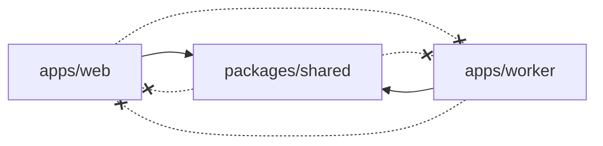
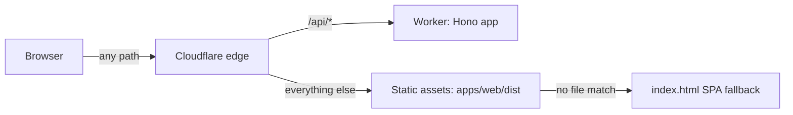

# Design Document

## Overview

This design turns `requirements.md` into concrete files, configuration, and scripts for the HyperGeist monorepo scaffold. It contains no product code. The only logic written in this spec is small and pure: the seed helper, the dependency-check rules, the placeholder page, and the Worker health and 404 routes.

Key decisions:

- **One origin.** A single Cloudflare Worker serves the built web app through the Workers static assets feature and handles `/api/*` in code. Routing uses `assets.run_worker_first` with the array form (`["/api/*"]`), so only API requests invoke the Worker and everything else is served from `apps/web/dist` with SPA fallback to `index.html`. See the [Cloudflare run_worker_first changelog](https://developers.cloudflare.com/changelog/post/2025-06-17-advanced-routing/) and the [SPA routing docs](https://developers.cloudflare.com/workers/static-assets/routing/single-page-application/).
- **Shared package is consumed as TypeScript source.** `@hypergeist/shared` has no emit step. Its `exports` map points at `src/*.ts`, and Vite and Wrangler (esbuild) compile it as part of each app. Its `build` script is a `tsc --noEmit` check.
- **Repo tooling is TypeScript run by Node type stripping.** `scripts/check-deps` runs with `node scripts/check-deps/cli.ts`, which needs no extra dependency (such as `tsx`) on Node 22.18 or later. The tooling code uses erasable TypeScript syntax only and `.ts` import extensions.
- **Dependency check uses the `typescript` package already in the repo.** `ts.preProcessFile` extracts import specifiers, so no regex parsing and no new dependency.
- **One root Vitest config using `projects`.** `pnpm test` is `vitest run` at the root and covers the three packages plus `scripts/`. Each package also has its own `test` script for `--filter` use and for the seed replay command.

## Architecture

### Repository tree

```
hypergeist/
├── .github/workflows/ci.yml
├── .kiro/                         committed, never ignored
├── apps/
│   ├── web/
│   │   ├── index.html
│   │   ├── package.json
│   │   ├── tsconfig.json
│   │   ├── vite.config.ts         defineConfig from vitest/config (build, dev proxy, test)
│   │   └── src/
│   │       ├── main.tsx
│   │       ├── App.tsx            named export App, renders <h1>HyperGeist</h1>
│   │       └── App.test.tsx       smoke test
│   └── worker/
│       ├── package.json
│       ├── tsconfig.json
│       ├── vitest.config.ts
│       ├── wrangler.jsonc
│       └── src/
│           ├── app.ts             Hono app: /api/health, notFound, onError
│           ├── app.test.ts        smoke test
│           └── index.ts           export default app (Workers entry)
├── packages/
│   └── shared/
│       ├── package.json           exports map: ".", "./format", "./engine"
│       ├── tsconfig.json          src only, types: []
│       ├── tsconfig.test.json     adds test-support and node types
│       ├── vitest.config.ts
│       ├── src/
│       │   ├── index.ts           export {}
│       │   ├── format/index.ts    export {}
│       │   ├── engine/index.ts    export {}
│       │   ├── smoke.test.ts
│       │   └── smoke.property.test.ts
│       └── test-support/
│           ├── seed.ts            seed helper
│           ├── seed.test.ts
│           └── seed.property.test.ts
├── scripts/
│   ├── tsconfig.json
│   └── check-deps/
│       ├── rules.ts               pure: extract, classify, check
│       ├── scan.ts                file walk
│       ├── cli.ts                 prints violations, sets exit code
│       ├── check-deps.test.ts
│       ├── check-deps.property.test.ts
│       └── fixtures/
│           ├── violations/{packages/shared/src,apps/web/src,apps/worker/src}/*.ts
│           └── clean/{packages/shared/src,apps/web/src,apps/worker/src}/*.ts
├── e2e/
│   ├── tsconfig.json
│   └── smoke.spec.ts
├── docs/
│   ├── kiroween-2026-project-brief.md   existing
│   ├── assets-licenses.md
│   └── kiro-journal.md
├── .env.example
├── .gitignore
├── .prettierignore
├── .prettierrc.json
├── LICENSE
├── README.md
├── eslint.config.mjs
├── package.json
├── playwright.config.ts
├── pnpm-lock.yaml                 generated by the Developer's first install, committed
├── pnpm-workspace.yaml
├── tsconfig.base.json
└── vitest.config.ts               root projects config
```

### Dependency flow



Solid arrows are allowed imports, and only through `@hypergeist/shared`, `@hypergeist/shared/format`, or `@hypergeist/shared/engine`. Crossed dotted arrows are the violations that `check:deps` reports.

### Runtime shape



In local development there are two modes:

- **Single origin (matches production):** `pnpm build`, then `pnpm --filter @hypergeist/worker dev` (`wrangler dev --port 8787`). This is the mode Playwright uses.
- **Hot reload:** run the Worker dev server on 8787 and `pnpm --filter @hypergeist/web dev` (Vite on 5173). Vite proxies `/api` to `http://localhost:8787`. Wrangler still requires `apps/web/dist` to exist, because the assets directory is validated at startup. The README says to run `pnpm build` once first.

## Components and Interfaces

### Root `package.json`

```jsonc
{
  "name": "hypergeist",
  "private": true,
  "type": "module",
  "packageManager": "pnpm@<exact version from `pnpm --version` at install time>",
  "engines": { "node": ">=22.18.0 <25" },
  "scripts": {
    "build": "pnpm --filter @hypergeist/shared build && pnpm --filter @hypergeist/web build && pnpm --filter @hypergeist/worker build",
    "test": "vitest run",
    "typecheck": "pnpm -r --if-present typecheck && tsc -p scripts/tsconfig.json && tsc -p e2e/tsconfig.json",
    "lint": "eslint .",
    "format": "prettier --write .",
    "format:check": "prettier --check .",
    "check:deps": "node scripts/check-deps/cli.ts",
    "test:e2e": "playwright test"
  },
  "devDependencies": {
    "@eslint/js": "…",
    "@playwright/test": "…",
    "@types/node": "…",
    "eslint": "…",
    "prettier": "…",
    "typescript": "…",
    "typescript-eslint": "…",
    "vitest": "…"
  }
}
```

Notes:

- `packageManager` must hold an exact version. Because requirement 16.4 forbids running `pnpm install` before the Developer installs pnpm, the file is written with a placeholder that the task list fills from `pnpm --version` after the install step.
- `engines.node` is bounded below 25 so that `actions/setup-node` with `node-version-file: package.json` resolves to the newest Node 24 release, not a non-LTS line. Node 25 developers get an engines warning from pnpm, not an error. The lower bound 22.18.0 is the first Node 22 release that strips types by default.
- `build` follows requirement 4.3: shared, then web, then the Worker dry run. `&&` makes the first failing step abort the script with a non-zero exit code.
- `typecheck` runs each package's own `typecheck` script, then the two root tooling projects.

### `pnpm-workspace.yaml`

```yaml
packages:
  - apps/*
  - packages/*
onlyBuiltDependencies:
  - esbuild
  - workerd
```

pnpm 10 skips dependency build scripts unless they are allowed. `esbuild` and `workerd` run install scripts that Vite, Vitest, and Wrangler rely on. The task list runs `pnpm approve-builds` once to confirm the final list (for example `sharp`, if Wrangler pulls it in).

### `tsconfig.base.json`

```jsonc
{
  "compilerOptions": {
    "strict": true,
    "target": "ES2022",
    "module": "ESNext",
    "moduleResolution": "Bundler",
    "lib": ["ES2022"],
    "types": [],
    "noEmit": true,
    "skipLibCheck": true,
    "isolatedModules": true,
    "verbatimModuleSyntax": true,
    "noUncheckedIndexedAccess": true,
    "noImplicitOverride": true,
    "noFallthroughCasesInSwitch": true,
    "forceConsistentCasingInFileNames": true,
    "erasableSyntaxOnly": true
  }
}
```

`lib` and `types` default to the narrowest setting. Each package widens only what it needs. `erasableSyntaxOnly` keeps all code compatible with Node type stripping and with the repo's no-classes-for-data style (no enums, no parameter properties).

### Per-package TypeScript configuration

| File | Extends | `lib` | `types` | `include` / `exclude` |
|---|---|---|---|---|
| `packages/shared/tsconfig.json` | base | `ES2022` | `[]` | include `src`; exclude `**/*.test.ts` |
| `packages/shared/tsconfig.test.json` | `./tsconfig.json` | `ES2022` | `["node"]` | include `src`, `test-support`; no exclude |
| `apps/web/tsconfig.json` | base | `ES2022`, `DOM`, `DOM.Iterable` | `[]` | include `src`, `vite.config.ts`; `jsx: "react-jsx"` |
| `apps/worker/tsconfig.json` | base | `ES2022` | `["@cloudflare/workers-types"]` | include `src`, `vitest.config.ts` |
| `scripts/tsconfig.json` | base | `ES2022` | `["node"]` | include `.`, `../vitest.config.ts`, `../playwright.config.ts`; exclude `check-deps/fixtures`; `allowImportingTsExtensions: true` |
| `e2e/tsconfig.json` | base | `ES2022`, `DOM` | `["node"]` | include `.`; `allowImportingTsExtensions: true` |

Why the shared package has two configs: tests live next to code (`conventions`), and the seed helper reads `process.env`, which needs Node types. The production config (`tsconfig.json`) excludes tests and has no DOM, Worker, or Node types, so any reference to those APIs in shared source fails type checking (requirement 3.3, 6.5). The test config adds Node types for test files and `test-support/` only.

Each package `typecheck` script:

- shared: `tsc -p tsconfig.json && tsc -p tsconfig.test.json`
- web: `tsc -p tsconfig.json`
- worker: `tsc -p tsconfig.json`

### `packages/shared`

`package.json`:

```jsonc
{
  "name": "@hypergeist/shared",
  "private": true,
  "type": "module",
  "exports": {
    ".": "./src/index.ts",
    "./format": "./src/format/index.ts",
    "./engine": "./src/engine/index.ts"
  },
  "scripts": {
    "build": "tsc -p tsconfig.json",
    "typecheck": "tsc -p tsconfig.json && tsc -p tsconfig.test.json",
    "test": "vitest run"
  },
  "dependencies": { "zod": "^4" },
  "devDependencies": { "@types/node": "…", "fast-check": "…", "vitest": "…" }
}
```

`zod` is declared and never imported (requirement 16.3). `src/index.ts`, `src/format/index.ts`, and `src/engine/index.ts` each contain `export {};`.

`vitest.config.ts` sets `test.name = 'shared'`, `environment: 'node'`, and `include: ['src/**/*.test.ts', 'test-support/**/*.test.ts']`.

### Seed helper (`packages/shared/test-support/seed.ts`)

The helper is test support, not part of the public API. It is not exported from `index.ts`.

```ts
export const SEED_VARIABLE = 'HYPERGEIST_TEST_SEED';

export type ParseSeedResult =
  | { readonly ok: true; readonly value: number }
  | { readonly ok: false; readonly error: string };

/** Accepts a decimal integer string in [-2147483648, 2147483647]. */
export function parseSeed(raw: string): ParseSeedResult;

/**
 * Pure resolution. `env` and `generate` are injected so the function is testable.
 * - variable unset or empty string -> generate()
 * - variable valid                 -> parsed value
 * - variable invalid               -> throws Error naming SEED_VARIABLE and the raw value
 */
export function resolveSeed(
  env: Readonly<Record<string, string | undefined>>,
  generate: () => number,
): number;

/** Random int32 from crypto.getRandomValues. */
export function generateSeed(): number;

/** Resolved once per module instance (one per Vitest worker file), then memoized. */
export function getTestSeed(): number;

export function replayCommand(seed: number): string;
// -> `HYPERGEIST_TEST_SEED=${seed} pnpm --filter @hypergeist/shared test`

/** fast-check parameters with seed and numRuns (default 100) always set. */
export function propertyParams<T>(overrides?: Partial<fc.Parameters<T>>): fc.Parameters<T>;

/**
 * Wraps fc.assert. On failure: console.error prints the seed and replayCommand(seed),
 * then rethrows the original error.
 */
export function assertProperty<T>(
  property: fc.IProperty<T>,
  overrides?: Partial<fc.Parameters<T>>,
): void;
```

Behavior details:

- An empty `HYPERGEIST_TEST_SEED=` counts as unset. This matches `.env.example`, which lists the name with no value.
- A raw value is valid only if it matches `^-?\d+$` and, as a number, lies within the signed 32-bit range. `"1.5"`, `"0x10"`, `" 7"`, and `"2147483648"` are rejected.
- `resolveSeed` throws on invalid input. Requirement 8.5 asks for a throw, and a bad seed is a configuration error for the developer, not an expected runtime failure. `parseSeed` returns a result value so the caller can build the message.
- `assertProperty` calls `propertyParams`, so every run receives the seed (requirement 8.3). `overrides` cannot replace `seed`; the helper applies the seed last.
- Limitation: when the variable is unset, each Vitest worker file generates its own seed. The seed is always printed on failure, so replay works in every case. Setting the variable pins one seed for the whole run.

### Dependency check (`scripts/check-deps`)

#### Approach

The check is split into a pure core and a thin file-system shell.

```ts
// rules.ts (pure)
export type RuleId =
  | 'shared-imports-app'     // packages/shared -> apps/*
  | 'cross-app-import'       // apps/web <-> apps/worker
  | 'shared-internal-import'; // apps/* -> shared outside the public API

export type SourceFile = { readonly path: string; readonly text: string }; // repo-relative, POSIX separators

export type Violation = {
  readonly rule: RuleId;
  readonly file: string;
  readonly line: number;      // 1-based
  readonly specifier: string;
  readonly message: string;
};

export const SHARED_PUBLIC_ENTRY_POINTS: readonly string[] = [
  '@hypergeist/shared',
  '@hypergeist/shared/format',
  '@hypergeist/shared/engine',
];

export function extractSpecifiers(text: string): readonly { specifier: string; line: number }[];
export function checkFile(file: SourceFile): readonly Violation[];
export function checkFiles(files: readonly SourceFile[]): readonly Violation[]; // sorted by file, line, rule
```

```ts
// scan.ts (file system)
export function collectFiles(root: string, dirs?: readonly string[]): Promise<readonly SourceFile[]>;
// defaults dirs to ['apps', 'packages']; walks recursively; keeps .ts and .tsx;
// skips node_modules, dist, .wrangler, coverage; returns repo-relative POSIX paths.
```

```ts
// cli.ts
// 1. collectFiles(repoRoot) 2. checkFiles 3. print one line per violation
//    `<file>:<line>  [<rule>]  <message>  (<specifier>)`
// 4. exit 0 when empty, 1 when violations exist, 2 when the scan itself fails (read error).
```

Specifier extraction uses `ts.preProcessFile(text, true, true)` and reads each `importedFiles` entry's `fileName` and `pos`. This covers `import ... from`, side-effect `import 'x'`, `export ... from`, `import('x')` with a string literal, and `require('x')`. The line number is derived from `pos`. Template-literal and computed dynamic imports are not detectable and are out of scope. Type-only imports count, because a type import still couples packages.

Classification of one import (`checkFile` calls this for each specifier):

1. Determine the importer's owner from its path: `packages/shared/` is `shared`, `apps/web/` is `web`, `apps/worker/` is `worker`. A file with no owner produces no violations.
2. Determine the target:
   - A relative specifier is resolved against the importer's directory with `path.posix` and normalized. The result is a repo-relative path. If it escapes the repo root, treat it as external.
   - A specifier equal to or beginning with `@hypergeist/<name>/` is a package target. `<name>` is `shared`, `web`, or `worker`. Any other `@hypergeist/*` name is external.
   - Everything else is external and never a violation.
3. Apply the rule table.

| Importer | Target | Result |
|---|---|---|
| shared | web or worker (relative path into `apps/` or package name) | `shared-imports-app` |
| web | worker (path or package name) | `cross-app-import` |
| worker | web (path or package name) | `cross-app-import` |
| web or worker | shared via package name, specifier in `SHARED_PUBLIC_ENTRY_POINTS` | allowed |
| web or worker | shared via package name, any other subpath (for example `@hypergeist/shared/src/x`) | `shared-internal-import` |
| web or worker | shared via relative path into `packages/shared` | `shared-internal-import` |
| any | same package, third-party, or `node:` module | allowed |

The root `scripts/`, `e2e/`, and config files are not scanned (requirement 7.1 limits the scan to `apps/` and `packages/`).

Fixtures live under `scripts/check-deps/fixtures/` as small file trees whose layout mirrors the repo (`packages/shared/src/...`, `apps/web/src/...`). The test calls `collectFiles(fixtureRoot)` with the fixture directory as root. They sit outside `apps/` and `packages/`, so the real scan never sees them, and `scripts/tsconfig.json`, ESLint, and Prettier all ignore them.

- `fixtures/violations/` has three files, one per rule: a shared file importing `../../../../apps/web/src/App`, a web file importing `@hypergeist/worker`, and a worker file importing `@hypergeist/shared/src/engine/index`.
- `fixtures/clean/` has one file per package that uses only allowed imports.

Test-only exception: `check-deps.property.test.ts` imports the seed helper by relative path (`../../packages/shared/test-support/seed.ts`). `scripts/` is repo tooling, not a workspace package, and the check does not scan it, so the architecture rule against cross-package internals does not apply. The README does not need to mention this.

### `apps/web`

`package.json` scripts:

```jsonc
{
  "name": "@hypergeist/web",
  "private": true,
  "type": "module",
  "scripts": {
    "dev": "vite",
    "build": "vite build",
    "typecheck": "tsc -p tsconfig.json",
    "test": "vitest run"
  },
  "dependencies": { "@hypergeist/shared": "workspace:*", "react": "…", "react-dom": "…" },
  "devDependencies": {
    "@testing-library/react": "…",
    "@types/react": "…",
    "@types/react-dom": "…",
    "@vitejs/plugin-react": "…",
    "jsdom": "…",
    "vite": "…",
    "vitest": "…"
  }
}
```

The `workspace:*` dependency is declared now so later specs only add imports (requirement 2.5). The scaffold imports nothing from it.

`vite.config.ts` (default export allowed here by the lint override):

```ts
import { defineConfig } from 'vitest/config';
import react from '@vitejs/plugin-react';

export default defineConfig({
  plugins: [react()],
  build: { outDir: 'dist' },
  server: {
    port: 5173,
    proxy: { '/api': { target: 'http://localhost:8787' } },
  },
  test: { name: 'web', environment: 'jsdom', include: ['src/**/*.test.tsx', 'src/**/*.test.ts'] },
});
```

`index.html` has a `<div id="root">` and `<script type="module" src="/src/main.tsx">` and nothing else external: no CDN, no web fonts, no analytics (requirement 9.6). No PWA manifest or service worker.

The smoke test renders `<App />` and asserts `getByRole('heading', { name: 'HyperGeist' })` exists. It uses `toBeTruthy` rather than adding `@testing-library/jest-dom`.

### `apps/worker`

`package.json`:

```jsonc
{
  "name": "@hypergeist/worker",
  "private": true,
  "type": "module",
  "scripts": {
    "dev": "wrangler dev --port 8787",
    "build": "wrangler deploy --dry-run --outdir dist",
    "typecheck": "tsc -p tsconfig.json",
    "test": "vitest run"
  },
  "dependencies": { "@hypergeist/shared": "workspace:*", "hono": "…" },
  "devDependencies": { "@cloudflare/workers-types": "…", "vitest": "…", "wrangler": "…" }
}
```

`wrangler.jsonc`:

```jsonc
{
  "name": "hypergeist",
  "main": "src/index.ts",
  "compatibility_date": "<date of implementation, not later than today>",
  "assets": {
    "directory": "../web/dist",
    "binding": "ASSETS",
    "not_found_handling": "single-page-application",
    "run_worker_first": ["/api/*"]
  }
}
```

- `run_worker_first: ["/api/*"]` sends API paths to the Worker before assets (requirement 10.4). All other paths go to the asset handler directly, which serves the matching file (10.2) or `index.html` when none matches (10.3, via `single-page-application`).
- The `ASSETS` binding is declared per requirement 10.1 but unused by the code; the Worker never needs to proxy to assets itself.
- No `vars` and no secrets (requirement 10.9). Later specs add secrets with `wrangler secret put`, and local values go in `.dev.vars` (ignored).
- `wrangler deploy --dry-run --outdir dist` bundles the Worker and validates the assets directory without a Cloudflare login (requirement 11.2). It fails if `../web/dist` is missing, which is why the root `build` runs the Worker step last.

`src/app.ts` (shape, not final code):

```ts
export const app = new Hono();
app.get('/api/health', (c) => c.json({ ok: true }));
app.notFound((c) => c.json({ error: 'Not found' }, 404));
app.onError((_err, c) => c.json({ error: 'Internal error' }, 500));
```

Only `/api/*` requests reach this app in production, so `notFound` always yields the API 404. No `hono/cors` middleware is installed (requirement 10.7). `onError` returns a generic body and never echoes the error.

`src/index.ts` contains `export default app;` because the Workers runtime requires a default export. The ESLint override below allows it for this one file.

`vitest.config.ts` sets `test.name = 'worker'` and `environment: 'node'`. The smoke test calls `app.request(...)` directly and needs no Workers test pool.

### Root Vitest config (`vitest.config.ts`)

```ts
import { defineConfig } from 'vitest/config';

export default defineConfig({
  test: {
    projects: [
      'packages/*',
      'apps/*',
      { test: { name: 'scripts', environment: 'node', include: ['scripts/**/*.test.ts'] } },
    ],
  },
});
```

`vitest run` is single-run mode (requirement 4.4). The `scripts` project is inline, so `scripts/` needs no `package.json`. The `fixtures` directory contains no `*.test.ts` files.

### ESLint (`eslint.config.mjs`)

Flat config with `@eslint/js` recommended and `typescript-eslint` recommended (no type-aware linting, so no `parserOptions.project` setup).

- Files: `**/*.{ts,tsx}`.
- Ignores: `**/dist`, `**/.wrangler`, `**/coverage`, `**/test-results`, `**/playwright-report`, `scripts/check-deps/fixtures`.
- Rules set explicitly to `error`: `@typescript-eslint/no-explicit-any`, `@typescript-eslint/no-non-null-assertion`.
- Default exports: core rule `no-restricted-exports` with `restrictDefaultExports: { direct: true, named: true, defaultFrom: true, namedFrom: true, namespaceFrom: true }`.
- Override that turns the default-export restriction off for: `**/vite.config.ts`, `**/vitest.config.ts`, `playwright.config.ts`, and `apps/worker/src/index.ts`.

The Worker entry is a framework-required default export, but requirement 5.4 lists only Vite, Playwright, and Vitest configs. The override for `apps/worker/src/index.ts` is a small extension of that list. See Open Items.

### Prettier

`.prettierrc.json`: `{ "singleQuote": true, "semi": true, "trailingComma": "all", "printWidth": 100 }`.

`.prettierignore`: `node_modules`, `dist`, `.wrangler`, `coverage`, `test-results`, `playwright-report`, `pnpm-lock.yaml`, `.kiro`, `docs/kiroween-2026-project-brief.md`, `scripts/check-deps/fixtures`.

`.kiro` and the existing brief are excluded so that `format:check` does not fail on files this spec does not own. `format` and `format:check` run Prettier over the repo root (`.`).

### Git files

`.gitignore`:

```
node_modules/
dist/
.wrangler/
.dev.vars
.env
.env.*
!.env.example
*.tsbuildinfo
coverage/
test-results/
playwright-report/
.DS_Store
```

No pattern matches `.kiro`. The `.env.*` pattern with the `!.env.example` exception keeps the example file tracked. `.env.example` holds one line: `HYPERGEIST_TEST_SEED=`.

The repo is created with `git init -b main`. `LICENSE` is the MIT text, `Copyright (c) 2026 HyperGeist contributors`.

### Playwright (`playwright.config.ts`, `e2e/smoke.spec.ts`)

```ts
export default defineConfig({
  testDir: 'e2e',
  timeout: 30_000,
  forbidOnly: !!process.env.CI,
  retries: process.env.CI ? 1 : 0,
  reporter: process.env.CI ? [['html', { open: 'never' }], ['list']] : 'list',
  use: { baseURL: 'http://127.0.0.1:8787' },
  projects: [{ name: 'chromium', use: { ...devices['Desktop Chrome'] } }],
  webServer: {
    command: 'pnpm --filter @hypergeist/worker exec wrangler dev --ip 127.0.0.1 --port 8787',
    url: 'http://127.0.0.1:8787/api/health',
    timeout: 120_000,
    reuseExistingServer: !process.env.CI,
    env: { WRANGLER_SEND_METRICS: 'false' },
  },
});
```

The suite starts the same Worker plus assets setup used in production, so it needs `pnpm build` first (requirement 12.6). `wrangler dev` runs locally without a Cloudflare login.

`smoke.spec.ts` has three tests:

1. Load `/`, assert the heading "HyperGeist" is visible, and record every request URL. Assert that every request host equals the app origin. This covers requirements 9.6 and 12.4, because any call to an AI provider host would fail the assertion.
2. `request.get('/api/health')` returns status 200 and JSON `{ ok: true }`.
3. Load `/some/unknown/path` and assert the heading is visible, which shows the SPA fallback serves `index.html` (requirement 10.3), and `request.get('/api/nope')` returns 404 with a JSON body.

Playwright tests use no recorded-response provider yet because no AI call exists in the scaffold.

### CI (`.github/workflows/ci.yml`)

One job with named steps. A single job avoids running install and build three times, and the step names satisfy requirement 13.3.

```yaml
name: CI
on:
  push: { branches: [main] }
  pull_request: { branches: [main] }
permissions:
  contents: read
concurrency:
  group: ci-${{ github.ref }}
  cancel-in-progress: true
jobs:
  verify:
    runs-on: ubuntu-latest
    timeout-minutes: 20
    steps:
      - uses: actions/checkout@v4
      - uses: pnpm/action-setup@v4          # reads packageManager from package.json
      - uses: actions/setup-node@v4
        with:
          node-version-file: package.json   # reads engines.node
          cache: pnpm
      - name: Install dependencies
        run: pnpm install --frozen-lockfile
      - name: Type check
        run: pnpm typecheck
      - name: Lint
        run: pnpm lint
      - name: Format check
        run: pnpm format:check
      - name: Dependency rules
        run: pnpm check:deps
      - name: Unit tests
        run: pnpm test
      - name: Build
        run: pnpm build
      - name: Install Playwright Chromium
        run: pnpm exec playwright install --with-deps chromium
      - name: E2E smoke test
        run: pnpm test:e2e
      - name: Upload Playwright report
        if: failure()
        uses: actions/upload-artifact@v4
        with:
          name: playwright-report
          path: playwright-report/
          retention-days: 7
```

Action major versions are the ones known to work today. The implementation task checks for newer majors before committing. The workflow defines no `env` secrets and no deploy job.

## Data Models

The scaffold has no persistent data. The only structured values are:

- `Violation` and `SourceFile` (dependency check), defined above.
- `ParseSeedResult` (seed helper), defined above.
- The Health_Endpoint body `{ "ok": true }` and the API error body `{ "error": "<generic message>" }`.

Because the scaffold imports Zod nowhere, these are plain TypeScript types. Later specs that cross a trust boundary derive types from Zod schemas, per `conventions`.

## Error Handling

| Situation | Behavior |
|---|---|
| `HYPERGEIST_TEST_SEED` set to a non-int32 value | `resolveSeed` throws `Error` with the variable name and the raw value in the message, so the test run fails at the first property test. |
| A fast-check property fails | `assertProperty` prints the seed and replay command with `console.error`, then rethrows the original error. |
| `check:deps` finds violations | One line per violation on stdout, exit code 1. |
| `check:deps` cannot read a file or directory | Message on stderr, exit code 2. |
| Source file has a syntax error | `ts.preProcessFile` still returns the imports it can scan. The check does not report syntax errors, because `typecheck` owns that. |
| Unknown `/api/*` route | Worker returns 404 and `{ "error": "Not found" }`. |
| Unhandled exception in a Worker route | `onError` returns 500 and `{ "error": "Internal error" }` with no stack or message. |
| `pnpm build` runs the Worker dry run without `apps/web/dist` | Wrangler fails on the missing assets directory, so the build fails. This is intended (requirement 11.3). |
| pnpm missing when a task needs it | The task stops and points the Developer to the README install steps (requirement 16.5). |

## Testing Strategy

Dual approach, matching `conventions`.

**Property tests** (fast-check, 100 runs each, seed from the helper, tag format `Feature: repo-scaffold, Property N: ...`):

- `packages/shared/test-support/seed.property.test.ts`: Properties 1 and 2.
- `packages/shared/src/smoke.property.test.ts`: the trivial commutativity property required by 8.2, written with `assertProperty`.
- `scripts/check-deps/check-deps.property.test.ts`: Properties 3, 4, and 5.

**Unit and example tests:**

- Shared: `smoke.test.ts` imports `.`, `./format`, and `./engine` entry modules. Seed tests cover the unset case (injected generator), failure output (spy on `console.error`), and a few explicit invalid values (`"1.5"`, `"0x10"`, `" 7"`, `"2147483648"`).
- Check-deps: fixture-based test asserts the three violation rules and the file names on `fixtures/violations`, and zero violations on `fixtures/clean`. Extra examples cover dynamic `import('x')`, `export * from`, type-only imports, and the walker skipping `node_modules` and `dist`.
- Web: render test for the heading.
- Worker: `app.request('/api/health')` returns 200 and `{ ok: true }`. `app.request('/api/unknown')` and `app.request('/api/health', { method: 'POST' })` return 404 with the generic body. No response carries an `access-control-*` header. These are examples, not properties, because the Worker package cannot import the shared seed helper without crossing a package boundary.

**End to end:** the Playwright smoke test above, run against `wrangler dev` after `pnpm build`.

**Not tested by property:** configuration files, scripts, README, license, CI, ESLint and Prettier setup. These are verified by the pipeline running (`typecheck`, `lint`, `format:check`, `check:deps`, `test`, `build`, `test:e2e`).

## Correctness Properties

*A property is a characteristic or behavior that should hold true across all valid executions of a system. Properties serve as the bridge between human-readable specifications and machine-verifiable correctness guarantees.*

### Property 1: Seed resolution

For any environment map and any generator output in the signed 32-bit range, `resolveSeed` returns the parsed value when the variable holds a decimal integer within the signed 32-bit range, returns the generator output when the variable is unset or empty, and throws an error whose message contains both `HYPERGEIST_TEST_SEED` and the raw value when the variable holds any other string.

**Validates: Requirements 8.4, 8.5**

### Property 2: Same seed, same input sequence

For any signed 32-bit seed and any fast-check arbitrary, sampling the arbitrary twice with `propertyParams` built from that seed produces identical sequences of inputs.

**Validates: Requirements 8.3, 8.7**

### Property 3: Specifier extraction round trip

For any list of module specifiers and any choice of statement form per specifier (named import, side-effect import, `export ... from`, dynamic `import('...')`), rendering the statements into a source text and calling `extractSpecifiers` returns the same specifiers in the same order, each with the line number on which its statement was placed.

**Validates: Requirements 7.1**

### Property 4: Import classification follows the rule table

For any importing file located in `packages/shared`, `apps/web`, `apps/worker`, or outside those directories, and for any import specifier that is relative, a `@hypergeist/*` package path, or external, `checkFile` reports exactly the violations the rule table prescribes: `shared-imports-app` for shared importing an app, `cross-app-import` for web and worker importing each other, `shared-internal-import` for an app importing shared outside `@hypergeist/shared`, `@hypergeist/shared/format`, and `@hypergeist/shared/engine`, and no violation for every other combination.

**Validates: Requirements 6.3, 7.2, 7.3, 7.4, 7.5**

### Property 5: Check result is independent of file order

For any set of source files and any permutation of that set, `checkFiles` returns the same violations in the same order, and the result is empty exactly when every file passes `checkFile` with no violation.

**Validates: Requirements 7.1, 7.5**

## Open Items

These are points where the design had to go beyond or against the literal requirements. None blocks implementation, and the task list should record how each was resolved.

1. **`jsdom` is not in requirement 16.2's dependency list.** The Web_App smoke test (9.3) renders React in Vitest and needs a DOM environment. The design adds `jsdom` as a web dev dependency. Alternative: `happy-dom`. Type packages (`@types/node`, `@types/react`, `@types/react-dom`) and `@eslint/js` are in the same position and are treated as part of "TypeScript" and "ESLint with its config packages".
2. **Worker entry default export.** Workers require `export default`. Requirement 5.4 names only Vite, Playwright, and Vitest configs as exceptions. The design adds `apps/worker/src/index.ts` to the ESLint override. If that is not acceptable, the alternative is a single `// eslint-disable-next-line no-restricted-exports` comment with a reason.
3. **`engines.node` range `>=22.18.0 <25`.** This makes CI resolve to Node 24. Node 25 works for local use with a pnpm engines warning. If the Developer wants Node 25 supported without a warning, widen the range and accept that CI then picks the newest 25.x.
4. **`.kiro` and the project brief are excluded from Prettier.** This stops `format:check` from failing on files outside this spec.
5. **`compatibility_date` and `packageManager` are filled during implementation.** The first needs the install date, the second needs the version of pnpm the Developer installed.
6. **Seed scope.** With no `HYPERGEIST_TEST_SEED`, each Vitest worker file picks its own seed. A global setup that pins one seed per run was left out to keep the scaffold small.
