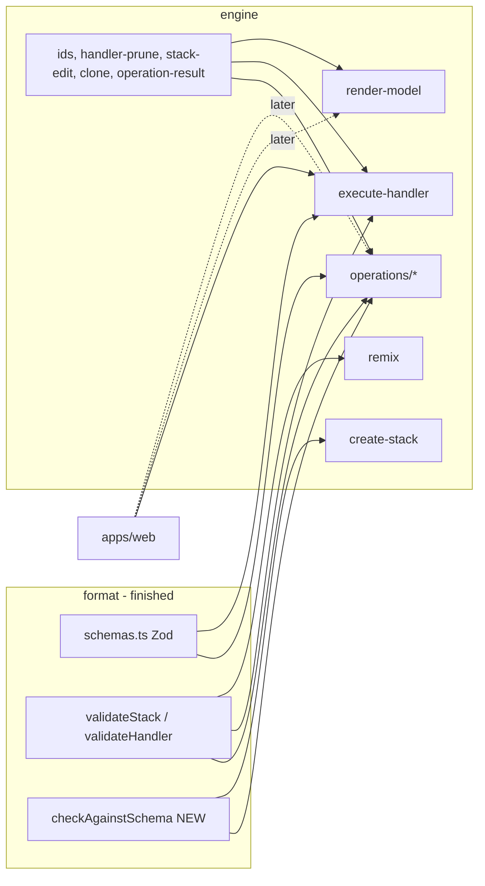
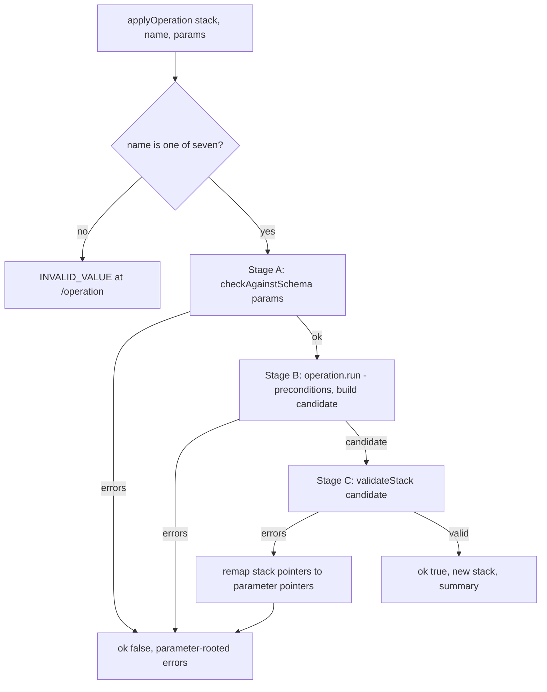

# Design Document

## Overview

This design turns `requirements.md` into changes to `packages/shared/src/engine`. The engine is not built from scratch. The thin slice already ships `executeHandler` (four of the nine Actions), the helpers in `stack-edit.ts`, and about 1,500 tests across the shared package. The format module is finished (`validateStack`, `validateHandler`, `parseStack`, `serializeStack`, `stackJsonSchema`, the closed code set, the limits, five Object types, nine Action types). This design **extends** both and replaces nothing that a test pins today.

What exists, what changes, and what is new, by requirement:

| Requirement | State today | Work |
| --- | --- | --- |
| 1 Operation contract | Absent | New: `applyOperation`, result types, id assignment, safety-net validation |
| 2 Card operations | Absent | New: `create_card`, `delete_card` with cascades |
| 3 Object operations | Absent | New: `add_object`, `update_object`, `remove_object` with cascades |
| 4 Link and action operations | Absent | New: `link_cards`, `set_action` |
| 5 Action execution | `executeHandler` runs `go_to_card`, `show_message`, `set_value`, `append_item`. The other five end in "this action type is not supported". `effects` is always `[]` and its type is `never`. | Extend: `remove_item`, four Effect_Request kinds, a real `EffectRequest` union. Keep the four working actions byte for byte. |
| 6 Render model | The web app reads `Card` and `StackObject` straight from the store | New: `buildRenderModel`. The web app adopts it later, without a breaking change. |
| 7 Remix | Absent | New: `remixStack` |
| 8 Stack creation | Absent | New: `createStack` |
| 9 Operation schemas | Absent | New: Zod 4 parameter schemas, `OPERATIONS`, `operationJsonSchema` |
| 10 Purity | Executor is pure | Keep, and add a source-scan test for the new files |
| 11 Test support | `arbStack`, `arbHandlerFor(stack, 'all')`, `assertProperty`, ajv wrapper | Add operation-template, factory-parameter and freeze helpers |

Design decisions that shape everything else:

1. **Validate by hybrid.** Every Operation runs three stages: the Operation_Schema (Zod) on the parameters, Operation-specific precondition checks, then `validateStack` on the candidate result. The first two stages produce errors whose `path` points into the **parameters**, which is what an AI repair loop needs. The third stage is a safety net: it guarantees atomicity (an Operation can never return an invalid Stack) and catches rules like bounds and ai-field inputs without duplicating them. Its errors are mapped back to parameter paths.
2. **One door for validation.** `applyOperation` does the schema parse, the call, and the final validation in one place, so no Operation can skip the safety net.
3. **The format's error mapper is reused.** Parameter errors use the same Zod-issue mapper as the format, through one small new export in the format module (`checkAgainstSchema`). Codes, messages and hints stay consistent with `validateStack`.
4. **The engine stays pure and small.** No new dependency. No Node or DOM types (the shared tsconfig has `lib: ["ES2022"]` and `types: []`). No clock, randomness, storage or network.

Research notes that informed the design:

- Zod 4 `z.toJSONSchema` targets draft 2020-12 by default, inlines reused schemas (`reused: "inline"` is the default), throws on unrepresentable schemas, and copies registered metadata into the output, where metadata wins over generated keywords ([Zod JSON Schema docs](https://zod.dev/json-schema)). Content was rephrased for compliance with licensing restrictions.
- The format work already found the Zod 4 caveats that matter here: a custom `.check()` is invisible to `toJSONSchema` (so maxima are added with `.meta({ maxLength })`), `.max()` on an array hides element errors (so `limitedArray` is used), and exactly-one-of pairs only survive as `.meta({ oneOf })`. Operation schemas reuse those property schemas, so they inherit the same bounds.
- Model providers commonly require the root of a tool schema to be `type: "object"`, and often reject a root `oneOf`. That drives the flat `add_object` schema (see Decision D2).

## Architecture

### Module layout

```
packages/shared/src/
├── format/                          (finished; one small addition)
│   ├── schema-check.ts              NEW   checkAgainstSchema, createValidationError, toJsonPointer re-export
│   └── index.ts                     CHANGED  three new exports
└── engine/
    ├── index.ts                     CHANGED  public API (see below)
    ├── types.ts                     CHANGED  EffectRequest union, ExecutionResult unchanged in shape
    ├── execute-handler.ts           CHANGED  nine actions, effects, remove_item
    ├── effects.ts                   NEW   builds one EffectRequest from an Action and a Stack
    ├── stack-edit.ts                CHANGED (additive)  findCard, withCard helpers
    ├── ids.ts                       NEW   collectEntityIds, nextEntityId
    ├── handler-prune.ts             NEW   actionReferences, pruneHandler (cascade helper)
    ├── clone.ts                     NEW   deepCopyJson (no structuredClone: not in ES2022 lib)
    ├── operation-result.ts          NEW   OperationResult, OperationSummary, error helpers, path remap
    ├── operations/
    │   ├── index.ts                 NEW   registry, applyOperation, OPERATIONS, operationJsonSchema
    │   ├── params.ts                NEW   Zod parameter schemas with AI-reader descriptions
    │   ├── object-defaults.ts       NEW   OBJECT_DEFAULTS table (Requirement 1.7)
    │   ├── create-card.ts           NEW
    │   ├── delete-card.ts           NEW
    │   ├── add-object.ts            NEW
    │   ├── update-object.ts         NEW
    │   ├── remove-object.ts         NEW
    │   ├── link-cards.ts            NEW
    │   └── set-action.ts            NEW
    ├── render-model.ts              NEW   buildRenderModel
    ├── remix.ts                     NEW   remixStack
    └── create-stack.ts              NEW   createStack
packages/shared/test-support/
├── operation-arbitraries.ts         NEW   operation templates, sequence generator
├── factory-arbitraries.ts           NEW   valid and corrupted create_stack parameters
└── freeze.ts                        NEW   deepFreeze, deepCopy for tests
```

Tests sit next to each file (`*.test.ts`), property tests as `*.property.test.ts`, as the conventions require.

### Module boundaries



- `engine` imports only `../format/index.ts` (never a file inside `format/`), plus `zod` and its own files. This is the rule the existing executor already follows.
- `format` never imports `engine`. `packages/shared` imports nothing from `apps/*` (enforced by `check:deps`).
- No engine file imports `node:*`, uses `Date`, `Math.random`, `crypto`, `process`, `fetch`, timers, `document` or `window`. A source-scan test enforces it (Requirement 10).

### Operation pipeline



Stages A and B stop at the first stage that reports errors. Within stage B all preconditions are collected, so one call can report an unknown card and a duplicate id together.

### Public API of `@hypergeist/shared/engine`

The entry file `engine/index.ts` is the only import path for other packages.

Values:

| Export | From | Purpose |
| --- | --- | --- |
| `executeHandler` | `execute-handler.ts` | Existing. Now runs all nine Actions. |
| `applyOperation` | `operations/index.ts` | Single entry for the seven Operations, by name. |
| `OPERATION_NAMES`, `OPERATIONS` | `operations/index.ts` | Enumerable list for the tool registry. |
| `operationJsonSchema` | `operations/index.ts` | JSON Schema (draft 2020-12) of one Operation. |
| `buildRenderModel` | `render-model.ts` | Requirement 6. |
| `remixStack` | `remix.ts` | Requirement 7. |
| `createStack` | `create-stack.ts` | Requirement 8. |

Types: `EffectRequest` (and each kind), `EffectInput`, `ExecutionResult`, `OperationName`, `OperationParams`, `OperationResult`, `OperationSummary`, `OperationInfo`, `OperationJsonSchema`, `RenderModel`, `RenderObject`, `RenderLink`, `RenderModelResult`, `RemixResult`, `CreateStackParams`, `CreateStackResult`.

Not exported: `findObject`, `withObject`, `textOf`, `ids.ts`, `handler-prune.ts`, `clone.ts`, and the per-operation modules. Callers use `applyOperation` by name, which is also how the AI orchestrator calls tools.

Format additions in `@hypergeist/shared/format`: `checkAgainstSchema`, `createValidationError`, `toJsonPointer`.

## Components and Interfaces

### Format addition: `format/schema-check.ts`

The engine needs the format's Zod-issue mapper and error builder, which are internal today. One new file exposes them as a small, documented API instead of letting the engine import internals.

```ts
import type { z } from 'zod';
import type { ValidationError, ValidationErrorCode } from './errors.ts';

export type SchemaCheck<T> =
  | { readonly ok: true; readonly value: T }
  | { readonly ok: false; readonly errors: readonly ValidationError[]; readonly truncated: boolean };

export type SchemaCheckOptions = {
  /**
   * JSON Pointers of integer parameters whose number-valued failures (not an integer,
   * below the minimum, above the maximum) are reported as OUT_OF_RANGE instead of
   * INVALID_VALUE. A wrong JSON type (a string) stays WRONG_TYPE.
   */
  readonly rangePaths?: readonly string[];
};

/** Parses `candidate` with `schema`. Same mapper, codes, sorting and 100-error cap as validateStack. Never throws. */
export function checkAgainstSchema<S extends z.ZodType>(
  schema: S,
  candidate: unknown,
  options?: SchemaCheckOptions,
): SchemaCheck<z.infer<S>>;

/** Builds one ValidationError. `actual` is cut to 200 code points; `ABSENT_VALUE` gives `null`. */
export function createValidationError(input: {
  readonly code: ValidationErrorCode;
  readonly path: string;
  readonly message: string;
  readonly expected: string;
  readonly hint: string;
  readonly actual?: unknown;
}): ValidationError;

export { toJsonPointer } from './text.ts';
```

Implementation notes (no code here): `checkAgainstSchema` is `safeParse`, then `mapZodIssues`, then `finalize`, wrapped in the same try/catch that `check.ts` uses so a cyclic or throwing value yields the existing `unreadableResult`. The `rangePaths` rewrite is a post-pass over the mapped errors: an error at a listed path with code `INVALID_VALUE` becomes `OUT_OF_RANGE`. `mapZodIssues` already gives `INVALID_VALUE` to a non-integer, `too_small` and `too_big` on numbers and `WRONG_TYPE` to a string, so no new Zod mapping is needed.

### Types: `engine/types.ts`

`EffectRequest` widens from `never` to a union. `ExecutionResult` keeps its fields.

```ts
/** The current text of one input Object of an ai-field, in `inputObjectIds` order. */
export type EffectInput = {
  readonly objectId: string;
  readonly name: string;
  readonly text: string;
};

export type RunAiFieldEffect = {
  readonly kind: 'run_ai_field';
  /** Zero-based position of the Action in the Handler. Lets a runtime match results and messages. */
  readonly actionIndex: number;
  readonly targetObjectId: string;
  readonly prompt: string;
  readonly inputs: readonly EffectInput[];
};

export type FetchNewsEffect = {
  readonly kind: 'fetch_news';
  readonly actionIndex: number;
  readonly targetObjectId: string;
  readonly topics: readonly string[];
};

export type TranscribeAudioEffect = {
  readonly kind: 'transcribe_audio';
  readonly actionIndex: number;
  readonly targetObjectId: string;
};

export type ScheduleNotificationEffect = {
  readonly kind: 'schedule_notification';
  readonly actionIndex: number;
  readonly message: string;
  /** The Action's `at`, or the current text of the `atFromObjectId` Field. The runtime parses it. */
  readonly at: string;
  /** Present only when `at` came from a Field. */
  readonly atFromObjectId?: string;
};

export type EffectRequest =
  | RunAiFieldEffect
  | FetchNewsEffect
  | TranscribeAudioEffect
  | ScheduleNotificationEffect;

export type ExecutionResult = {
  readonly stack: Stack;
  readonly effects: readonly EffectRequest[];
  readonly navigateTo?: string;
  readonly messages: readonly string[];
};
```

Effect shapes are decided as follows (Requirement 5.10, 5.11):

- The discriminant is `kind`, not `type`, so an effect is never confused with an Action.
- The resolved source text is carried in the effect, so the runtime needs no access to the Stack to start work. `run_ai_field` carries the target's `prompt` and one `{ objectId, name, text }` per input, in `inputObjectIds` order. Text uses the same `textOf` rule as `set_value` (List items joined by newlines, Field and ai-field `value`).
- `fetch_news` and `transcribe_audio` have no source Object. `transcribe_audio` carries only the target id (the audio itself comes from the browser, not from the Stack).
- `schedule_notification` resolves `at` to text. A Field can hold anything, so the executor does not judge it (Requirement 5.10 says "the current text"). The effects runtime reports a non-timestamp to the user.
- Effects are plain data with no functions, so they can cross a Worker boundary. They get Zod schemas in the spec that sends them over the network, not here.

### Executor: `engine/execute-handler.ts`

The signature does not change.

```ts
export function executeHandler(stack: Stack, handler: Handler): ExecutionResult;
```

Algorithm, written as a delta against the existing code:

```
1. invalid stack   -> unchanged result, message "The stack is not valid, so no actions ran."   (kept)
2. invalid handler -> unchanged result, message "The handler is not valid for this stack, so no actions ran."  (kept)
3. for (index, action) of handler:
     show_message  -> messages += text                                    (kept)
     go_to_card    -> navigateTo = cardId; stop                           (kept; effects so far are retained)
     set_value     -> applyEdit                                           (kept, incl. ai-field target)
     append_item   -> applyEdit, with the "list is full" message at 500   (kept)
     remove_item   -> applyEdit: in range -> remove item; else unchanged, no message      NEW
     run_ai_field | fetch_news | transcribe_audio | schedule_notification
                   -> effects += effectFor(current, action, index); stack unchanged       NEW
     default       -> exhaustiveness check (type `never`), so a tenth Action type fails to compile
4. edit actions re-validate the candidate with validateStack and skip with
   "Skipped action N (type): the result would not be a valid stack."           (kept)
```

Reconciliation of existing behavior with the requirement wording:

| Behavior | Today | Requirement | Decision |
| --- | --- | --- | --- |
| Skip message text | `Skipped action N (type): reason.` | 5.17 says "indicating that the Action was skipped" | Keep exactly. The web tests pin the prefix. |
| List full message | `The list "<name or id>" is full (500 items).` | 5.5 | Keep. |
| Invalid Stack | one message, input returned (same reference) | 5.16 | Keep. |
| Invalid Handler | one message, input returned | Not stated | Keep. A Handler that fails `validateHandler` can name missing ids, so running it would break 5.12. |
| Actions naming a missing id or a wrong type | Cannot reach execution, because step 2 rejects the Handler | 5.17 lists them as skip cases | Keep the defensive skip branch for the two reasons that remain reachable (result would break a limit, source unreadable). The other two are unreachable after step 2. A test documents this. |
| "this action type is not supported" | Used for the five other Actions | Absent | **Removed.** The five Actions now run. This is the one intended behavior change. |
| `remove_item` with `index >= length` | Skipped with "not supported" | 5.7: unchanged, no message | New behavior as required. Negative and non-integer indexes never arrive, because the format rejects them. |
| `readOnly` Fields | The executor writes to them | Not stated | Keep. Only the typing UI honors `readOnly`. |
| `effects` for the four old Actions | Always `[]` | 5.10 | Unchanged, so every existing assertion `effects toEqual []` stays true. |

`effectFor` (in `effects.ts`) is a pure function `(stack, action, index) => EffectRequest | undefined` over the four effect Actions. The executor never runs an effect. It only describes it (Requirement 5.14).

### `stack-edit.ts` (additive)

Existing `findObject`, `withObject`, `textOf` stay. Two additions for the Operations:

```ts
export function findCard(stack: Stack, cardId: string): Card | undefined;
/** Returns a new Stack with the Card at `index` replaced. Other Cards keep identity. */
export function withCard(stack: Stack, index: number, replacement: Card): Stack;
```

### Id assignment: `ids.ts`

```ts
export type IdKind = 'card' | 'obj' | 'link';
/** Every Entity_ID of every Card, Object and Link. Ids are unique across kinds. */
export function collectEntityIds(stack: Stack): ReadonlySet<string>;
/** `<kind>-<n>` with the smallest positive integer n that is not used. Deterministic. */
export function nextEntityId(used: ReadonlySet<string>, kind: IdKind): string;
```

`nextEntityId` counts upward from 1 and tests the set, so it makes at most `used.size + 1` probes. Ids such as `card-1` held by an Object, or `constructor`, are handled because the set holds plain strings (a `Set`, not an object with keys). `<kind>-<n>` always matches the Entity_ID pattern: the longest case is `card-` plus a number of at most 4 digits for any legal Stack (at most 200 Cards, 100 Objects per Card, 50 Links per Card).

### Cascade helper: `handler-prune.ts`

```ts
/** The Entity_IDs an Action refers to: cardId, targetObjectId, fromObjectId, atFromObjectId. */
export function actionReferences(action: Action): readonly string[];
export function pruneHandler(
  handler: Handler,
  isRemoved: (referencedId: string) => boolean,
): { readonly handler: Handler; readonly removed: number };
```

`pruneHandler` returns the same array when nothing is removed (structural sharing), so unchanged Cards and Objects keep their identity. `delete_card` and `remove_object` share it, so the cascade rules of Requirements 2.4, 2.5 and 3.8 exist once.

### Operation result and errors: `operation-result.ts`

```ts
export type OperationSummary = {
  readonly created: readonly string[];
  /** Entities that changed, including owners whose Handler or inputs lost entries in a cascade. */
  readonly updated: readonly string[];
  readonly removed: readonly string[];
  /** Number of Actions removed from remaining Handlers (Requirements 2.8 and 3.9). 0 when none. */
  readonly removedActions: number;
};

export type OperationResult =
  | { readonly ok: true; readonly stack: Stack; readonly summary: OperationSummary }
  | { readonly ok: false; readonly errors: readonly ValidationError[]; readonly truncated: boolean };
```

Rules for the summary: each array lists an id at most once and is empty when the Operation produced none (1.8). Order is document order, except for `delete_card`, whose `removed` order is fixed by 2.8.

Error path convention for Operations. The `path` of every error is a JSON Pointer into the **parameters object** passed to `applyOperation`, so `/cardId` points at the offending parameter. Exceptions:

- An unknown Operation name is reported at `/operation`.
- The stage C safety net maps a pointer into the candidate Stack back to the parameter that produced it (table below). A pointer that cannot be mapped is reported as `/stack` followed by the Stack pointer. This should never occur for a valid input Stack, and a test counts it as a failure.
- A missing property is reported at the nearest existing ancestor (usually `""`), as everywhere else in the format (see Open Item 1).

Stack-pointer to parameter-pointer mapping, per Operation:

| Operation | Stack pointer prefix | Parameter pointer |
| --- | --- | --- |
| `add_object` | `/cards/{c}/objects/{i}/{prop}…` | `/{prop}…` |
| `add_object` | `/cards/{c}/objects/{i}` (object-level, for example `OUT_OF_BOUNDS`) | `""` |
| `update_object` | `/cards/{c}/objects/{i}/{prop}…` | `/changes/{prop}…` |
| `update_object` | `/cards/{c}/objects/{i}` | `/changes` |
| `link_cards` | `/cards/{c}/links/{last}/label` | `/label` |
| `link_cards` | `/cards/{c}/links/{last}/targetCardId` | `/toCardId` |
| `set_action` on a Button | `/cards/{c}/objects/{i}/onClick/{n}…` | `/handler/{n}…` |
| `set_action` on a Card | `/cards/{c}/onOpen/{n}…` | `/handler/{n}…` |
| `create_card`, `delete_card`, `remove_object` | none expected | `/stack…` fallback |

Each Operation module returns its own `mapPath` function (a pure `(stackPointer) => string | undefined`), so the mapping sits next to the code that knows where it put things.

### Operations: `operations/index.ts`

```ts
export const OPERATION_NAMES = [
  'create_card', 'delete_card', 'add_object', 'update_object',
  'remove_object', 'link_cards', 'set_action',
] as const;
export type OperationName = (typeof OPERATION_NAMES)[number];

export type OperationParams = {
  create_card: CreateCardParams;
  delete_card: DeleteCardParams;
  add_object: AddObjectParams;
  update_object: UpdateObjectParams;
  remove_object: RemoveObjectParams;
  link_cards: LinkCardsParams;
  set_action: SetActionParams;
};   // every member is z.infer of the Zod schema in params.ts

/**
 * The only way to apply an Operation. `name` and `params` are `unknown`/`string` because
 * they arrive from model tool calls. Never throws. `stack` must be a valid Stack.
 */
export function applyOperation(stack: Stack, name: string, params: unknown): OperationResult;

export type OperationInfo = {
  readonly name: OperationName;
  /** The same text as the top-level `description` of the JSON Schema. */
  readonly description: string;
  readonly schema: z.ZodType;
};
/** Exactly seven entries, one per name, in the order of OPERATION_NAMES (Requirement 9.4). */
export const OPERATIONS: readonly OperationInfo[];

export type OperationJsonSchema = z.core.JSONSchema.BaseSchema;
/** A fresh JSON Schema document (draft 2020-12) each call, as `stackJsonSchema` does. */
export function operationJsonSchema(name: OperationName): OperationJsonSchema;
```

Internal contract of one Operation module (not exported from the package):

```ts
type RunOutcome =
  | { ok: true; candidate: Stack; summary: OperationSummary; mapPath: (stackPointer: string) => string | undefined }
  | { ok: false; errors: readonly ValidationError[] };

type OperationDefinition<P> = {
  name: OperationName;
  schema: z.ZodType<P>;
  /** Passed to checkAgainstSchema as `rangePaths`. */
  rangePaths: readonly string[];
  /** Stage B. Pure. Receives parsed parameters. Returns a candidate; never validates the whole Stack itself. */
  run: (stack: Stack, params: P) => RunOutcome;
};
```

Pseudo-code of the single door (no application code is written by this spec):

```
applyOperation(stack, name, params):
  def = registry[name]                       // own-property lookup, so "constructor" is not an Operation
  if def undefined: reject INVALID_VALUE at /operation (expected: the seven names)
  parsed = checkAgainstSchema(def.schema, params, { rangePaths: def.rangePaths })
  if not parsed.ok: reject parsed.errors
  outcome = def.run(stack, parsed.value)
  if not outcome.ok: reject outcome.errors
  checked = validateStack(outcome.candidate)
  if not checked.valid: reject remap(checked.errors, outcome.mapPath)
  return { ok: true, stack: outcome.candidate, summary: outcome.summary }
```

`validateStack` is used (not `parseStack`) for stage C so the candidate keeps structural sharing with the input and no whole-Stack copy is made. The input Stack is trusted to be valid (it is typed `Stack` and was validated at its trust boundary). It is not re-validated, which would cost a pass over up to 2 MiB per call. If a caller passes an invalid Stack anyway, stage C usually reports the existing errors and the call returns `ok: false`. It never throws.

### The seven Operations

Each row lists the parameters (Zod schema in `params.ts`), then stage B checks and the cascade. Parameter schemas reuse property schemas from the format (`CardSchema.shape.name`, `ButtonSchema.shape.label`, `HandlerSchema`, and so on), so bounds, regexes and `maxLength` metadata have one definition.

**`create_card`** `{ name, id?, index? }` (`rangePaths: ['/index']`)

- Schema: `name` is `CardSchema.shape.name` (1 to 100 code points: empty gives `INVALID_VALUE`, longer gives `LIMIT_EXCEEDED`, absent gives `MISSING_PROPERTY`). `id` is an optional Entity_ID (a bad pattern gives `INVALID_VALUE`). `index` is `z.int().min(0)`.
- Stage B: `id` already used by any entity gives `DUPLICATE_ID` at `/id`. A Stack that already has 200 Cards gives `LIMIT_EXCEEDED` at `""`, because no parameter named the container (see Error Handling). `index` above the Card count gives `OUT_OF_RANGE` at `/index`.
- Result: a Card with `objects: []`, `links: []`, `onOpen: []` inserted at `index` or at the end. `startCardId` unchanged. Summary `created: [cardId]`.

**`delete_card`** `{ cardId }`

- Stage B: not the id of a Card (missing, or the id of an Object or Link) gives `UNKNOWN_ENTITY` at `/cardId`. Exactly one Card gives `LIMIT_EXCEEDED` at `/cardId`.
- Cascade, in this order, all on a new Stack:
  1. Remove the Card. Collect `deletedObjectIds` and its Link ids.
  2. In every remaining Card: drop Links with `targetCardId === cardId` (these Link ids are `removed`), then `pruneHandler` on every Button `onClick` and on `onOpen` with `isRemoved = id => id === cardId || deletedObjectIds.has(id)`, then filter `inputObjectIds` of every ai-field against `deletedObjectIds`.
  3. If `startCardId === cardId`, set it to `cards[0].id` of the result.
- Summary: `removed` is the Card, its Objects in array order, its Links in array order, then the removed Links of remaining Cards in document order (Requirement 2.8). `removedActions` counts Actions pruned from remaining Handlers. `updated` lists owners whose Handler lost an Action or whose `inputObjectIds` shrank, in document order.
- Note: the format already requires ai-field inputs to be on the same Card, so step 2's `inputObjectIds` filter cannot find a match. It stays because Requirement 2.5 states it, and a test pins that it is a no-op on valid Stacks.

**`add_object`** `{ cardId, type, x, y, width, height, id?, index?, name?, …type properties }` (`rangePaths: ['/index']`)

- Schema (flat, one object, `type` is `z.enum(OBJECT_TYPES)`): `x`, `y`, `width`, `height` required; `name`, `id`, `index` and every type-specific property optional (`label`, `onClick`, `value`, `placeholder`, `multiline`, `readOnly`, `items`, `ordered`, `src`, `alt`, `prompt`, `inputObjectIds`). The property schemas come from the format's Object schemas, so limits and patterns are the format's. Properties that belong to a different `type` are caught in stage B.
- Stage B:
  1. `cardId` is not a Card gives `UNKNOWN_ENTITY` at `/cardId`. The Card already holds 100 Objects gives `LIMIT_EXCEEDED` at `/cardId`. `index` above the Object count gives `OUT_OF_RANGE` at `/index`. A supplied `id` already used gives `DUPLICATE_ID` at `/id`.
  2. Assign `id` (`obj-<n>`) when absent. Build the object candidate from the type's row of `OBJECT_DEFAULTS` plus the supplied properties (everything except `cardId` and `index`).
  3. Validate that candidate with `checkAgainstSchema(ObjectSchema, candidate)`. Because `ObjectSchema` is a strict discriminated union, this one call reports a missing required property (`MISSING_PROPERTY`: `label` for a Button, `src` for an Image, `prompt` for an ai-field), a property the type does not define (`UNKNOWN_PROPERTY`), and a bad value (`INVALID_VALUE`). Paths are already parameter paths, since the candidate has the same property names as the parameters.
  4. Insert the parsed Object (the Zod output, so it is detached and in canonical key order).
- Stage C catches what needs the whole Stack: `OUT_OF_BOUNDS`, ai-field inputs on another Card, Handler references. These map through the table above.
- Summary `created: [objectId]`.

**`update_object`** `{ objectId, changes }`

- Schema: `changes` is a strict object whose keys are the union of every mutable property of every Object type, each optional. It may be empty. `id` and `type` are not in it.
- Pre-pass on the raw parameters, before the schema: an own `id` or `type` key in `changes` gives `INVALID_VALUE` at `/changes/id` or `/changes/type` (Requirement 3.5). Without the pre-pass the strict schema would report `UNKNOWN_PROPERTY`, which is the wrong code.
- Stage B: `objectId` is not an Object gives `UNKNOWN_ENTITY` at `/objectId`. A key in `changes` that the Object's type does not define gives `UNKNOWN_PROPERTY` at `/changes/<key>` (the set of keys per type is read from the type's Zod `.shape`). Then the merged Object `{ ...object, ...changes }` is validated with `ObjectSchema`, and its errors are prefixed with `/changes`.
- Empty `changes`: return the input Stack and an empty summary (Requirement 3.7).
- Summary `updated: [objectId]`.

**`remove_object`** `{ objectId }`

- Stage B: not an Object gives `UNKNOWN_ENTITY` at `/objectId`.
- Cascade: remove the Object, then in every Card `pruneHandler` on every Button `onClick` and on every `onOpen` with `isRemoved = id => id === objectId`, and filter `inputObjectIds` of every ai-field.
- A removal can never make the Stack invalid, so stage C is a pure safety net here. Property 11 asserts `ok` is always true for an existing Object.
- Summary: `removed: [objectId]`, `removedActions`, `updated` for owners that lost entries.

**`link_cards`** `{ fromCardId, toCardId, label, id? }`

- Schema: `label` is `LinkSchema.shape.label`. `id` is an optional Entity_ID.
- Stage B: either card id not a Card gives `UNKNOWN_ENTITY` at `/fromCardId` or `/toCardId`. The source Card already has a Link to `toCardId` gives `DUPLICATE_LINK` at `/toCardId`. The source Card has 50 Links gives `LIMIT_EXCEEDED` at `/fromCardId`. A supplied `id` already used gives `DUPLICATE_ID` at `/id`. `fromCardId === toCardId` is allowed. All checks are collected.
- Result: the Link (`link-<n>` when `id` is absent) appended last. Summary `created: [linkId]`.

**`set_action`** `{ ownerId, handler }`

- Schema: `handler` is `HandlerSchema`, so structural errors (unknown Action type, missing property) come back at `/handler/...` from stage A.
- Stage B: `ownerId` is not an entity gives `UNKNOWN_ENTITY` at `/ownerId`. It is an entity that is neither a Button nor a Card gives `WRONG_REFERENCE_TYPE` at `/ownerId`. Then `validateHandler(stack, handler)` supplies the semantic errors (dangling references, wrong reference kinds, exactly-one-of, limits). Its Handler-relative paths get the prefix `/handler`. On any error the owner's existing Handler is untouched, because no candidate is returned.
- Result: the owner's `onClick` (Button) or `onOpen` (Card) replaced by the supplied Handler. Summary `updated: [ownerId]`. Applying the same call twice gives equal Stacks (Requirement 4.8), because the Handler is replaced, not merged.

Operation_Schema content rules (Requirement 9.2): each schema has a top-level `.meta({ description })` of at most 1,000 characters, and each top-level parameter has a `description` of at most 500 characters saying meaning, type and constraints. Descriptions are written for a model: they name the allowed values, bounds and what is required for each Object type. They live next to the schema in `params.ts`. Notes on Zod 4 for the schemas:

- Reused format property schemas carry `.meta({ maxLength })` and `.meta({ maxItems })`. Adding a `description` with `.meta()` clones the schema. Zod's registry merges metadata from the parent schema, so the bound survives. A test pins this by checking that every bound in the output equals the `LIMITS` row (the same test shape as the format's `json-schema.test.ts`).
- No `.default()`, `.transform()`, `.refine()` or `.pipe()` in any Operation schema. `.default()` would change `required` between input and output mode, `.transform()` throws as unrepresentable, and `.refine()` is silently dropped. Defaults are applied in code (`OBJECT_DEFAULTS`). Cross-field rules live in stage B and are described in the text.
- Every schema is a `z.strictObject` at the root, so the JSON Schema has `type: "object"` and `additionalProperties: false`.
- `z.int()` keeps `type: "integer"`. `index` uses `.min(0)`, so the output has `minimum: 0`. The upper bound depends on the Stack and is described in text.
- `operationJsonSchema` calls `z.toJSONSchema(schema)` with defaults (draft 2020-12, `unrepresentable: "throw"`, inline reuse). A schema that cannot be represented fails a test instead of becoming `{}`.
- The `$schema` key is present in the output. The tool registry (a later spec) may drop it per provider.

### Render model: `engine/render-model.ts`

```ts
export type RenderInput = { readonly id: string; readonly name: string };
export type RenderAiField = AiFieldObject & { readonly inputs: readonly RenderInput[] };
export type RenderObject =
  | ButtonObject | FieldObject | ImageObject | ListObject | RenderAiField;
export type RenderLink = Link & { readonly targetCardName: string };

export type RenderModel = {
  readonly cardWidth: number;
  readonly cardHeight: number;
  readonly id: string;
  readonly name: string;
  /** Array order of the Card: first Object at the back, last Object at the front. */
  readonly objects: readonly RenderObject[];
  readonly links: readonly RenderLink[];
};

export type RenderModelResult =
  | { readonly ok: true; readonly model: RenderModel }
  | { readonly ok: false; readonly errors: readonly ValidationError[] };

export function buildRenderModel(stack: Stack, cardId: string): RenderModelResult;
```

- Every Object carries every property it has in the Stack (Requirement 6.1), so `RenderObject` is assignable to `StackObject`. Position and size are copied as stored, never clipped (6.6).
- An ai-field also gets `inputs`, the `{ id, name }` of each `inputObjectIds` entry in the same order (6.3). `inputObjectIds` stays, so the type remains a `StackObject`.
- A Link carries `targetCardName`, the `name` of the Card named by `targetCardId`.
- The model is a deep copy (`deepCopyJson`) containing only objects, arrays, strings, numbers and booleans, so it survives a JSON round trip and shares nothing with the Stack (6.5, 6.7). Strings are immutable, so even a 1 MB image `src` costs one reference.
- A `cardId` that is not a Card (including an Object or Link id) gives `UNKNOWN_ENTITY` at `/cardId` and no model (6.4).
- The builder trusts a valid Stack. On an invalid one it never throws: an unresolved name falls back to `""`.

How `apps/web` relates to it. Today `Canvas`, `LinkBar` and `ObjectView` read `Card` and `StackObject` straight from the store. Nothing changes in this spec. Adoption later is additive:

1. The store gets a selector that calls `buildRenderModel(stack, currentCardId)`, memoized by Stack identity and `cardId`. Because every edit produces new objects only along the changed path, a per-Card cache keyed by the `Card` object (a `WeakMap`, kept in the web app, not in the pure engine) avoids copying an unchanged Card on every keystroke.
2. `ObjectView` and `propertyRows` already take `StackObject`. A `RenderObject` is assignable to it, so they accept the render model without a signature change.
3. `LinkBar` can read `targetCardName` for a label or tooltip. It keeps `link.id` and `link.targetCardId` for navigation, which the render Link still has.
4. Nothing in the render model replaces store state. It is a derived view, so Edit mode, selection and the executor keep operating on the Stack.

### Remix: `engine/remix.ts`

```ts
export type RemixResult =
  | { readonly ok: true; readonly stack: Stack }
  | { readonly ok: false; readonly errors: readonly ValidationError[] };

export function remixStack(stack: unknown, newId: unknown): RemixResult;
```

- Check `newId` first: a non-string or a string that fails `ENTITY_ID_PATTERN` gives `INVALID_VALUE` at `/newId` and no Stack (7.3).
- Then `validateStack(stack)`. If invalid, return its errors unchanged, with paths into the Stack, and no Stack (7.4). A caller can tell the two cases apart by the code and path.
- Result: a new Stack object in canonical key order with `id: newId` and `remixedFrom: stack.id`. Every other field is the same value, including `cards`, so Entity_IDs are unchanged (7.2). An existing `remixedFrom` is replaced (7.1). The `cards` array is shared with the input, which is safe because Stacks are never mutated.

### Stack factory: `engine/create-stack.ts`

```ts
export type CreateStackParams = {
  readonly id: string;
  readonly name: string;
  readonly cardWidth?: number;     // 64..4096, default 512
  readonly cardHeight?: number;    // 64..4096, default 342
  readonly firstCardId?: string;   // default "card-1"
  readonly firstCardName?: string; // default "Card 1"
};
export type CreateStackResult =
  | { readonly ok: true; readonly stack: Stack }
  | { readonly ok: false; readonly errors: readonly ValidationError[] };

export function createStack(params: unknown): CreateStackResult;
```

- Validation is `checkAgainstSchema` with a strict Zod schema built from the format's property schemas (`StackSchema.shape.id`, `.name`, `.cardWidth`, `.cardHeight`, `CardSchema.shape.id`, `.name`) and `rangePaths: ['/cardWidth', '/cardHeight']`. That yields `MISSING_PROPERTY`, `INVALID_VALUE` (pattern, empty name), `LIMIT_EXCEEDED` (name over 100) and `OUT_OF_RANGE` with the format's messages.
- Error order (8.14) is `id, name, cardWidth, cardHeight, firstCardId, firstCardName`. The format sorts errors in document order of the candidate, so `createStack` first rebuilds the candidate with its own keys in that canonical order (unknown keys last). Missing-property errors sit at `""` and sort first, and only `id` and `name` can be missing, so they come first, in that order.
- Unknown parameters give `UNKNOWN_PROPERTY` (default-deny on external data).
- Result: `formatVersion: 1`, the given `id` and `name`, `cardWidth` 512 and `cardHeight` 342 unless given, `startCardId` equal to the first Card id, one Card (`objects: []`, `links: []`, `onOpen: []`), no `remixedFrom`. No clock or randomness: the caller supplies the id. The result is also passed through `validateStack` as a safety net, as for Operations.

### Test support (new)

- `operation-arbitraries.ts`: `arbOperationTemplate`, `resolveOperation(stack, template)`, `arbOperationSequence` (0 to 50 templates). A template holds choices as fractions in `[0, 1)` and a `fault` tag (`none`, `unknown-entity`, `duplicate-id`, `bad-id-pattern`, `index-out-of-range`, `missing-required`, `wrong-type`, `unknown-property`, `over-limit`, `wrong-reference-kind`, `bad-handler`). `resolveOperation` turns a template into `{ name, params, expectedCode? }` against the **current** Stack, so ids are real after earlier steps changed the Stack. Both accepted and rejected outcomes occur (Requirement 11.2).
- `factory-arbitraries.ts`: `arbCreateStackParams` (minimum, maximum and in-between sizes and name lengths; each optional parameter present and omitted; Requirement 11.13) and `arbCorruptedCreateStackParams` (a valid set with a random subset of parameters broken, together with the expected ordered error list for Property 23).
- `freeze.ts`: `deepFreeze` and `deepCopy`, extracted so new tests share them. Existing tests keep their local copies.
- Reused unchanged: `arbStack`, `arbHandlerFor(stack, 'all')`, `arbMutationFor`, `assertProperty`, `createSchemaValidator` (ajv), the oracles.

## Data Models

### Parameter shapes (all `z.infer` of the schemas in `params.ts`)

| Operation | Required | Optional |
| --- | --- | --- |
| `create_card` | `name` | `id`, `index` |
| `delete_card` | `cardId` | none |
| `add_object` | `cardId`, `type`, `x`, `y`, `width`, `height`, plus `label` (button), `src` (image), `prompt` (ai-field) | `id`, `index`, `name`, and the other type properties |
| `update_object` | `objectId`, `changes` | none |
| `remove_object` | `objectId` | none |
| `link_cards` | `fromCardId`, `toCardId`, `label` | `id` |
| `set_action` | `ownerId`, `handler` | none |

### `OBJECT_DEFAULTS` (Requirement 1.7)

| Type | Defaults stored when omitted |
| --- | --- |
| all | `name: ""` |
| button | `onClick: []` |
| field | `value: ""`, `placeholder: ""`, `multiline: false`, `readOnly: false` |
| image | `alt: ""` |
| list | `items: []`, `ordered: false` |
| ai-field | `value: ""`, `inputObjectIds: []` |

Properties with no default are required: `x`, `y`, `width`, `height` (all types), `label`, `src`, `prompt`. A consistency test derives each type's full property list from the Zod `.shape` and asserts `defaults ∪ required = all properties`, so a property added to the format later fails a test instead of silently having no default.

### Id kinds

`card-<n>`, `obj-<n>`, `link-<n>`. The counter is per kind but the uniqueness check is across all kinds, because format ids are unique across Cards, Objects and Links.

### Error codes used by the engine

All codes come from the closed set of 14. The engine is the only producer of `UNKNOWN_ENTITY` and `OUT_OF_RANGE`.

| Situation | Code | Path |
| --- | --- | --- |
| Unknown Operation name | `INVALID_VALUE` | `/operation` |
| Parameters not an object | `WRONG_TYPE` | `""` |
| Missing required parameter | `MISSING_PROPERTY` | nearest existing ancestor |
| Wrong JSON type | `WRONG_TYPE` | the parameter |
| Bad Entity_ID pattern, empty text, unknown type, `id`/`type` in `changes` | `INVALID_VALUE` | the parameter |
| Text or array over its maximum | `LIMIT_EXCEEDED` | the parameter |
| `index` or card size not an integer in range | `OUT_OF_RANGE` | `/index`, `/cardWidth`, `/cardHeight` |
| Id names nothing, or names an entity of the wrong kind, where a Card or Object is required | `UNKNOWN_ENTITY` | the parameter |
| `set_action` owner exists but is not a Button or Card | `WRONG_REFERENCE_TYPE` | `/ownerId` |
| Supplied id already used | `DUPLICATE_ID` | `/id` |
| Second Link to the same Card | `DUPLICATE_LINK` | `/toCardId` |
| 200 Cards, 100 Objects, 50 Links, last Card deleted | `LIMIT_EXCEEDED` | the parameter that named the container |
| Unknown property | `UNKNOWN_PROPERTY` | the property |
| Rules found by `validateStack` or `validateHandler` | their own codes | mapped to the parameter |

## Correctness Properties

*A property is a characteristic or behavior that should hold true across all valid executions of a system-essentially, a formal statement about what the system should do. Properties serve as the bridge between human-readable specifications and machine-verifiable correctness guarantees.*

Prework found the engine is a set of pure functions over a large structured input space, so property-based testing applies. Reflection merged several criteria. Unique ids and duplicate rejection (1.6, 1.11, 2.10, 4.11) became one property. Unknown-entity reporting (1.9, 3.10, 4.9, 6.4) and unknown names (1.12, 9.7) became one. Rejected-Operation behavior (1.2, 1.3, 3.13, 11.7) is one property, and purity (1.4, 5.15, 6.7, 8.15, 10.2) is one. Criteria 5.1 to 5.5, 5.8, 5.9 (stack and messages), 5.16 and 5.17 are covered by the existing thin-slice Properties 10 to 14, which stay and are not repeated.

### Property 1: Operations keep the Stack valid

For any valid Stack and any sequence of 0 to 50 Operations, each with valid or invalid parameters, the Stack held after every step passes `validateStack`, whether that step was accepted or rejected, and an accepted step returns `ok: true` with a Stack that passes `validateStack`.

**Validates: Requirements 1.1, 11.6**

### Property 2: A rejected Operation changes nothing

For any valid Stack and any Operation that is rejected, the result has `ok: false`, at least one error, no `stack` property, every error has a code from the closed set, non-empty `message`, `expected` and `hint`, an `actual` that is `null` or at most 200 code points, a `path` that is `""` or starts with `/` and not with `/stack`, and the input Stack, deeply frozen beforehand, is deeply equal to a copy taken before the call.

**Validates: Requirements 1.2, 1.3, 1.10, 3.13, 4.7, 9.6, 11.7**

### Property 3: Engine functions are pure and deterministic

For any valid Stack, Handler, Operation, card id, new Stack id and `create_stack` parameters, calling `applyOperation`, `executeHandler`, `buildRenderModel`, `remixStack` and `createStack` twice on deeply frozen inputs gives deeply equal results, and no call modifies its inputs.

**Validates: Requirements 1.3, 1.4, 5.15, 6.7, 8.15, 10.2**

### Property 4: Created ids are the smallest unused, and supplied duplicates are rejected

For any valid Stack, a creating Operation (`create_card`, `add_object`, `link_cards`) applied without `id` assigns `<kind>-<n>` where n is the smallest positive integer for which `<kind>-<n>` is not used by any Card, Object or Link, including Stacks where those ids are held by entities of another kind. Applied with an `id` equal to any existing Entity_ID, it returns `DUPLICATE_ID` at `/id` and the existing entity is unchanged.

**Validates: Requirements 1.6, 1.11, 2.10, 4.11**

### Property 5: The summary equals the difference of the two Stacks

For any valid Stack and any accepted Operation, `created` equals the set of Entity_IDs present in the result and absent from the input, `removed` equals the set present in the input and absent from the result, `updated` contains only ids present in both, each array lists an id at most once, and an Operation that creates or removes nothing has empty `created` and `removed`. For `delete_card`, `removed` is ordered as the deleted Card, its Objects, its Links, then removed Links of the remaining Cards in document order.

**Validates: Requirements 1.8, 2.8, 3.7, 3.9**

### Property 6: create_card inserts an empty Card at the index

For any valid Stack with fewer than 200 Cards and any integer `index` from 0 through the number of Cards, `create_card` inserts a Card with no Objects, no Links and an empty `onOpen` at that position, the Cards that were at `index` and after it move one position later, and `startCardId` is unchanged. For any `index` that is negative, non-integer or above the number of Cards, the result is `OUT_OF_RANGE` at `/index`. A Stack with 200 Cards gives `LIMIT_EXCEEDED`.

**Validates: Requirements 2.1, 2.2, 2.9**

### Property 7: delete_card removes the Card and everything that referred to it

For any valid Stack with at least two Cards and any Card in it, `delete_card` is accepted, and the result equals the model result computed by an independently written filter: the Card, its Objects and Links are gone, no remaining Link has the Card as target, no remaining Handler holds an Action that references the Card or any of its Objects, no `inputObjectIds` entry names a removed Object, every other Card is otherwise unchanged, `startCardId` is the id of `cards[0]` when the start Card was deleted and unchanged otherwise, and `removedActions` equals the number of Actions the model removed.

**Validates: Requirements 2.3, 2.4, 2.5, 2.6, 2.8**

### Property 8: add_object applies defaults and inserts at the index

For any valid Stack, Card with fewer than 100 Objects, Object type, valid required properties, and `index` from 0 through the Object count (or omitted), `add_object` is accepted when the Object fits the Card, the stored Object equals the supplied properties plus the `OBJECT_DEFAULTS` row of its type for every omitted optional property, it sits at `index` (or last), and for an `index` outside that range the result is `OUT_OF_RANGE` at `/index`.

**Validates: Requirements 1.7, 3.1, 3.11**

### Property 9: add_object then remove_object restores the Stack

For any valid Stack and any accepted `add_object`, applying `remove_object` to the new Object's id gives a Stack deeply equal to the original Stack.

**Validates: Requirements 3.1, 3.8**

### Property 10: update_object replaces only the named properties

For any valid Stack, Object and valid `changes` for the Object's type, `update_object` replaces exactly the named properties and leaves every other property of the Object and every other entity unchanged. Empty `changes` return a Stack deeply equal to the input and empty summary arrays. `changes` with `id` or `type` give `INVALID_VALUE` at `/changes/id` or `/changes/type`, and a property the Object's type does not define gives `UNKNOWN_PROPERTY` at `/changes/<property>`.

**Validates: Requirements 3.4, 3.5, 3.6, 3.7**

### Property 11: remove_object removes the Object and every reference to it

For any valid Stack and any Object in it, `remove_object` is accepted, the Object is gone, no Action in any Handler has `targetObjectId`, `fromObjectId` or `atFromObjectId` equal to its id, no ai-field lists its id in `inputObjectIds`, all other entities are unchanged, and `removedActions` equals the number of Actions that referenced it.

**Validates: Requirements 3.8, 3.9**

### Property 12: link_cards appends one Link and refuses repeats

For any valid Stack and any two Cards (the same Card allowed) with no existing Link between them, `link_cards` appends a Link with the given label and `targetCardId` as the last Link of the source Card and lists its id as created. Applying the same call to the result gives `DUPLICATE_LINK` at `/toCardId`. For a source Card that already has 50 Links, the result is `LIMIT_EXCEEDED` at `/fromCardId`.

**Validates: Requirements 4.1, 4.2, 4.3**

### Property 13: set_action replaces one Handler and is idempotent

For any valid Stack, any Button or Card, and any valid Handler for that Stack, `set_action` replaces the whole `onClick` (Button) or `onOpen` (Card) with the Handler and changes nothing else, and applying the same call a second time is accepted and returns a Stack deeply equal to the first result.

**Validates: Requirements 4.4, 4.5, 4.8**

### Property 14: Unknown entities and unknown names are reported at the parameter

For any valid Stack and any Operation or `buildRenderModel` call in which a parameter that must name a Card, Object or Link is replaced by an id that names no such entity (unused, or the id of an entity of another kind), the result is `ok: false` with `UNKNOWN_ENTITY` at that parameter's pointer. For `set_action`, an `ownerId` that names a Link is `WRONG_REFERENCE_TYPE`. For any string that is not one of the seven names, `applyOperation` returns `INVALID_VALUE` at `/operation`. In each case the Stack is unchanged.

**Validates: Requirements 1.9, 1.12, 3.10, 4.6, 4.9, 6.4, 9.7**

### Property 15: Schema violations are rejected and conforming parameters never throw

For any valid Stack, Operation name and parameters (valid or mutated), if an independent JSON Schema 2020-12 validator (ajv) reports a violation of `operationJsonSchema(name)`, then `applyOperation` returns `ok: false` with at least one error and the Stack unchanged. For any parameters, `applyOperation` returns either `ok: true` or at least one error and never throws. For `add_object` the rejection includes `MISSING_PROPERTY` for an omitted required property and `INVALID_VALUE` for an invalid value of a present property.

**Validates: Requirements 3.12, 9.3, 9.5, 9.6**

### Property 16: Executor results stay valid for all nine Actions

For any valid Stack and any valid Handler of all nine Action types, the Stack returned by `executeHandler` passes `validateStack`, `navigateTo` (when present) is the id of a Card, every message is a string, an Action that is skipped leaves the Stack as it was before that Action and adds exactly one message that starts with `Skipped action`, and execution continues with the next Action.

**Validates: Requirements 5.12, 5.17, 11.8**

### Property 17: Effect Actions emit Effect_Requests in order and leave the Stack unchanged

For any valid Stack and any valid Handler made of effect Actions, `show_message` and at most one `go_to_card`, the Stack returned equals the input, and `effects` holds one request per effect Action that comes before the first `go_to_card`, in Handler order, of the same kind as the Action, carrying its parameters and resolved source text (the target's `prompt` and the ordered input texts for `run_ai_field`, the Field text or literal for `schedule_notification`), with `actionIndex` equal to its position. Effect Actions after a `go_to_card` produce no request.

**Validates: Requirements 5.9, 5.10, 5.11, 5.13**

### Property 18: remove_item removes exactly the item at the index

For any valid Stack, List and `index` of 0 or more, `remove_item` removes the item at `index` and keeps the order of the others when `index` is below the item count, and otherwise leaves the List unchanged and adds no message.

**Validates: Requirements 5.6, 5.7**

### Property 19: The Render_Model is total and faithful

For any valid Stack and any Card in it, `buildRenderModel` returns a model without error, whose `cardWidth`, `cardHeight`, `id` and `name` equal the Stack's and the Card's, whose `objects` equal the Card's Objects in order with every property and every position and size unchanged, whose `links` equal the Card's Links in order each with `targetCardName` equal to the name of its target Card, and whose ai-fields carry `inputs` equal to the `{ id, name }` of each `inputObjectIds` entry in order (empty when `inputObjectIds` is empty).

**Validates: Requirements 6.1, 6.2, 6.3, 6.6, 11.5**

### Property 20: The Render_Model is JSON-safe and detached

For any valid Stack and Card, `JSON.parse(JSON.stringify(model))` is deeply equal to the model, the model contains no function, `undefined`, circular reference or object shared with the Stack, and changing a deep copy of the model leaves the Stack deeply equal to its earlier state.

**Validates: Requirements 6.5, 6.7**

### Property 21: Remix changes only the identity

For any valid Stack, including one that already has `remixedFrom`, and any string matching the Entity_ID pattern, `remixStack` returns a valid Stack whose `id` is the new id, whose `remixedFrom` is the input Stack's `id`, whose every other field is deeply equal to the input's (so every Card, Object and Link keeps its Entity_ID). For any value that does not match the pattern, it returns `INVALID_VALUE` at `/newId` and no Stack. For any Stack that fails `validateStack`, it returns exactly the errors `validateStack` reports and no Stack.

**Validates: Requirements 7.1, 7.2, 7.3, 7.4**

### Property 22: createStack makes a valid one-Card Stack

For any valid `create_stack` parameters (card sizes from 64 through 4096, names of 1 through 100 code points, each optional parameter present or omitted), `createStack` returns a Stack that passes `validateStack`, has `formatVersion` 1, exactly one Card with empty `objects`, `links` and `onOpen`, `startCardId` equal to that Card's id, no `remixedFrom`, the supplied values where given, and 512, 342, `card-1` and `Card 1` for omitted `cardWidth`, `cardHeight`, `firstCardId` and `firstCardName`.

**Validates: Requirements 8.1, 8.2, 8.3, 8.4, 8.5, 8.6, 8.7, 8.8, 11.14**

### Property 23: createStack reports each invalid parameter once, in order

For any valid `create_stack` parameters with a random subset of parameters made invalid (omitted `id` or `name`, a bad id pattern, an empty name, a name over 100 code points, a card size that is not an integer from 64 through 4096), `createStack` returns `ok: false`, no Stack, and exactly one error per broken parameter with the expected code (`MISSING_PROPERTY`, `INVALID_VALUE`, `LIMIT_EXCEEDED`, `OUT_OF_RANGE`), in the order `id`, `name`, `cardWidth`, `cardHeight`, `firstCardId`, `firstCardName`.

**Validates: Requirements 8.9, 8.10, 8.11, 8.12, 8.13, 8.14**

## Error Handling

- **No exceptions for expected failures.** Every public function returns a result value. `applyOperation`, `checkAgainstSchema`, `remixStack` and `createStack` catch the failures of the underlying validators, as the format does, so a cyclic or hostile value gives an error and not a throw (Requirement 9.5). `executeHandler` already never throws. A thrown error would mean a programmer error, such as an `OperationName` that has no registry entry, and the exhaustive `switch` types make that a compile error.
- **Pointer root.** For Operations, `path` points into the parameters object. For `remixStack`, a bad `newId` is at `/newId`, and Stack errors from step two keep Stack pointers (documented on `RemixResult`). For `buildRenderModel`, `UNKNOWN_ENTITY` is at `/cardId`. For `createStack`, parameter errors are at the parameter.
- **Container limits.** `LIMIT_EXCEEDED` for "this Card already holds 100 Objects" has no offending parameter value. It is reported at the parameter that named the container (`/cardId`, `/fromCardId`), and for `create_card`, which has no container parameter, at `""`. The message names the limit and the count.
- **Hints for repair.** A precondition error lists up to 20 valid ids in `hint` where that helps (for example "Use one of the existing card ids: card-1, card-2"), so the repair loop can fix the call in one retry. `actual` is the JSON of the offending value, cut to 200 code points by `createValidationError`.
- **Atomicity.** A failure at any stage returns before any new Stack is built, or discards the candidate. The input is never written to (all edits use spread and `map`), so a rejected call leaves nothing behind. The 100-error cap and `truncated` flag from the format apply to Operation results too.
- **Executor.** Unchanged policy: invalid Stack or Handler runs nothing and returns one message. A skipped Action adds one message and the run continues. An effect needing an outside service is not an error. The executor returns it, and the web app (for now) says it is not available yet.
- **Safety-net failures.** If stage C rejects a candidate that stages A and B accepted, the call returns `ok: false` and the unmapped errors are reported under `/stack`. Properties 7 and 11 assert this never happens for `delete_card` and `remove_object`, and Property 2 asserts that no error path in a generated rejection starts with `/stack`.

## Testing Strategy

### Why property-based testing applies

The engine is a set of pure functions over structured data (Stacks, Handlers, parameter objects) with clear universal claims: closure, atomicity, round trips (add then remove), idempotence (`set_action`), invariants (ids, summary), and model-based checks (a filter-based oracle for cascades). That is the case where property tests find more than a few examples do. Not property-tested, because they are finite or environmental: the seven schema documents (examples), source-scan purity (smoke), the 200-Card, 100-Object and 50-Link boundaries (examples, with a built Stack), and the message wording (examples).

### Property-based tests

- Library: fast-check, through `assertProperty` from `test-support/seed.ts` (100 runs by default, seed from `HYPERGEIST_TEST_SEED`, seed and replay command printed on failure). No harness is written by hand (Requirement 11.3, 11.4).
- Source of Stacks: `arbStack` for every property (Requirement 11.1). Handlers: `arbHandlerFor(stack, 'all')` for Properties 16 to 18. The default `'executable'` mode keeps its name and meaning (four state-only Actions with no effects) so the thin-slice properties that assert `effects` is `[]` keep running unchanged. Only its doc comment is updated.
- Each property is one `fc.property` test, tagged `Feature: stack-engine, Property N: <title>` with a `Validates` line.
- Files: `operations/closure.property.test.ts` (P1, P2, P5), `operations/ids.property.test.ts` (P4), `operations/cards.property.test.ts` (P6, P7), `operations/objects.property.test.ts` (P8 to P11), `operations/links-actions.property.test.ts` (P12, P13), `operations/errors.property.test.ts` (P14, P15), `execute-effects.property.test.ts` (P16 to P18), `render-model.property.test.ts` (P19, P20), `remix.property.test.ts` (P21), `create-stack.property.test.ts` (P22, P23), `purity.engine.property.test.ts` (P3).
- Oracles written independently of the production code: a filter-based `delete_card` and `remove_object` model, a smallest-unused-id model, an id-set difference for the summary, `ajv` for JSON Schema verdicts. Pointer resolution reuses `test-support/oracles.ts`.
- Generator coverage tests (Requirement 11.2 and 11.13): a fixed-seed sample of 200 operation sequences contains every Operation name, both accepted and rejected steps, a sequence of length 0 and one of length 50. A fixed-seed sample of `arbCreateStackParams` contains the minimum, maximum and an in-between value of both sizes and of both name lengths, with each optional parameter present and omitted.
- Run time: Property 1 runs up to 50 Operations, each followed by `validateStack`, per run. `arbStack` keeps its large variants rare, and the shared `testTimeout` is 30 s. If a run is slow, reduce Stack size in the generator for that property, never `numRuns` below 100.

### Example tests

- One accepted and one rejected example per Operation (Requirement 11.9).
- One example per Action type that runs a Handler and asserts Stack, `messages`, `navigateTo` and `effects` (11.10). The four old Actions already have them. New: `remove_item` (in range, at length, on an empty List), `run_ai_field` (two inputs in order, an empty input list), `fetch_news`, `transcribe_audio`, `schedule_notification` (literal `at`, `at` from a Field).
- `UNKNOWN_ENTITY` with its path from a rejected Operation (`/cardId`) and from `buildRenderModel` with an Object id (`/cardId`) (11.11). `OUT_OF_RANGE` with its path from `create_card` (`/index`) and `add_object` (`/index`) (11.12).
- Factory rejections (11.15): omitted `id` and `name` (code `MISSING_PROPERTY`, path `""`), a bad id, an empty name, a 101-character name, `cardWidth` 63 and 4097, `cardHeight` 63 and 4097, a non-integer size. Defaults example (11.16): only `id` and `name` gives 512 by 342, `card-1`, `Card 1`.
- Boundary tables for text limits (1, 100, 101 code points, ASCII and astral) for `create_card.name`, `link_cards.label` and the factory names.
- Container limits: 200 Cards, one Card, 100 Objects, 50 Links, using Stacks built in the test.
- `OBJECT_DEFAULTS` consistency test against the Zod `.shape` of each Object type.
- Schema tests: the seven documents validate under ajv's 2020-12 meta-schema, `OPERATIONS` has seven unique names, every top-level description is at most 1,000 characters and every parameter description is non-empty and at most 500 (9.1, 9.2, 9.4). Every `maxLength` and `maxItems` in an output equals the matching `LIMITS` row (guards the metadata-merge assumption). The root of each document is `type: "object"`.
- Executor reconciliation tests: the invalid Stack and invalid Handler messages, the skip prefix, the "list is full" message, and that the removed "not supported" message no longer appears for any Action type.
- Purity scan (Requirement 10, 1.5, 5.14): a test reads every non-test file under `engine/` and fails on `node:` imports and on the names `Date`, `Math.random`, `crypto`, `process`, `fetch`, `setTimeout`, `setInterval`, `localStorage`, `indexedDB`, `document`, `window`. The shared tsconfig (`lib: ES2022`, `types: []`) already blocks DOM and Node types at compile time.
- Web: `stack-store.test.ts` examples for effect messages (see Migration step 3).

## Migration

Every step ends with `pnpm format:check`, `pnpm lint`, `pnpm typecheck`, `pnpm check:deps`, `pnpm test` and `pnpm build` green. Steps 1, 2, 4 and 5 change no existing test expectation except the export-list pins in `smoke.test.ts`. The run is orchestrator mode, and the user runs `pnpm install` and `pnpm test:e2e` (no new dependency is needed, and `ajv` is already a dev dependency).

| Step | Files | Change | Existing tests whose expectations change |
| --- | --- | --- | --- |
| 1. Format helper | `format/schema-check.ts` (new), `format/index.ts`, tests | `checkAgainstSchema`, `createValidationError`, `toJsonPointer`. Properties of the mapper stay the same, because it reuses `mapZodIssues` and `finalize`. | `smoke.test.ts` (format export list gains three names) |
| 2. Engine foundations | `engine/types.ts`, `ids.ts`, `handler-prune.ts`, `clone.ts`, `stack-edit.ts` (additive), `operation-result.ts`, `test-support/freeze.ts`, tests | `EffectRequest` widens from `never` to the union. `ExecutionResult` is unchanged in shape, so `effects: readonly EffectRequest[]` still accepts `[]`. Nothing creates an effect yet. | None |
| 3. Executor and web message | `engine/execute-handler.ts`, `effects.ts`, `apps/web/src/state/stack-store.ts`, tests, `docs/handoff.md` | `remove_item` and the four effects. The exhaustive switch removes the "not supported" branch. **In the same step** the web store appends one message per effect so a button with an effect Action still says something honest: `Skipped action N (kind): <AI, news, voice transcription, reminders> arrives in a later release.` using `actionIndex + 1`. Without it the UI would silently do nothing, which is worse than today. New properties 16 to 18. | `execute-handler.test.ts` (the `Actions that are only validated` block: five "not supported" cases become real behavior tests, one per Action). `stack-store.test.ts` (the `Actions that are validated but not executable in this release` block: the `remove_item` Button now removes item 0 or does nothing and shows no skip message, and a new test pins the effect message and `effects` content). `smoke.test.ts` is unchanged here, because no export is added. |
| 4. Render model | `engine/render-model.ts`, `index.ts`, tests | `buildRenderModel` and types. Properties 19 and 20. `apps/web` is not touched. | `smoke.test.ts` (engine list gains the new names) |
| 5. Remix and factory | `engine/remix.ts`, `create-stack.ts`, `index.ts`, `test-support/factory-arbitraries.ts`, tests | Properties 21 to 23. | `smoke.test.ts` (engine list) |
| 6. Operations | `engine/operations/*`, `object-defaults.ts`, `index.ts`, `test-support/operation-arbitraries.ts`, tests | The seven Operations, `applyOperation`, `OPERATIONS`, `operationJsonSchema`. Properties 1, 2, 4 to 15, and the purity property 3 over all functions. Source-scan purity test. | `smoke.test.ts` (engine list) |
| 7. Docs | `README.md` (format and engine sections), `docs/handoff.md`, `docs/kiro-journal.md` | The executor now runs all nine Actions. The engine API. The remaining gap: the UI does not call Operations or effects yet. | None |

Steps 3 and 6 are the large ones. Step 6 can be split per Operation without breaking green: register one Operation at a time behind `OPERATION_NAMES`, with the registry test counting the names present so far, then finish with the seven-name pin.

Later, outside this spec: the UI spec adopts `buildRenderModel` (see the web section above) and calls `applyOperation` for Edit mode and AI-edit, the AI orchestrator builds its tool registry from `OPERATIONS`, and the effects runtime writes results back with `update_object` (see Open Items).

## Open Items

Conflicts with the finished format spec, or inside the requirements, that need a decision:

1. **Requirement 8.14 path for omitted parameters.** It says each error's `path` is the pointer to the offending parameter (example `/cardWidth`). The format spec (Requirement 7.4) says a missing property is reported at the nearest existing ancestor, and its tests resolve every path. This design follows the format: omitted `id` and `name` give `MISSING_PROPERTY` at `""`, and present-but-invalid parameters are at `/<parameter>`. Proposed amendment to 8.14: "or to the nearest existing ancestor when the parameter is omitted". The same applies to omitted Operation parameters. Requirement 11.15 asserts the code and path, so it follows the same rule.
2. **Requirement 4.10 versus 2.11 and the format.** 4.10 gives `INVALID_VALUE` for a `link_cards` label longer than 100 characters. Requirement 2.11, 8.12 and the format's text-maximum rule give `LIMIT_EXCEEDED` for the same situation. This design uses `LIMIT_EXCEEDED` for over-long text everywhere and keeps `INVALID_VALUE` for the empty label. Proposed amendment: change 4.10 to match. If the user prefers the literal text, `link_cards` needs a code override for that one path.
3. **Requirement 4.7 "one Validation_Error for each violating Action".** `validateHandler` can report several errors for one Action (for example both a dangling reference and a broken exactly-one-of). This design returns every error it reports, prefixed with `/handler`, so each violating Action has at least one error and none is hidden.
4. **Summary shape.** Requirement 1.8 says three arrays. Requirements 2.8 and 3.9 also need a count of removed Actions, so the summary has a fourth field, `removedActions`. Owners whose Handler or `inputObjectIds` lost entries in a cascade are listed in `updated`. Confirm.
5. **Wrong-kind ids.** A parameter that must name a Card or Object but names another kind of entity is `UNKNOWN_ENTITY` (matching Requirement 6.4 for the render builder). `set_action` is the one case with `WRONG_REFERENCE_TYPE`, because Requirement 4.6 says so.
6. **Number versus string for range parameters.** A string for `index` or `cardWidth` is `WRONG_TYPE`. Only numbers that are not integers or are out of range are `OUT_OF_RANGE`. Requirement 8.13 can be read to include strings.
7. **Unknown parameters.** Operations and `createStack` reject unknown parameters with `UNKNOWN_PROPERTY` (default-deny). The requirements do not say so for the factory.
8. **`add_object` geometry.** `x`, `y`, `width` and `height` have no default, because Requirement 1.7 lists none. A model must always supply them. A default placement helper would make AI calls shorter, but it needs a rule for where to put an Object and is not required.
9. **Remix edge cases.** A new id equal to the old id is allowed (Requirement 7 does not forbid it). When both `newId` and `stack` are bad, only the `newId` error is returned.
10. **Executor on an invalid Handler.** The requirements do not state the behavior. This design keeps the thin-slice behavior (run nothing, one message).

Items for later specs:

11. **Writing effect results back.** The effects runtime can apply a result through `applyOperation('update_object', { objectId, changes: { value } })` (ai-field, field) or `changes: { items }` (list). That keeps one validated write path, but a result longer than the 10,000-character `value` limit is rejected, so the runtime must truncate or report it.
12. **`schedule_notification` target.** The effect has no Card id, because the executor does not know the current Card. The runtime adds it from the web store if a notification should reopen a Card. The `at` text from a Field may not be a timestamp, and the runtime must say so.
13. **Provider schema compatibility.** Some providers accept only a subset of JSON Schema in strict tool mode. Dropping `$schema`, `pattern` or `oneOf` (inside `handler`) is the tool registry's job in the AI orchestrator spec, not this one.
14. **Bundle size.** The web app imports `executeHandler` from the engine entry, which will now also construct the Operation Zod schemas at import time. If the web bundle grows noticeably, add `"sideEffects": false` to `packages/shared/package.json` or move the Operations behind a separate export path. Measure after step 6.
15. **Web adoption of the render model.** Memoization per Card, and whether `LinkBar` shows `targetCardName`, belong to the UI spec.
16. **Hooks.** A Kiro hook that runs `pnpm --filter @hypergeist/shared test` when a file under `packages/shared/src/engine` is saved would shorten the loop for steps 3 to 6. Not created here.
