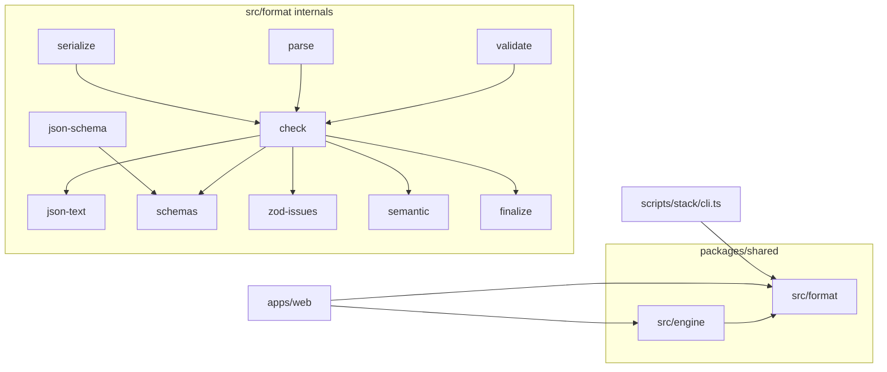
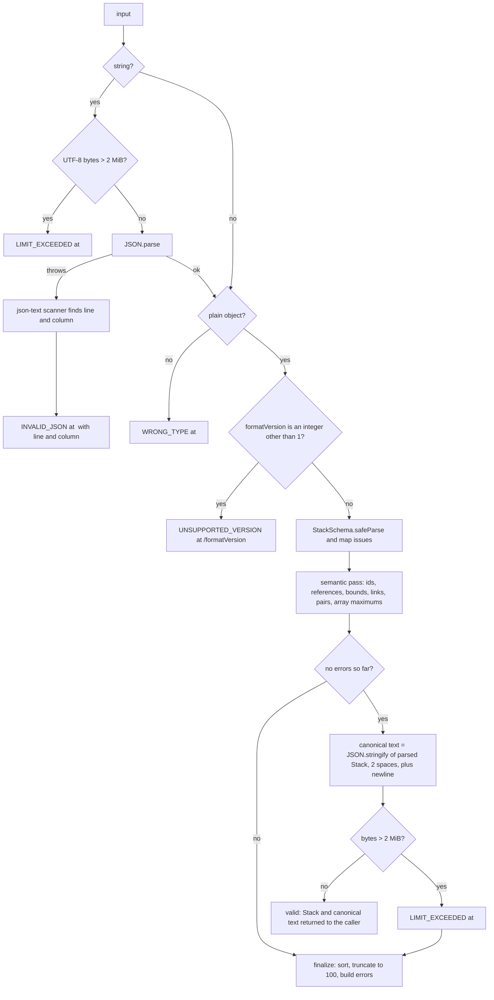

# Design Document

## Overview

This design turns `requirements.md` into changes to the existing `packages/shared/src/format` module. The thin slice already implements a strict subset of the format (three Object types, four Action types, the validator, Zod 4 schemas, 770 tests). This design **extends that module**. It adds the missing types and rules, the Stack_Parser, the Stack_Serializer, and the Stack_Schema export, and it fixes the places where the slice diverged from this spec. Nothing is rebuilt.

Key decisions:

- **All five Object types and all nine Action types become supported.** `image` and `ai-field`, and the five extra Actions, move from "not supported in this release" to ordinary members of the discriminated unions. A `type` that is not in the lists stays `INVALID_VALUE` with the message "is unknown". The `UNSUPPORTED_*` constants disappear, and `SUPPORTED_*` become `OBJECT_TYPES` and `ACTION_TYPES`.
- **One pipeline, three entry points.** `validateStack`, `parseStack`, and `serializeStack` share one internal check (`check.ts`). The check parses once, returns the typed Stack when valid, and computes the canonical text once. This removes the double parse in the web app's `loadStack`.
- **Array maximums move from Zod to the semantic pass.** Zod 4.6.7 checks the maximum size of an array before it parses any element, so an oversize array hides every element error. The semantic pass already walks the raw candidate and does not have this problem. Schema bounds still reach the JSON Schema through `.meta()`.
- **The JSON Schema comes from the same Zod objects.** `z.toJSONSchema` gives structure, and `.meta()` adds the keywords that a custom check hides (`maxLength` in code points, `maxItems`, `uniqueItems`, `oneOf` for exactly-one-of). Cross-entity rules stay out of the schema.
- **JSON syntax errors get their own locator.** `JSON.parse` messages differ across engines (Node 25 gives no position at all, Safari gives none either), so INVALID_JSON line and column come from a small hand-written scanner that runs only after `JSON.parse` has failed. A property test keeps the scanner and `JSON.parse` in agreement.
- **No new runtime dependency.** One dev dependency is proposed for tests: `ajv` 8 (2020-12 build) in `packages/shared` only. See [Open Decisions](#open-decisions).

Research that shaped the design (all findings were probed against Zod 4.6.7 and Node 25.2.1 in the repo's own `node_modules`, not assumed):

| Finding | Consequence |
|---|---|
| Zod 4 runs a container's maximum-size checks before parsing its elements (`capSize` in `zod/v4/core/schemas.js`). An oversize array reports one `too_big` and nothing else. | Open Item 1 of the thin slice cannot be fixed by keeping `z.array().max()`. |
| A custom `.refine()` on an array is skipped when an element already has an issue, even with `when: () => true`, because element issues carry `continue: false`. | A custom array check does not fix it either. The semantic pass does the array maximums. |
| A custom `.check()` or `.refine()` is silently ignored by `z.toJSONSchema` (no throw). `.meta({ ... })` keywords are merged into the output. | The existing code-point `text()` helper loses `maxLength` in the schema today. `.meta({ maxLength })` restores it. |
| `z.iso.datetime()` accepts `Z`-terminated timestamps with seconds, rejects offsets, `24:00:00`, second 60, and impossible dates (`2026-02-30`, `2027-02-29`), and converts to `format: "date-time"` plus a `pattern`. | It implements Requirement 6.11 with no custom code and appears in the schema. |
| `z.toJSONSchema` targets draft 2020-12 by default, turns `strictObject` into `additionalProperties: false`, and a discriminated union into `oneOf`. Its `unrepresentable` option defaults to `"throw"` for types such as transforms. See [Zod: JSON Schema](https://zod.dev/json-schema). | Keep the default so a future unrepresentable schema fails a test instead of becoming `{}`. |
| A parsed strict object returns its keys in shape declaration order. | Declaration order can define the canonical key order, if a golden test pins it. |
| Node 25's `JSON.parse` message has no position (`Unexpected token '}', "{"a":}" is not valid JSON`). | Requirement 9.3 needs the own scanner. |
| A regex over a 1,000,000-character base64 payload runs in about 4 ms, matching or failing. | A `pattern` is safe for data URIs, and the same pattern can go to the schema. |

## Architecture

### File tree

New and changed files only. Paths are inside `packages/shared` unless stated.

```
packages/shared/
├── package.json                      + devDependency ajv (tests only; see Open Decisions)
├── src/
│   ├── index.ts                      unchanged (still exports nothing; apps import subpaths)
│   ├── smoke.test.ts                 export list updated
│   ├── format/
│   │   ├── index.ts                  CHANGED: new exports (see Public API)
│   │   ├── limits.ts                 CHANGED: LIMITS rows, OBJECT_TYPES, ACTION_TYPES, patterns
│   │   ├── errors.ts                 unchanged
│   │   ├── text.ts                   unchanged
│   │   ├── schemas.ts                CHANGED: 2 Object schemas, 5 Action schemas, .meta(), no array .max()
│   │   ├── zod-issues.ts             CHANGED: type lists, regex/datetime messages, one unknown-type message
│   │   ├── semantic.ts               CHANGED: new reference rules, array maximums, ai-field rules
│   │   ├── finalize.ts               unchanged
│   │   ├── validate.ts               CHANGED: thin wrappers over check.ts; INVALID_JSON message
│   │   ├── check.ts                  NEW: the shared pipeline (text, value, canonical text)
│   │   ├── json-text.ts              NEW: JSON syntax scanner, line and column
│   │   ├── parse.ts                  NEW: parseStack
│   │   ├── serialize.ts              NEW: serializeStack
│   │   ├── json-schema.ts            NEW: stackJsonSchema
│   │   └── *.test.ts, *.property.test.ts   see Migration and Testing Strategy
│   └── engine/
│       ├── stack-edit.ts             CHANGED (1 line): textOf reads an ai-field value
│       └── execute-handler.ts        CHANGED (3 lines): set_value may target an ai-field
└── test-support/
    ├── arbitraries.ts                CHANGED: new types, hostile text, handler modes
    ├── oracles.ts                    NEW: independent oracles used by property tests
    └── json-text-arbitraries.ts      NEW: near-valid JSON text generators
```

Outside the package: `scripts/stack/` (fixtures and tests only), `apps/web/src` (four small files), `README.md`, `docs/handoff.md`. See [Migration](#migration).

### Module boundaries



`format` still imports only Zod and its own files. `engine` still imports `../format/index.ts` only. No file uses `TextEncoder`, `URL`, `Buffer`, `Date`, or any DOM or Node global, so Requirement 10.2 holds with `lib: ["ES2022"]` and `types: []`. (Tests may use them.)

### Validation pipeline



The early exits X1 to X4 return exactly one error, as in the slice. Everything else goes through `finalize`, unchanged.

### Public API of `@hypergeist/shared/format`

```ts
// constants (limits.ts)
export const FORMAT_VERSION: 1;
export const ENTITY_ID_PATTERN: RegExp;
export const OBJECT_TYPES: readonly ['button', 'field', 'image', 'list', 'ai-field'];
export const ACTION_TYPES: readonly ['go_to_card', 'set_value', 'append_item', 'remove_item',
  'show_message', 'run_ai_field', 'fetch_news', 'transcribe_audio', 'schedule_notification'];
export const LIMITS: { ... };                        // rows added, see Data Models
export const VALIDATION_ERROR_CODES: readonly [...14 codes];
// schemas and types (z.infer)
export { StackSchema, CardSchema, LinkSchema, ObjectSchema, ButtonSchema, FieldSchema,
         ImageSchema, ListSchema, AiFieldSchema, ActionSchema, HandlerSchema,
         GoToCardActionSchema, SetValueActionSchema, AppendItemActionSchema,
         RemoveItemActionSchema, ShowMessageActionSchema, RunAiFieldActionSchema,
         FetchNewsActionSchema, TranscribeAudioActionSchema, ScheduleNotificationActionSchema };
export type { Stack, Card, Link, StackObject, ButtonObject, FieldObject, ImageObject, ListObject,
              AiFieldObject, Action, Handler, ValidationError, ValidationErrorCode,
              ValidationResult, ParseResult, SerializeResult };
// functions
export function validateStack(candidate: unknown): ValidationResult;       // existing
export function validateHandler(stack: Stack, candidate: unknown): ValidationResult;   // existing
export function parseStack(input: unknown): ParseResult;                   // NEW
export function serializeStack(stack: unknown): SerializeResult;           // NEW
export function stackJsonSchema(): JsonSchemaDocument;                     // NEW
```

`ParseResult` and `SerializeResult` follow the steering convention `{ ok: true, value } | { ok: false, errors }`:

```ts
type ParseResult =
  | { readonly ok: true; readonly value: Stack }
  | { readonly ok: false; readonly errors: readonly ValidationError[]; readonly truncated: boolean };
type SerializeResult =
  | { readonly ok: true; readonly value: string }          // Canonical_JSON
  | { readonly ok: false; readonly errors: readonly ValidationError[]; readonly truncated: boolean };
```

`parseStack(input)` mirrors `validateStack`: a string is JSON text, any other value is a candidate object (for IndexedDB reads and model tool calls). `serializeStack(stack)` takes `unknown`, because a value typed `Stack` can still break a cross-entity rule. A string passed to `serializeStack` is not a Stack, so it gets `WRONG_TYPE` at `""`, never a parse.

**`validateHandler` stays public.** The executor already needs it (thin-slice Requirement 8.12), and the engine's `set_action` operation needs the same Handler rules. It is documented as an extension to this spec's required API. Its error paths are relative to the Handler (root `""`).

**The root `index.ts` stays empty.** Apps import `@hypergeist/shared/format` and `/engine`, as the dependency check requires. `smoke.test.ts` pins that.

## Components and Interfaces

### limits.ts

Adds the rows below to `LIMITS` (existing rows are unchanged), the two type lists, and two patterns. `constants.test.ts` pins every value.

| New `LIMITS` row | Value | Requirement |
|---|---|---|
| `imageAlt` | min 0, max 200 | 4.3 |
| `imageHttpsSrc` | min 1, max 2,000 | 4.4 |
| `imageDataSrc` | min 1, max 1,000,000 | 4.4 |
| `aiPrompt` | min 1, max 2,000 | 4.6 |
| `aiInputObjects` | min 0, max 10 | 4.6 |
| `aiFieldValue` | min 0, max 10,000 | 4.6 |
| `removeItemIndex` | min 0 | 6.6 |
| `newsTopics` | min 1, max 10 | 6.9 |
| `newsTopicText` | min 1, max 100 | 6.9 |
| `notificationMessage` | min 1, max 500 | 6.11 |

`OBJECT_TYPES` is in the order of Requirement 3.2 (`button, field, image, list, ai-field`). `ACTION_TYPES` is in the order of the glossary. These orders appear in hints ("Use one of: ...").

`IMAGE_SRC_PATTERN` is one regular expression with two alternatives, written so that it is ASCII only (so UTF-16 length equals code point count, and the schema `maxLength` is exact):

- `https:` URL: the lowercase scheme `https://`, then a non-empty authority made of `A-Z a-z 0-9 . _ ~ % ! $ & ' ( ) * + , ; = : [ ] -` (no `@`, so no user info), then optionally `/`, `?`, or `#` followed by printable ASCII except space and backslash.
- `data:` URI: `data:image/` then `png`, `jpeg`, `gif`, or `webp`, then `;base64,`, then a non-empty well-formed base64 payload: groups of four characters from `A-Za-z0-9+/`, ending with one more group of four, or three characters and `=`, or two characters and `==`.

The pattern is checked together with a maximum of 1,000,000 characters. The `https:` length limit of 2,000 is a separate check (below), because a pattern cannot say "if it starts with `https:`, at most 2,000".

### schemas.ts

The file keeps its style: Zod objects declared with explicit property order, `EntityId`, `text()`, `int()`, and one schema per Object and Action. Changes:

**`text(min, max)`** gets `.meta({ maxLength: max })`, so the JSON Schema keeps the code-point maximum. Behavior is otherwise unchanged.

**`limitedArray(element, max)`** is new. It returns `z.array(element).meta({ maxItems: max })` and nothing else. The maximum is enforced by the semantic pass. A minimum (`cards`, `topics`) is added with the built-in `.min()`, which does not trigger Zod's early size check.

**New Object schemas** (property order is the canonical order, see [Data Models](#data-models)):

```ts
const ImageSchema = z.strictObject({
  ...common('image'),                      // id, type, name, x, y, width, height, written out like the others
  src: imageSrc,                           // below
  alt: text(0, 200),
});
const AiFieldSchema = z.strictObject({
  ...common('ai-field'),
  prompt: text(1, 2000),
  inputObjectIds: limitedArray(EntityId, 10).meta({ uniqueItems: true }),
  value: text(0, 10_000),
});
export const ObjectSchema = z.discriminatedUnion('type', [Button, Field, Image, List, AiField]);
```

(The existing schemas write the seven common properties out by hand. The two new ones follow the same pattern. No refactor of the existing ones.)

`imageSrc` is `z.string().regex(IMAGE_SRC_PATTERN).max(1_000_000)` plus one custom check that pushes a `too_big` string issue (maximum 2,000) when the value starts with `https:` and has more than 2,000 characters. A string that is both too long and not matching reports `INVALID_VALUE` and `LIMIT_EXCEEDED` at the same path, ordered by code.

**New Action schemas** (each `z.strictObject`, `type` first, then the target or card id, then the rest):

| Action | Properties in canonical order |
|---|---|
| `go_to_card` | `type`, `cardId` |
| `set_value` | `type`, `targetObjectId`, `value?`, `fromObjectId?` |
| `append_item` | `type`, `targetObjectId`, `item?`, `fromObjectId?` |
| `remove_item` | `type`, `targetObjectId`, `index` (`z.int().min(0)`) |
| `show_message` | `type`, `text` |
| `run_ai_field` | `type`, `targetObjectId` |
| `fetch_news` | `type`, `targetObjectId`, `topics` (`limitedArray(text(1, 100), 10).min(1)`) |
| `transcribe_audio` | `type`, `targetObjectId` |
| `schedule_notification` | `type`, `message`, `at?` (`z.iso.datetime()`), `atFromObjectId?` |

The three exactly-one-of pairs (`set_value`, `append_item`, `schedule_notification`) keep both members optional in the Zod object, and the schema adds `.meta({ oneOf: [{ required: [a] }, { required: [b] }] })` so the JSON Schema states the rule too. The validator enforces it in the semantic pass (see Open Item 3 below).

`HandlerSchema` becomes `limitedArray(ActionSchema, 20)`. `StackSchema.cards` becomes `limitedArray(CardSchema, 200).min(1)`, and `CardSchema.objects` and `.links`, and `ListSchema.items`, use `limitedArray` with their maxima from `LIMITS`.

`-0` note: the schemas accept `-0` as an integer. The serializer writes it as `0`. Deep equality here means `===`, so `-0` and `0` are equal. A test pins this.

### semantic.ts

The pass keeps its shape (index, then a tolerant walk of the raw candidate) and gains four things.

**1. Wider reference table.** `Target` gains the `ai-field` and `image` names, and `walkAction` gains a case per new Action. The full table:

| Reference property | Allowed target |
|---|---|
| `startCardId`, Link `targetCardId`, `go_to_card.cardId` | Card |
| `set_value.targetObjectId` | `field` or `ai-field` |
| `set_value.fromObjectId` | `field`, `ai-field`, or `list` |
| `append_item.targetObjectId` | `list` |
| `append_item.fromObjectId` | `field` or `ai-field` |
| `remove_item.targetObjectId` | `list` |
| `run_ai_field.targetObjectId` | `ai-field` |
| `fetch_news.targetObjectId` | `list` |
| `transcribe_audio.targetObjectId` | `field` |
| `schedule_notification.atFromObjectId` | `field` |
| `ai-field.inputObjectIds[i]` | `field`, `list`, or `ai-field`, on the same Card, not the ai-field itself |

**2. ai-field inputs.** `EntityInfo` gains `cardIndex` (the index of the owning Card, for every kind). For each string entry of `inputObjectIds`, the pass reports:

- `DANGLING_REFERENCE` when the id is not in the index;
- `WRONG_REFERENCE_TYPE` when the id is the ai-field's own id, belongs to a Card or Link, belongs to an Object of type `button` or `image`, or belongs to an Object on a different Card. The message says which reason applies, and names the ai-field's id (Requirement 4.8);
- `INVALID_VALUE` at the later entry when the same id appears twice (Requirement 4.6 uniqueness; this is not `DUPLICATE_ID`, which is only about entity ids).

**3. Array maximums.** `checkArrayLimit(value, path, max)` reports `LIMIT_EXCEEDED` at the array path when a raw array is longer than `max`. It runs at: `/cards` (200), each Card's `objects` (100) and `links` (50), each List's `items` (500), each ai-field's `inputObjectIds` (10), each `fetch_news` `topics` (10), and every Handler (20) inside `walkHandler`, which also covers `validateHandler`. The message, expected, and hint texts are the ones the mapper produces today, moved to a shared helper (`limitMessages`) so the two paths cannot drift. Because the pass walks raw data, an oversize array no longer hides its element errors.

**4. Exactly-one-of** for `schedule_notification` (`at` or `atFromObjectId`), next to the existing two pairs.

`walkObject` now also walks `image` (bounds only) and `ai-field` (bounds, inputs, limit). `walkAction` skips only a `type` that is not in `ACTION_TYPES`. `walkHandler` keeps its signature, so `validateHandler` and the Button and Card call sites are unchanged.

### zod-issues.ts

| Zod issue | Change |
|---|---|
| `invalid_union` on `type` | Always "is unknown". The "not supported in this release" branch and the `UNSUPPORTED_*` imports are removed. The hint lists `OBJECT_TYPES` or `ACTION_TYPES`. |
| `invalid_format`, `format: "regex"` | A small table maps known patterns to messages: the Entity_ID pattern (existing) and `IMAGE_SRC_PATTERN` (new, `INVALID_VALUE`, message names the object id, hint "Use an https: URL, or a base64 data:image URI of type png, jpeg, gif, or webp."). |
| `invalid_format`, `format: "datetime"` | New: `INVALID_VALUE`, expected "a UTC timestamp such as 2026-12-01T09:00:00Z", hint "Write the time in UTC with seconds and a trailing Z." |
| `too_big` on an array | Kept, delegating to the shared `limitMessages` helper. No schema emits it any more, but the unit tests feed synthetic issues, and a future schema may use `.max()` safely on a leaf array. |
| everything else | unchanged |

### json-text.ts (new)

```ts
export type JsonSyntaxError = {
  readonly offset: number;          // UTF-16 index of the first character that cannot continue valid JSON, or text.length
  readonly line: number;            // 1-based
  readonly column: number;          // 1-based, in UTF-16 code units
  readonly found: string | null;    // the offending character, or null at the end of the text
};
export function findJsonSyntaxError(text: string): JsonSyntaxError | undefined;
```

It is an iterative RFC 8259 scanner with an explicit stack for nesting (so a 2 MiB text of `[` characters cannot overflow the call stack). It accepts exactly what `JSON.parse` accepts: whitespace is space, tab, line feed, and carriage return only; no BOM; no raw control characters in strings; no leading zeros; no trailing commas. Lines break at `\n` only, so `\r\n` files report correct lines, and a CR-only file counts as one line. Columns count UTF-16 code units from the start of the line.

`check.ts` calls the scanner only after `JSON.parse` has thrown. The message is deterministic and independent of the engine:

```
The text is not well-formed JSON: unexpected "}" at line 1, column 11.
The text is not well-formed JSON: unexpected end of text at line 3, column 1.
The text is not well-formed JSON: unexpected character U+000A at line 2, column 9.
```

The hint is "Fix the JSON syntax at line L, column C, for example a missing quote, comma, or bracket." A text that starts with a byte order mark gets the extra hint "Remove the byte order mark at the start of the text." If the scanner finds no error although `JSON.parse` threw (an engine difference the property test should never find), the result is still `INVALID_JSON`, at line 1, column 1, with a generic message. So the function is total.

### check.ts, validate.ts, parse.ts, serialize.ts (new and changed)

`check.ts` holds the pipeline of the diagram and exports two internal functions, `checkText(text)` and `checkValue(value)`, both returning:

```ts
type Checked = {
  readonly result: ValidationResult;
  readonly stack?: Stack;        // only when result.valid; the Zod output, keys in canonical order
  readonly canonical?: string;   // only when result.valid; JSON.stringify(stack, null, 2) + '\n'
};
```

The canonical text is built from the parsed Stack (not the raw candidate), so the size check in Requirement 8.7 measures exactly what the serializer would write. The check never throws: the outer `try` of today's `validateStack` moves here.

- `validateStack(candidate)` = `typeof candidate === 'string' ? checkText : checkValue`, returning `.result`. Behavior is the slice's, except the INVALID_JSON message text.
- `parseStack(input)` runs the same dispatch and returns `{ ok: true, value: checked.stack }` or `{ ok: false, errors, truncated }`. Requirement 9.2 to 9.4 and 9.10 fall out of the pipeline: oversize text gives one `LIMIT_EXCEEDED` before any parse, bad JSON gives one `INVALID_JSON`, and every other error is returned whole.
- `serializeStack(stack)` runs `checkValue` and returns `{ ok: true, value: checked.canonical }` or the errors (Requirement 9.11). The text is UTF-8 by definition (a JavaScript string is encoded by the caller), uses two-space indentation, and ends with exactly one newline.

**Canonical key order is the declaration order of the Zod shapes.** `StackSchema.safeParse` returns a new object whose keys follow the shape order, with optional properties that are absent left out. `JSON.stringify` keeps that order. The table in [Data Models](#data-models) is the specification, and a golden test compares serializer output with it, so a change in Zod's output order would fail a test instead of silently changing stored text. Array order is never changed.

JSON text produced this way preserves every code point: `JSON.stringify` writes non-ASCII characters as they are, escapes `"`, `\`, and control characters, and (since ES2019) escapes lone surrogates as `\udXXX`, which `JSON.parse` turns back into the same code unit.

### json-schema.ts (new)

```ts
export function stackJsonSchema(): JsonSchemaDocument;   // z.toJSONSchema(StackSchema), draft 2020-12
```

It calls `z.toJSONSchema(StackSchema)` with the default `target` (draft 2020-12) and the default `unrepresentable: "throw"`. It returns a fresh object on every call, so callers cannot change shared state. `JsonSchemaDocument` is `ReturnType<typeof z.toJSONSchema>`.

What the schema covers, and what it cannot:

| Rule | In the schema? |
|---|---|
| Required and optional properties, types, `additionalProperties: false` | yes |
| Integer ranges, `const` for `formatVersion` and each `type`, `oneOf` over Object and Action types | yes |
| String length bounds in code points (`minLength`, `maxLength`) | yes, `maxLength` through `.meta()` |
| Array bounds (`minItems`, `maxItems`), `uniqueItems` for `inputObjectIds` | yes, `maxItems` through `.meta()` |
| Entity_ID pattern, image `src` pattern, UTC timestamp (`format` and `pattern`) | yes |
| Exactly-one-of pairs | yes, `oneOf` of two `required` lists through `.meta()` |
| `https:` source of at most 2,000 characters (the schema allows up to 1,000,000) | no, validator only |
| Unique Entity_IDs, references, ai-field input rules, object bounds, unique links | no, validator only (Requirement 11.1 scopes the schema to structure) |
| The 2 MiB canonical size limit | no, validator only |

A caveat for the AI orchestrator spec: some providers' strict tool-call modes accept `anyOf` but not `oneOf`. That spec can convert with `override`; this spec exposes the plain output.

### Engine alignment (small, not new engine behavior)

The validator now accepts `set_value` into an `ai-field` and a copy from an `ai-field`. Without alignment, the executor would copy an empty string or skip with a wrong reason. Two edits keep the validator and executor honest, and nothing else in the engine changes (the other five Actions still end in the existing "this action type is not supported" skip message; the `stack-engine` spec owns their real behavior):

- `textOf` returns `value` for an `ai-field`.
- `applyEdit` accepts a `field` or an `ai-field` as the `set_value` target.

### Web (minimum for graceful degradation)

The web app compiles against `StackObject`, so the wider union breaks `ObjectView` (a `switch` without a return for new cases) and `propertyRows` (no return for new cases). The minimum:

- **`ObjectView`**: `image` renders a framed placeholder (`role="img"`, `aria-label` from `alt`, then `name`, then the id) with the word "Image" and the alt text. It never creates an `` or loads `src`, so a shared stack cannot make the browser contact a third party. `ai-field` renders a read-only `<textarea>` showing `value`, with the placeholder "AI field. AI arrives in a later release." Both are inert in Edit mode like every other preview. `data-type` is already on the wrapper.
- **`property-rows.ts`**: rows for `src` (cut to 80 code points followed by "…", so a 1 MB data URI cannot flood the Property_Readout) and `alt`; for `prompt`, `inputObjectIds`, `value`.
- **`accessible-name.ts`**: an `image` with an empty name uses `alt` before the id.
- **`canvas.css`**: two rules for `[data-type='image']` and `[data-type='ai-field']` using existing tokens (`--dither-25`, `--border`). The CSS token scan test stays green because no literal is added.
- **`stacks/load-stack.ts`**: calls `parseStack(text)` instead of `validateStack` plus `StackSchema.parse(JSON.parse(text))`.
- **Buttons with the new Actions** run through the existing store path. The executor skips them with "Skipped action N (remove_item): this action type is not supported.", which the Hint_Line shows. That is honest and needs no store change.

## Data Models

The Zod schemas are the single definition. TypeScript types are `z.infer` of them (`ImageObject`, `AiFieldObject`, and the new Action types are new). `ValidationError`, `ValidationResult`, and the 14 codes are unchanged. `ParseResult`, `SerializeResult`, and `JsonSyntaxError` are plain unions, because no schema describes them (see Open Item 7).

### Canonical key order

This table defines Canonical_JSON key order (Requirement 9.5). Optional properties are omitted when absent.

| Entity | Keys, in order |
|---|---|
| Stack | `formatVersion`, `id`, `name`, `cardWidth`, `cardHeight`, `startCardId`, `remixedFrom`, `cards` |
| Card | `id`, `name`, `objects`, `links`, `onOpen` |
| Link | `id`, `label`, `targetCardId` |
| Object, common | `id`, `type`, `name`, `x`, `y`, `width`, `height` |
| Button | common, `label`, `onClick` |
| Field | common, `value`, `placeholder`, `multiline`, `readOnly` |
| Image | common, `src`, `alt` |
| List | common, `items`, `ordered` |
| AI_Field | common, `prompt`, `inputObjectIds`, `value` |
| Actions | as in the Action table above |

The requirements list `fetch_news` as `topics` then `targetObjectId`, but they do not define key order. The design puts `targetObjectId` first for every Action that has one, so Actions read the same way.

### `remixedFrom` and the Stack id

Both are Entity_ID strings checked by the pattern only. They are provenance, not references: the validator never resolves them, never compares them with other ids, and never requires them to differ (Requirement 2.5). The Stack `id` is not in the entity index, so it may equal a Card id. The serializer writes `remixedFrom` right after `startCardId` and omits it when absent.

### Timestamps

`at` uses `z.iso.datetime()`: `YYYY-MM-DDTHH:mm:ss` with optional fraction, then a mandatory `Z`. The calendar is checked (leap years, month lengths). Offsets, lowercase `t` or `z`, a missing seconds part, and a date without a time are invalid. The validator reads no clock, so a time in the past is valid.

## Reconciliation of the thin-slice Open Items

| # | Thin-slice Open Item | Decision |
|---|---|---|
| 1 | Over-limit arrays hide element errors | **Fixed.** Array maximums are reported by the semantic pass over raw data (Components: semantic.ts). Property 7 pins it. Cost: Zod now parses every element of an oversize array. Text input is capped at 2 MiB, so this is bounded; callers that pass untrusted objects should pass text instead. |
| 2 | 2 MiB check only on otherwise valid stacks | **Kept, and documented.** Canonical_JSON exists only for a valid Stack (Requirement 9.11), so its length is defined only then. The check measures the parsed Stack's canonical text. The cost is that a repair loop may see this error one round later. A boundary test at exactly 2,097,152 and 2,097,153 bytes pins it. |
| 3 | Exactly-one-of lives in the semantic pass | **Kept, plus a schema statement.** The error stays `INVALID_VALUE` at the Action path with a precise hint. The JSON Schema also carries `oneOf` through `.meta()`, and Property 21 checks that schema and validator agree. |
| 4 | `validateStack` returns no parsed Stack | **Fixed.** `parseStack` returns the typed Stack from the same single pass. `loadStack` in the web app switches to it. |
| 5 | `validateHandler` is a new public function | **Kept** as documented public API (see Public API). |
| 6 | `EffectRequest` is `never` | Not in this spec. The `stack-engine` spec widens it. |
| 7 | Validation types are plain TypeScript | **Kept.** No schema duplicates them. A `ValidationErrorSchema` can be added when the engine's tool results need one, with the identical shape. |
| 8 | Pattern and range violations use `INVALID_VALUE` | **Kept and pinned** by example tests. `OUT_OF_RANGE` stays reserved for engine operations. |
| 9 | Declared property order | **Defined** by the key-order table and pinned by a golden test. |
| 10 | `StackObject` name | **Kept.** `ImageObject` and `AiFieldObject` are added. |
| 11 | Property tests only in `packages/shared` | Unchanged. Web helpers get example tests. |
| 12, 13 | Read-only Field contrast, no close boxes | UI concerns, not this spec. |
| 14 | Unsupported lists become empty | **Done at once:** `UNSUPPORTED_*` removed, `SUPPORTED_*` renamed `OBJECT_TYPES` and `ACTION_TYPES`. The unknown-type property draws arbitrary strings, so it needs no list. |

## Correctness Properties

*A property is a characteristic or behavior that should hold true across all valid executions of a system-essentially, a formal statement about what the system should do. Properties serve as the bridge between human-readable specifications and machine-verifiable correctness guarantees.*

### Property 1: Valid stacks validate

For any stack from `arbStack` (every Object type, every Action type, Links, optional `remixedFrom`, values at the minimum and maximum of each limit), `validateStack` of the stack, of its canonical text, and of its minified JSON text each return `{ valid: true, errors: [], truncated: false }`.

**Validates: Requirements 1.1, 1.2, 1.4, 1.5, 1.6, 1.8, 3.1, 3.2, 4.1, 4.2, 4.3, 4.5, 4.6, 5.1, 5.2, 5.3, 6.1, 6.2, 6.3, 6.4, 6.5, 6.6, 6.7, 6.8, 6.9, 6.10, 6.11, 7.2**

### Property 2: The validator is total, pure, and deterministic

For any candidate (arbitrary JSON values, JSON text, valid stacks, mutated stacks, deeply frozen copies), `validateStack` does not throw, leaves the candidate deeply equal to a copy taken before the call, and returns deeply equal results on two calls. The same holds for `parseStack` and `serializeStack`.

**Validates: Requirements 2.5, 7.11, 10.3, 12.6**

### Property 3: Results are well-formed and paths resolve

For any candidate, `valid` is true exactly when `errors` is empty; `errors.length` is at most 100; `truncated` implies exactly 100 errors; every `code` is in the closed set and is never `OUT_OF_RANGE` or `UNKNOWN_ENTITY`; `message`, `expected`, and `hint` are non-empty; `actual` is `null` or at most 200 code points; and every `path` is an RFC 6901 pointer that an independent resolver follows to a location in the candidate or to its nearest existing ancestor. For a mutated stack, `valid` is false or every error satisfies the above.

**Validates: Requirements 1.11, 3.6, 6.13, 7.1, 7.3, 7.4, 7.5, 7.13, 8.8, 12.5**

### Property 4: Root and version short-circuits

For any JSON value that is not an object, `validateStack` returns exactly one `WRONG_TYPE` error at `""`. For any object whose `formatVersion` is an integer other than 1, whatever else is wrong with it, `validateStack` returns exactly one `UNSUPPORTED_VERSION` error at `/formatVersion` whose hint names version 1.

**Validates: Requirements 7.9, 7.10**

### Property 5: Errors follow document order

For any mutated candidate, the errors are ordered by the depth-first position of their `path` (parent before child, array order, properties in the order they appear in the candidate), and errors with equal paths are ordered by `code` in ascending code-point order. An independent oracle computes the traversal.

**Validates: Requirements 7.8**

### Property 6: Every violation is reported, up to 100

For any valid stack and any number k of independent violations placed at distinct sites (unknown properties on k different entities), the result has min(k, 100) errors, `truncated` is true exactly when k exceeds 100, and the errors are the first min(k, 100) of the full list in document order.

**Validates: Requirements 7.6, 7.7**

### Property 7: Oversize arrays do not hide element errors

For any valid stack, any array site (Cards, Objects, Links, List items, Handler, `inputObjectIds`, `topics`), and any element violation inside that array, growing the array past its maximum yields both a `LIMIT_EXCEEDED` error at the array path and the element's own error.

**Validates: Requirements 7.6, 8.5**

### Property 8: Unknown types are rejected cleanly

For any valid stack, any Object or Action in it, and any string that is not in `OBJECT_TYPES` (for an Object) or `ACTION_TYPES` (for an Action), replacing `type` with that string gives exactly one error at or under that node: `INVALID_VALUE` at `<node>/type`, a message ending in "is unknown.", and a hint that lists the valid types. A string that is a valid type of the other kind is also unknown.

**Validates: Requirements 3.2, 6.2, 6.13**

### Property 9: Object bounds are inclusive and reported once

For any valid stack and any Object in it, moving the Object so that `x + width` equals `cardWidth` and `y + height` equals `cardHeight` keeps the stack valid; moving it one unit past either edge, or both, gives exactly one `OUT_OF_BOUNDS` error at the Object path.

**Validates: Requirements 3.5, 8.4**

### Property 10: Entity ids are unique across kinds

For any valid stack and any reassignment of Card, Object, and Link ids from a small pool, the `DUPLICATE_ID` paths equal the `id` paths of the later occurrences in document order, and an id used n times gives n minus 1 errors.

**Validates: Requirements 2.2, 8.1**

### Property 11: References resolve by kind

For any valid stack, any reference property in it (the full table above, including each `inputObjectIds` entry), and any retargeting: to a missing id gives `DANGLING_REFERENCE` at that path; to an existing entity outside the allowed set (including, for an ai-field input, a button, an image, an Object on another Card, the ai-field itself, a Card, or a Link) gives `WRONG_REFERENCE_TYPE`; to an allowed entity keeps the stack valid.

**Validates: Requirements 1.5, 2.3, 2.4, 2.7, 4.7, 5.6, 6.3, 6.4, 6.5, 6.8, 6.9, 6.10, 6.11, 8.2, 8.3**

### Property 12: Link rules

For any valid stack, any Card, and any target Card id, adding a Link with a fresh id keeps the stack valid when no Link in that Card has that target (including a self-link and a target shared with other Cards' Links), and gives exactly one `DUPLICATE_LINK` at the new Link's `targetCardId` path otherwise.

**Validates: Requirements 5.3, 5.4, 5.5, 8.6**

### Property 13: Exactly one of each pair

For any valid stack and any `set_value`, `append_item`, or `schedule_notification` Action in it, supplying both members of its pair or neither gives exactly one `INVALID_VALUE` at the Action path, and supplying exactly one is valid.

**Validates: Requirements 6.4, 6.5, 6.11**

### Property 14: Image sources

For any generated source, the validator accepts an Image exactly when the source is a lowercase `https://` URL of 1 to 2,000 printable ASCII characters with a non-empty authority and no user info, or a base64 `data:image/png`, `jpeg`, `gif`, or `webp` URI of at most 1,000,000 characters with a well-formed non-empty payload. Every rejected source (`http:`, `javascript:`, `data:image/svg+xml`, bad padding, empty payload, non-ASCII, over length) gives an error at the `src` path, and the message names the Image id. An independent predicate in `oracles.ts` decides which sources are valid.

**Validates: Requirements 4.3, 4.4, 4.8, 4.9**

### Property 15: Timestamps

For any `Date` value, its ISO string (always UTC with `Z`) is accepted as `at`. For any string of the shape `YYYY-MM-DDTHH:mm:ss(.fraction)?` followed by `Z`, an offset, or nothing, with arbitrary field values, `at` is accepted exactly when the suffix is `Z` and the fields form a real calendar date and time (checked with `Date.UTC` round trip in the oracle).

**Validates: Requirements 6.11**

### Property 16: Limits at the boundary

For any limit site in the table of arrays and strings (each `LIMITS` row that applies), content of exactly the maximum is valid, and content of one more is reported as exactly one `LIMIT_EXCEEDED` at the site. Text is counted in Unicode code points, so a string of astral characters at the maximum is valid.

**Validates: Requirements 1.4, 1.7, 3.3, 4.2, 4.5, 6.1, 6.7, 6.9, 8.5**

### Property 17: JSON syntax errors are located

For any string, the scanner reports an error exactly when `JSON.parse` throws. For text that fails, `validateStack` returns one `INVALID_JSON` error at `""` whose message contains the 1-based line and column that an independent oracle computes from the scanner's offset, and the line and column are within the text. Inputs come from arbitrary strings and from valid JSON with one character deleted, inserted, or truncated.

**Validates: Requirements 7.12, 9.3**

### Property 18: Canonical serialization

For any valid stack and any key-shuffled deep copy of it, `serializeStack` returns the same text. The text ends with exactly one newline, uses two-space indentation, has every object's keys in the order of the key-order table, keeps array order, and is at most 2,097,152 bytes.

**Validates: Requirements 9.1, 9.5, 9.6**

### Property 19: Serialization round trips

For any valid stack, including text with astral characters, `"`, `\`, line breaks, and lone surrogates, `parseStack(serializeStack(stack).value)` returns a stack deeply equal to the input with the same code point sequences in every string. For any canonical text produced this way, serializing the parsed stack gives the identical text. For any valid stack and any valid JSON formatting of it (indentation, whitespace, key order), parsing then serializing gives the canonical text.

**Validates: Requirements 8.7, 9.7, 9.8, 9.9, 10.1, 12.4**

### Property 20: The parser and serializer agree with the validator

For any candidate, `parseStack(candidate).ok` equals `validateStack(candidate).valid`, and when not ok its `errors` and `truncated` equal the validator's. For any object candidate, `serializeStack` returns the same errors and no text when the validator rejects it. A string passed to `serializeStack` gives one `WRONG_TYPE` at `""`.

**Validates: Requirements 9.2, 9.10, 9.11**

### Property 21: The JSON Schema accepts valid stacks and rejects structural violations

For any valid stack, the Stack_Schema accepts it. For any mutation that deletes a required property, replaces a value with another JSON type, adds an unknown property, or breaks an exactly-one-of pair, and that the Zod parse reports as a structural issue, the Stack_Schema rejects it. The Stack_Schema itself validates against the draft 2020-12 meta-schema. These checks use an independent JSON Schema validator.

**Validates: Requirements 11.1, 12.7**

## Error Handling

| Where | Failure | Behavior |
|---|---|---|
| `validateStack` | Any bad candidate, including cycles and throwing getters | Returns a `ValidationResult`. It never throws and never changes the candidate. A value that cannot be read gives `WRONG_TYPE` at `""`. |
| `parseStack` | Text over 2,097,152 bytes | One `LIMIT_EXCEEDED` at `""`, before any parse. |
| `parseStack` | Not well-formed JSON | One `INVALID_JSON` at `""`. The message holds the line and column. |
| `parseStack` | Any other violation | All errors (up to 100) and `truncated`. No Stack is returned. |
| `serializeStack` | Invalid Stack, or a string | The validator's errors, no text. A string gives `WRONG_TYPE`. |
| `serializeStack` | Valid Stack whose canonical text exceeds 2 MiB | One `LIMIT_EXCEEDED` at `""`. |
| JSON scanner | Engine difference (scanner accepts, `JSON.parse` throws) | `INVALID_JSON` at line 1, column 1 with a generic message. Property 17 should never find this case. |
| `stackJsonSchema` | A future schema has an unrepresentable type | Zod throws at call time. The unit test that calls it fails. This is a programmer error, not user data, so throwing is correct. |
| `validateHandler` | Not an array, bad Action | A `ValidationResult` with paths relative to the Handler. |
| Executor | Action accepted by the validator but not run yet (`remove_item`, `run_ai_field`, `fetch_news`, `transcribe_audio`, `schedule_notification`) | Skipped with one message. The result Stack is unchanged and valid. |
| Web | Object type the UI does not draw yet | Placeholder rendering. No crash, no network request. |

## Testing Strategy

Both kinds of test are used. Property tests (21 above) cover the invariants over generated input. Example tests cover boundaries, messages, and one case per error code.

### Why property-based testing applies

PBT applies here: the validator, parser, serializer, and JSON scanner are pure functions over a large structured input space, and the format has round-trip and invariant requirements. Every property runs through `assertProperty` from `test-support/seed.ts` (100 runs by default, seed from `HYPERGEIST_TEST_SEED`, printed with the replay command on failure). The prework found criteria that are not properties: boundary tables (1.3, 1.7, 3.3, 3.4, 6.6, 6.7, 8.7, 9.4), message content (2.6, 4.8), generator coverage (12.1), and design statements (1.10, 6.12, 10.2). Those are example tests.

Reflection merged these prework properties: unique ids (2.2, 8.1), reference kinds (2.3, 2.4, 4.7, 8.2, 8.3, 5.6), bounds (3.5, 8.4), link rules (5.4, 8.6), and round trips (9.7, 9.9, 10.1, 12.4) each became one property; 12.5, 12.6, 12.7 are folded into Properties 3, 2, and 21.

### Property-based tests

- Library: fast-check with `assertProperty` from `test-support/seed.ts` (minimum 100 runs, reproducible seed, replay command printed on failure). No property harness is written by hand.
- Each property is one `fc.property` test, with the comment `Feature: stack-format-and-validator, Property N: <title>` and the `Validates` line.
- Files: `valid-stacks.property.test.ts` (extend, P1), `validator-total.property.test.ts` (extend, P2, P3, P5), plus new `validator-structure.property.test.ts` (P4, P6, P7, P8, P16), `semantic-rules.property.test.ts` (P9 to P13), `values.property.test.ts` (P14, P15), `json-text.property.test.ts` (P17), `roundtrip.property.test.ts` (P18 to P20), `json-schema.property.test.ts` (P21). The thin-slice tags (`Feature: thin-slice, Property N`) on the existing tests stay.
- **Generators** (`test-support/arbitraries.ts`): `arbStack` produces all five Object kinds and the new Action kinds; it fills ai-field `inputObjectIds` in a second pass from sibling ids on the same Card, as it already fills Handlers. Image sources mix short and 2,000-character `https:` URLs with data URIs (a 1,000,000-character one appears rarely, as a cached constant, so runs stay fast; the 1.9 MB size filter stays). `at` comes from `fc.date().toISOString()`. Text keeps the existing edge units (`a`, `é`, `😀`) and adds `"`, `\`, `\n`, and lone surrogates. `arbHandlerFor(stack, mode)` takes `mode: 'executable' | 'all'`. The default `'executable'` keeps today's four Action types, so the engine's property tests (purity, result validity) behave as before. The format tests pass `'all'`. `arbMutationFor` gains reference sites for the new Actions and `inputObjectIds`, limit sites for the new strings, and `src` and `at` value sites.
- **Oracles** (`test-support/oracles.ts`, new): pointer resolver, document-order traversal, canonical key order (the golden table), line and column from offset, image-source predicate, timestamp predicate. Each is written independently of the production code so a shared bug cannot cancel itself out.
- **Coverage test for the generator** (Requirement 12.1): a fixed-seed sample of `arbStack` asserts that every Object type, every Action type, Links, `remixedFrom` present and absent, and the minimum and maximum of each limit all appear.

### Example and edge-case tests

- **One example per returnable code** (Requirement 12.8): the existing table in `validate.test.ts` already covers the 12 codes the validator returns; add new-type examples (ai-field input on another Card gives `WRONG_REFERENCE_TYPE`, `at` with an offset gives `INVALID_VALUE`, a 2,001-character `https:` source gives `LIMIT_EXCEEDED`).
- **Boundary tables** for every limit row, ASCII and astral text: 1.3, 1.7, 3.3, 3.4, 6.6 (`index` of 0, -1, 1.5), 6.7.
- **Size limits**: text of exactly 2,097,152 bytes parses and one byte more gives `LIMIT_EXCEEDED` without parsing (existing tests, plus `parseStack`); a valid stack whose canonical text is 2,097,152 bytes validates and one byte more gives `LIMIT_EXCEEDED` at `""` (new; the stack is built from a padded Field value).
- **Type lists**: `constants.test.ts` pins `OBJECT_TYPES`, `ACTION_TYPES`, and every `LIMITS` row. A consistency test checks that `OBJECT_TYPES` equals the `type` literals of `ObjectSchema`'s options, and the same for Actions.
- **Key order**: a golden test serializes one stack that has every Object and Action type and compares the keys of every object with the table.
- **Schema consistency**: `stackJsonSchema()` is compiled by the independent validator (it must also validate against the 2020-12 meta-schema); a table-driven test asserts that each `maxItems` and `maxLength` in the output equals the `LIMITS` row used by the semantic pass; the three exactly-one-of pairs reject both and neither.
- **Messages**: ai-field and image errors name the object id (Requirement 4.8, 4.9); `INVALID_JSON` messages contain `line` and `column` numbers for a set of fixed inputs, including a CRLF text and an end-of-text error.
- **`-0`**: a stack with `x: -0` validates, and `serializeStack` writes `0`.
- **Web**: `ObjectView` renders an image and an ai-field with no `` and no network call; `propertyRows` cuts a 1 MB `src`; a Button with `remove_item` shows the skip message in the Hint_Line; `load-stack.test.ts` uses `'nope'` as the unknown type.
- **Engine**: `textOf` of an ai-field, `set_value` into an ai-field and from an ai-field.
- **CLI**: a new fixture with every type exits 0; the text of INVALID_JSON includes line and column.

### Test infrastructure

The JSON Schema tests need an independent JSON Schema 2020-12 validator, which the repo does not have (`ajv` 6.15 is present only through ESLint, and it supports draft-07 only). The proposal is `ajv` ^8 as a **dev dependency of `packages/shared` only** (import from `ajv/dist/2020.js`; options `strict: false`, `validateFormats: false`, since the pattern already covers `date-time`). It is never imported by `src/`. If the user prefers no new dependency, the fallback is a 100-line subset checker in `test-support` for the keywords Zod emits (`type`, `properties`, `required`, `additionalProperties`, `items`, `oneOf`, `const`, `minimum`, `maximum`, `minLength`, `maxLength`, `minItems`, `maxItems`, `uniqueItems`, `pattern`), with the meta-schema check dropped. That is more test code to trust, so `ajv` is preferred.

## Migration

The order below keeps `pnpm test`, `pnpm typecheck`, `pnpm lint`, and `pnpm check:deps` green at the end of every step. Each step is meant to become one small implementation task. Steps 1 to 4 change no existing test expectation.

**Existing tests whose expectations must change** (all others stay as they are): `constants.test.ts` (LIMITS pin, type lists), `unsupported-types.test.ts` (rename to `type-discrimination.test.ts`; the "unsupported" cases become "valid when complete" cases, the "unknown", "absent", and "non-string" cases stay), `zod-issues.test.ts` (lines for unsupported types, and the cases that use `image` or `fetch_news` as an invalid type; use `nope`), `validate.test.ts` (the `fetch_news` "not supported" case), `schemas.test.ts` (the cases that reject `image`, `ai-field`, and the five Actions), `semantic.test.ts` (three cases that use a partial `image` Object as an "unsupported Object that is skipped"; use an unknown type), `smoke.test.ts` (export list), and in `apps/web`: `load-stack.test.ts` and `demo-stack.test.ts`.

| Step | Files | Change |
|---|---|---|
| 1. JSON text scanner | `format/json-text.ts` (new), tests, `json-text-arbitraries.ts`, `oracles.ts` | Scanner and line and column. Property 17 (scanner against `JSON.parse`). Not yet wired. |
| 2. Shared pipeline | `format/check.ts` (new), `format/validate.ts` | Move the pipeline out of `validate.ts`. `validateStack` and `validateHandler` become wrappers. INVALID_JSON message uses the scanner. Existing tests assert code, path, and `actual` only, so they pass unchanged. |
| 3. Array maximums | `schemas.ts`, `semantic.ts`, `zod-issues.ts`, new `format/limit-messages.ts` | `limitedArray`, `checkArrayLimit`, shared message helper. `text()` gets `.meta({ maxLength })`. Existing array-limit tests pass because the messages are identical. New tests: Property 7, Property 16. |
| 4. Canonical text, parse, serialize | `format/parse.ts`, `format/serialize.ts`, `format/index.ts`, `check.ts` | Add `parseStack`, `serializeStack`, `ParseResult`, `SerializeResult`. `loadStack` in the web app uses `parseStack`. Properties 18 to 20, golden key order test. |
| 5. JSON Schema | `format/json-schema.ts`, `format/index.ts`, `package.json` (ajv, installed by the user) | `stackJsonSchema`. Property 21 and the consistency tests, for the current subset. Later steps extend the schema, and these tests catch drift. |
| 6. Image and ai-field | `limits.ts`, `schemas.ts`, `zod-issues.ts`, `semantic.ts`, `index.ts`; **same commit:** `apps/web` (`ObjectView`, `property-rows`, `accessible-name`, `canvas.css`) | New schemas and rules, `OBJECT_TYPES`, remove `UNSUPPORTED_OBJECT_TYPES`. The web change must land with it because the wider union breaks typecheck in the web app. Tests listed above change. Properties 8, 11, 14. |
| 7. Five new Actions | `limits.ts`, `schemas.ts`, `zod-issues.ts`, `semantic.ts`, `index.ts`; `engine/stack-edit.ts`, `engine/execute-handler.ts` | New Action schemas and reference rules, `ACTION_TYPES`, remove `UNSUPPORTED_ACTION_TYPES`. Engine alignment (3 small edits). Properties 13, 15. |
| 8. Generators and properties | `test-support/arbitraries.ts`, `arbitraries.test.ts`, property test files | `KINDS` gains `image` and `ai-field`; new Action generators behind `mode: 'all'`; hostile text; extended mutations. Properties 1 to 6, 9, 10, 12. The generator coverage test. (The generator work for steps 6 and 7 can be done inside those steps if the property tests land with them.) |
| 9. CLI and docs | `scripts/stack/fixtures/all-types-stack.json` (new), `scripts/stack/cli.test.ts`, `README.md`, `docs/handoff.md` | CLI code does not change: it already prints `validateStack` output. Add the fixture and a test that exits 0, and a test for the INVALID_JSON line and column. README "Supported stack format" and "Limits" sections are rewritten (five Object types, nine Actions, "unknown" instead of "not supported in this release"). `docs/handoff.md` lines on the slice's supported set are updated. |

`packages/shared/src/index.ts` is not touched, and `pnpm stack` gets no new subcommand. A command that rewrites a file in canonical form would be `serializeStack(parseStack(text))` and can be added later if wanted.

## Open Decisions

These need a yes or no from the user, or are choices this design made where the requirements are silent.

1. **New dev dependency `ajv` ^8** in `packages/shared` (tests only). Needed for Property 21 and the meta-schema check. The agent shell has no network, so the user runs the install. The alternative is a hand-written subset checker (see Test infrastructure).
2. **`https:` URL shape.** The requirements say only "an `https:` URL". The design accepts lowercase `https://`, ASCII only, an authority without `@` (no embedded user name or password), and no spaces or backslashes. This is stricter than the URL standard because shared stacks are untrusted. Loosening it later is a pattern change.
3. **Timestamp shape.** `at` needs seconds and a `Z`. `2026-12-01T09:00Z` and `+01:00` offsets are valid ISO 8601 but are rejected. This keeps one unambiguous UTC form.
4. **Errors name the object id only for the new types.** Requirements 4.8 and 4.9 ask that the error identify the Object's id. Existing errors identify an Object through the JSON Pointer path (by position). The design adds the id to the messages for `src` and ai-field errors and leaves every other message as it is, so the 770 existing assertions hold. A general rule would change many messages.
5. **Duplicate keys in JSON text.** `JSON.parse` keeps the last of two equal keys, so `{"id":"a","id":"b"}` is silently accepted. The scanner could report this as `INVALID_JSON`. The requirements do not ask for it, and canonical text never contains duplicates, so it is left out. It is a cheap hardening if wanted.
6. **Canonical key order for Actions** puts `targetObjectId` before other properties, which differs from the order of words in Requirement 6.9. The requirements do not define key order, so the table in Data Models is the definition. It may be worth copying into the requirements.
7. **The `stack-engine` spec** owns the real behavior of `remove_item`, `run_ai_field`, `fetch_news`, `transcribe_audio`, and `schedule_notification`. Until it is built, buttons with those Actions show a skip message. No gap in this spec was found that needs a change to the approved requirements.
