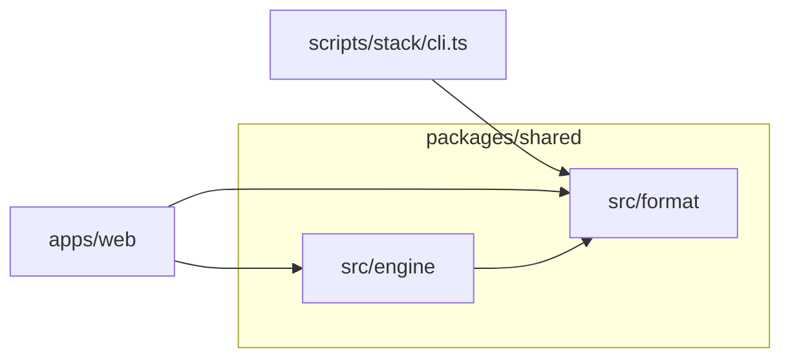
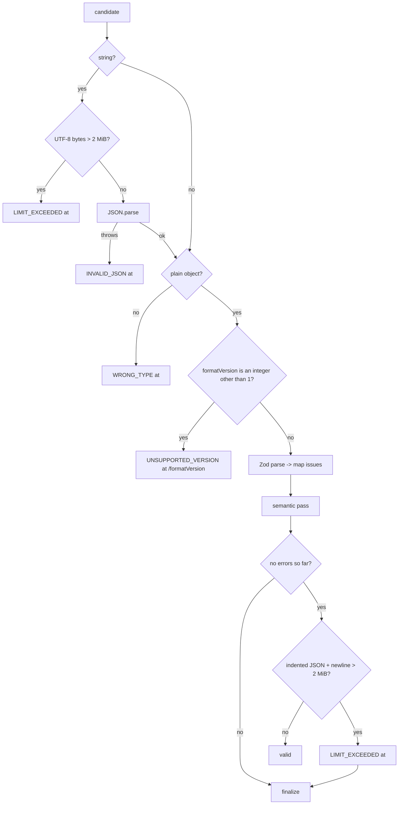

# Design Document

## Overview

This design turns `requirements.md` into modules, schemas, algorithms, and tests for the thin slice: a strict subset of the Stack_Format, a validator, a pure executor, a CLI, and a retro React shell that plays a three-card to-do stack. It builds on the repo scaffold (pnpm workspaces, Vite 8, Vitest 5, Playwright, one Worker that serves `apps/web/dist`). It contains no AI, no network call other than loading the app, and no persistence.

Key decisions:

- **Subset by construction.** Every name, bound, code, and result shape comes from `stack-format-and-validator` and `stack-engine`. Unsupported Object and Action types are rejected by the discriminated unions and reported as `INVALID_VALUE`. The full specs add union members later and change nothing that exists.
- **Zod is the schema, a small mapper is the validator.** One Zod 4 parse produces the structural issues. A mapper turns them into `Validation_Error`s. A separate, tolerant semantic pass walks the raw candidate for cross-entity rules. Both feed one sort-and-truncate step.
- **Shared sources run under Node type stripping.** `packages/shared/src` uses explicit `.ts` import specifiers and erasable syntax only, so `node scripts/stack/cli.ts` imports it with no build step. Verified, see [Module resolution and tooling](#module-resolution-and-tooling).
- **One Zustand store, no timers inside it.** The store is a plain state machine. The 4-second Status_Message expiry is a React effect, so the store is testable without fake timers.
- **Everything visual is a token.** Positions use CSS custom properties (`--x`, `--y`, `--scale`) multiplied by `--px`, so no length literal appears in a component CSS file and the CSS scan test can be strict.
- **The slice states its limits in the UI.** A notice on every card says nothing is saved. The Ghost window says AI arrives later.

## Architecture

### File tree

New or changed files only. Existing scaffold files are not listed unless they change.

```
hypergeist/
├── package.json                        + "stack" script, + devDependency @hypergeist/shared (workspace:*)
├── tsconfig.base.json                  + allowImportingTsExtensions
├── eslint.config.mjs                   + no-restricted-imports rule for .ts specifiers
├── .prettierignore                     + scripts/stack/fixtures
├── README.md                           run steps, CLI docs, slice limits
├── docs/assets-licenses.md             + Pixelify Sans, VT323, Ghost sprite rows
├── e2e/thin-slice.spec.ts              new Playwright tests (smoke.spec.ts unchanged)
├── scripts/stack/
│   ├── cli.ts                          entry: reads argv and file, sets process.exitCode
│   ├── run.ts                          pure: run(argv, readText) -> { stdout, stderr, exitCode }
│   ├── run.test.ts                     unit tests with an injected reader
│   ├── cli.test.ts                     child-process tests (Demo_Stack, fixture, missing file)
│   └── fixtures/{invalid-stack.json,not-json.txt}
├── packages/shared/
│   ├── test-support/arbitraries.ts     fast-check generators (stacks, handlers, mutations)
│   └── src/
│       ├── format/
│       │   ├── index.ts                public API (see below)
│       │   ├── limits.ts               LIMITS, constants, type lists
│       │   ├── schemas.ts              Zod schemas + z.infer types
│       │   ├── errors.ts               codes, ValidationError, ValidationResult
│       │   ├── text.ts                 utf8ByteLength, codePointLength, pointer helpers
│       │   ├── zod-issues.ts           Zod issue -> RawError mapper
│       │   ├── semantic.ts             entity index + tolerant walk
│       │   ├── finalize.ts             document order, sort, truncate, build errors
│       │   ├── validate.ts             validateStack, validateHandler
│       │   └── *.test.ts, *.property.test.ts
│       └── engine/
│           ├── index.ts                public API: executeHandler, types
│           ├── types.ts                ExecutionResult, EffectRequest
│           ├── stack-edit.ts           immutable helpers: findObject, replaceObject, textOf
│           ├── execute-handler.ts      the executor loop
│           └── *.test.ts, *.property.test.ts
└── apps/web/
    ├── package.json                    + zustand, @fontsource/pixelify-sans, @fontsource/vt323
    ├── tsconfig.json                   + types: ["vite/client"]
    ├── vite.config.ts                  + build.assetsInlineLimit: 0
    └── src/
        ├── main.tsx                    imports fonts and styles, renders App
        ├── App.tsx                     load, validate, error screen or Desktop
        ├── vite-env.d.ts               /// <reference types="vite/client" />
        ├── stacks/{thin-slice-todo.json, load-stack.ts}
        ├── state/{stack-store.ts, hints.ts, StackStoreContext.tsx}
        ├── lib/{canvas-scale.ts, accessible-name.ts, property-rows.ts, css-vars.ts}
        ├── components/
        │   ├── Desktop.tsx  MenuBar.tsx  ModeControl.tsx  StackWindow.tsx
        │   ├── Canvas.tsx  ObjectView.tsx  SelectionOverlay.tsx  LinkBar.tsx
        │   ├── PropertyReadout.tsx  StatusBar.tsx  GhostWindow.tsx  GhostSprite.tsx
        │   └── LoadErrorScreen.tsx
        └── styles/
            ├── tokens.css  base.css  window.css  controls.css  canvas.css  ghost.css
            └── scan-css.ts + css-tokens.test.ts
```

Tests sit next to the code as `*.test.tsx` and `*.test.ts`. Property tests exist only in `packages/shared` (see Open Items).

### Module boundaries



- `format` imports Zod and its own files only. `engine` imports `../format/index.ts`, never the reverse. Both are pure: no I/O, no clock, no randomness, no DOM, and no global that `lib: ["ES2022"]` lacks (so no `TextEncoder`; `utf8ByteLength` is hand-written).
- Apps import `@hypergeist/shared/format` and `@hypergeist/shared/engine` only (`pnpm check:deps` enforces it).
- `scripts/stack/cli.ts` imports `@hypergeist/shared/format`. It resolves through `node_modules/@hypergeist/shared`, which pnpm links once the root `package.json` declares the workspace dependency (Requirement 20.3).

### Public API of `@hypergeist/shared/format`

```ts
// constants
export const FORMAT_VERSION: 1;
export const ENTITY_ID_PATTERN: RegExp;
export const SUPPORTED_OBJECT_TYPES, UNSUPPORTED_OBJECT_TYPES: readonly string[];
export const SUPPORTED_ACTION_TYPES, UNSUPPORTED_ACTION_TYPES: readonly string[];
export const LIMITS: { ... };
export const VALIDATION_ERROR_CODES: readonly [...14 codes];
// schemas and types (z.infer)
export { StackSchema, CardSchema, LinkSchema, ButtonSchema, FieldSchema, ListSchema,
         ObjectSchema, ActionSchema, HandlerSchema,
         GoToCardActionSchema, SetValueActionSchema, AppendItemActionSchema, ShowMessageActionSchema };
export type { Stack, Card, Link, StackObject, ButtonObject, FieldObject, ListObject,
              Action, Handler, ValidationError, ValidationErrorCode, ValidationResult };
// functions
export function validateStack(candidate: unknown): ValidationResult;
export function validateHandler(stack: Stack, candidate: unknown): ValidationResult;
```

`validateHandler` is the one addition beyond Requirement 1. The executor needs it for Requirement 8.12, and the full `set_action` operation needs the same rules. Its error paths are relative to the Handler (root path `""`).

`engine/index.ts` exports `executeHandler`, `ExecutionResult`, and `EffectRequest`.

## Module resolution and tooling

The CLI imports shared TypeScript source through Node. Everything below was checked in a scratch project outside the repo, using the repo's own tools (TypeScript 6.0.3, Vite 8.3.8, Vitest 5.1.0, Node 25.2.1, Zod 4.6.7). The scratch project mirrored the layout: a package whose `exports` points at `src/*.ts`, linked into `node_modules` by symlink, a relative import written as `./limits.ts`, and a Zod import inside the linked package.

| Tool | Result | What the slice must do |
|---|---|---|
| Node | `node scripts/cli.ts` runs the linked package, including `import { z } from 'zod'` resolved from the package's own `node_modules`. Node resolves the symlink to the real path, so the file is not under `node_modules` and type stripping applies. | Write every relative import in `packages/shared/src` and `scripts` with a `.ts` extension, including `./dir/index.ts` (no directory shorthand). Use `import type` for types. No enums, namespaces, or parameter properties (`erasableSyntaxOnly` already enforces this). |
| TypeScript 6.0.3, `moduleResolution: "Bundler"` | Without the flag, `tsc` fails with TS5097 on `./limits.ts`. With `allowImportingTsExtensions: true` it passes and prints no deprecation warning. | Put `allowImportingTsExtensions: true` in `tsconfig.base.json`. It is legal there because the base already sets `noEmit: true`. Without it, `apps/web`, `apps/worker`, and `packages/shared` fail typecheck on the first `.ts` specifier. `scripts/` and `e2e/` already set it. |
| Vite 8.3.8 | `vite build` bundled the `.ts` specifiers and the linked package, and `import raw from './x.json?raw'` returned the file text. | No config change for `.ts` specifiers. Add `/// <reference types="vite/client" />` in `src/vite-env.d.ts`, because with `types: []` TypeScript otherwise cannot resolve `?raw` (TS2307 observed). Set `build.assetsInlineLimit: 0` so the two fonts always emit as files. |
| Vitest 5.1.0 | Ran a test that imports the linked package and a `?raw` file with no config. | None. |
| ESLint 10 | The scaffold config does not check import extensions. | Add the rule below so a missing `.ts` fails lint instead of failing the CLI at run time. |

```js
// eslint.config.mjs, new block
{
  files: ['packages/shared/src/**/*.ts', 'scripts/**/*.ts'],
  rules: {
    'no-restricted-imports': ['error', { patterns: [{
      regex: '^\\.{1,2}(/.*)?(?<!\\.ts)$',
      message: 'Relative imports here must end in .ts so Node can run them.',
    }] }],
  },
}
```

Notes and limits of the check:

- Only Node 25.2.1 was available. On Node 22.18 type stripping is on by default but prints an `ExperimentalWarning` to stderr. The CLI tests therefore spawn `node --disable-warning=ExperimentalWarning scripts/stack/cli.ts ...` so the "stderr holds one line" assertion is stable. The `stack` script itself stays exactly `node scripts/stack/cli.ts` (Requirement 10.1).
- The existing `packages/shared/test-support/seed.test.ts` imports `./seed`. That folder is outside the lint scope above (only Vitest loads it), so it can stay.
- The Worker bundles through esbuild, which accepts explicit `.ts` paths. The Worker does not import the shared package in this slice, so this was not exercised.
- Root `package.json` gains `"@hypergeist/shared": "workspace:*"` in `devDependencies`. The implementer runs `pnpm install` to link it and update `pnpm-lock.yaml`. No third-party package is added.

## Components and Interfaces

### Format: limits and schemas

`limits.ts` holds one flat table. Each entry is `{ min, max }` unless noted. The values are those of Requirements 2, 3, and 4, which equal the full specs.

```ts
export const LIMITS = {
  stackName: { min: 1, max: 100 },       cardSize: { min: 64, max: 4096 },
  cards: { min: 1, max: 200 },           cardName: { min: 1, max: 100 },
  objectsPerCard: { min: 0, max: 100 },  linksPerCard: { min: 0, max: 50 },
  linkLabel: { min: 1, max: 100 },       objectName: { min: 0, max: 100 },
  objectPosition: { min: 0, max: 4096 }, objectSize: { min: 8, max: 4096 },
  buttonLabel: { min: 1, max: 100 },     fieldValue: { min: 0, max: 10_000 },
  fieldPlaceholder: { min: 0, max: 200 }, listItems: { min: 0, max: 500 },
  listItemText: { min: 0, max: 500 },    handlerActions: { min: 0, max: 20 },
  setValueText: { min: 0, max: 10_000 }, appendItemText: { min: 0, max: 500 },
  messageText: { min: 1, max: 500 },
  maxDocumentBytes: 2_097_152, maxErrors: 100, actualMaxChars: 200,
} as const;
```

`schemas.ts` declares properties in the order the requirements list them (`formatVersion, id, name, cardWidth, cardHeight, startCardId, remixedFrom, cards`; Objects as `id, type, name, x, y, width, height, ...specific`). A later Stack_Serializer can use declaration order as the canonical key order.

```ts
const EntityId = z.string().regex(ENTITY_ID_PATTERN);

/** min is 0 or 1 everywhere, so the UTF-16 length check is exact for min.
 *  max counts Unicode code points, which z.string().max() does not. */
function text(min: number, max: number) {
  return z.string().min(min).check((ctx) => {
    if (ctx.value.length > max && [...ctx.value].length > max) {
      ctx.issues.push({ code: 'too_big', origin: 'string', maximum: max, inclusive: true, input: ctx.value });
    }
  });
}
const int = (min: number, max: number) => z.int().min(min).max(max);

const SetValue = z.strictObject({
  type: z.literal('set_value'), targetObjectId: EntityId,
  value: text(0, 10_000).optional(), fromObjectId: EntityId.optional(),   // exactly-one-of: semantic pass
});
// GoToCard, AppendItem, ShowMessage follow the same shape.
export const ActionSchema = z.discriminatedUnion('type', [GoToCard, SetValue, AppendItem, ShowMessage]);
export const HandlerSchema = z.array(ActionSchema).max(LIMITS.handlerActions.max);

export const ObjectSchema = z.discriminatedUnion('type', [Button, Field, List]);   // strict members
export const CardSchema = z.strictObject({ id: EntityId, name: text(1, 100), objects: z.array(ObjectSchema).max(100),
  links: z.array(LinkSchema).max(50), onOpen: HandlerSchema });
export const StackSchema = z.strictObject({ formatVersion: z.literal(1), id: EntityId, name: text(1, 100),
  cardWidth: int(64, 4096), cardHeight: int(64, 4096), startCardId: EntityId, remixedFrom: EntityId.optional(),
  cards: z.array(CardSchema).min(1).max(200) });
export type Stack = z.infer<typeof StackSchema>;   // and so on for every exported type
```

Why the exactly-one-of rule is not a Zod refinement: Zod 4 skips a `refine` on an object when a sibling property already has a type issue, and refinements do not survive `z.toJSONSchema()`. Both properties are therefore optional in the schema and the semantic pass reports `INVALID_VALUE` at the Action (Requirement 4.6).

Zod 4.6.7 behavior that the mapper relies on (probed, not assumed):

| Situation | Zod issue |
|---|---|
| Unknown key in a strict object | `unrecognized_keys`, `keys: string[]`, `path` is the parent |
| Absent required key | `invalid_type`, `path` ends in the missing key |
| Non-integer number with `z.int()` | `invalid_type` with `expected: "int"` |
| Wrong JSON type | `invalid_type` with the expected type name |
| String or array over the maximum | `too_big`, `origin: "string"` or `"array"` |
| Number over a maximum | `too_big`, `origin: "number"` |
| Minimum violated (string, array, number) | `too_small` |
| Regex fails | `invalid_format`, `format: "regex"` |
| Literal mismatch | `invalid_value`, `values: [1]` |
| No union member matches `type` (absent, wrong type, unknown, unsupported) | `invalid_union`, `note: "No matching discriminator"`, `path` already ends in `type` |
| Array longer than its maximum | `too_big` only. **Element issues inside that array are not reported.** |

### Format: structural mapping

`zod-issues.ts` maps each Zod issue to zero or more `RawError`s. A `RawError` is `{ code, segments, message, expected, hint, actual }`, where `segments` is the path as an array and `actual` is the offending value or an `absent` marker. JSON Pointers are produced at the end, escaping `~` as `~0` and `/` as `~1`.

| Zod issue | Result |
|---|---|
| `unrecognized_keys` | One `UNKNOWN_PROPERTY` per key, path `parent/key` |
| `invalid_type`, value absent at the path (own-property check on the parent) | `MISSING_PROPERTY` at the parent path |
| `invalid_type` with `expected: "int"` | `INVALID_VALUE` (a JSON number, but not an integer) |
| other `invalid_type` | `WRONG_TYPE` at the path |
| `too_big` on string or array | `LIMIT_EXCEEDED` |
| `too_big` on number, any `too_small`, `invalid_format` | `INVALID_VALUE` |
| `invalid_value`, `typeof` input differs from the allowed values | `WRONG_TYPE` |
| other `invalid_value` | `INVALID_VALUE` |
| `invalid_union` with the discriminator note | see below |
| anything else | `INVALID_VALUE`, message taken from Zod |

**Unsupported-type handling.** For a discriminator issue, the mapper reads the value at the `type` path:

1. `type` absent: `MISSING_PROPERTY` at the Object or Action path.
2. `type` not a string: `WRONG_TYPE` at `.../type`.
3. `type` in `UNSUPPORTED_OBJECT_TYPES` or `UNSUPPORTED_ACTION_TYPES`: `INVALID_VALUE` at `.../type`. Message: `The object type "image" is not supported in this release.` Hint: `Use one of: button, field, list.` (or the action list).
4. Any other string: `INVALID_VALUE` at `.../type`. Message: `The object type "x" is unknown.` Same hint.

Because the union fails before it looks at other properties, Requirement 5.4 (no other property-level error for that node) holds with no extra code. The semantic pass registers the node's `id` for duplicate detection but runs no other check on it. A reference that points at an unsupported-type Object resolves, and fails with `WRONG_REFERENCE_TYPE` because the Object is not a Field or List.

Each error needs a non-empty `expected` and `hint`. They come from one small table keyed by the error kind: for example `expected: "an array of at most 20 items"` and `hint: "Remove 3 items from this array."`, computed from the issue's `maximum`, `minimum`, `expected`, or `values`.

### Format: semantic pass

`semantic.ts` walks the raw candidate with type guards (`isRecord`, `isArray`, `isString`). It skips any subtree that does not have the expected shape, because the structural pass reports those. This keeps Requirement 6.4 (every violation reported) true when structural and semantic problems coexist.

1. **Index (document order).** For each Card, register the Card `id`, then each Object `id`, then each Link `id`. The index maps `id` to `{ kind: 'card' | 'object' | 'link', objectType?: string }`. A second occurrence of an `id` adds `DUPLICATE_ID` at `.../id` of the later occurrence. The first occurrence stays in the index.
2. **References.** A reference check takes the value, its path, and the allowed targets. A non-string value is skipped. An id missing from the index gives `DANGLING_REFERENCE`. An id whose kind or Object type is not allowed gives `WRONG_REFERENCE_TYPE`.

   | Reference property | Allowed target |
   |---|---|
   | `startCardId`, Link `targetCardId`, `go_to_card.cardId` | Card |
   | `set_value.targetObjectId` | Object of type `field` |
   | `set_value.fromObjectId` | Object of type `field` or `list` |
   | `append_item.targetObjectId` | Object of type `list` |
   | `append_item.fromObjectId` | Object of type `field` |

3. **Exactly-one-of.** For `set_value` (`value` or `fromObjectId`) and `append_item` (`item` or `fromObjectId`), both present or both absent gives `INVALID_VALUE` at the Action path.
4. **Bounds.** For an Object of a supported type whose `x`, `y`, `width`, `height` and the Stack `cardWidth`, `cardHeight` are finite numbers: `x + width > cardWidth` or `y + height > cardHeight` gives one `OUT_OF_BOUNDS` at the Object path. Sums that equal the card size pass.
5. **Duplicate links.** In each Card, a Link whose `targetCardId` equals an earlier Link's gives `DUPLICATE_LINK` at `.../targetCardId` of the later Link. A Link to its own Card and equal targets across different Cards are accepted.
6. **Handlers.** Buttons (`onClick`) and Cards (`onOpen`) are walked with the same function that `validateHandler` uses, so there is one implementation of the Handler rules.

### Format: validation pipeline



The early exits (`X1` to `X4`) each return exactly one error, matching Requirements 6.8 to 6.11. All other errors go through `finalize`.

**Finalize (`finalize.ts`).**

1. For each `RawError`, compute a document-order key: walk the candidate along `segments`. At an array, the key element is the index. At an object, it is the position of the property in `Object.keys(container)`. Missing-property errors already point to an existing ancestor, so every key resolves.
2. Sort by key, comparing element by element with a shorter prefix first (parent before child), then by `code` in ascending code-point order. `Array.prototype.sort` is stable, and both passes emit errors in a fixed order, so equal keys stay deterministic.
3. Keep the first 100. `truncated` is true when more than 100 existed.
4. Only for the kept errors, build the final `ValidationError` with the pointer string and `actual`. `actual` is `JSON.stringify(value)` cut to 200 code points, or `null` when the property is absent. A value that `JSON.stringify` cannot serialize falls back to `String(value)`.

The result object is `{ valid: errors.length === 0, errors, truncated }`, and each error is built with keys in the order `code, path, message, expected, actual, hint`.

**Size check placement.** The indented-size check (Requirement 6.12) runs only when no other violation exists, because only then is the candidate a Stack with a defined canonical length. See Open Items.

### Engine: executor

```ts
export type EffectRequest = never;   // the full engine widens this union; no slice code creates one
export type ExecutionResult = {
  readonly stack: Stack;
  readonly effects: readonly EffectRequest[];
  readonly navigateTo?: string;
  readonly messages: readonly string[];
};
export function executeHandler(stack: Stack, handler: Handler): ExecutionResult;
```

Algorithm:

```
executeHandler(stack, handler):
  1. if !validateStack(stack).valid        -> return { stack, effects: [], messages: [INVALID_STACK] }
  2. if !validateHandler(stack, handler).valid -> return { stack, effects: [], messages: [INVALID_HANDLER] }
  3. state = { stack, messages: [], navigateTo: undefined }
     for (i, action) of handler:
        switch action.type:
          show_message: state.messages += action.text
          go_to_card:   state.navigateTo = action.cardId; stop the loop
          set_value:    next = withObject(state.stack, target, { ...target, value: newText })
          append_item:  if target.items.length >= 500: messages += LIST_FULL(target); continue
                        next = withObject(state.stack, target, { ...target, items: [...target.items, itemText] })
        for set_value / append_item: if validateStack(next).valid -> state.stack = next
                                     else messages += `Skipped action ${i + 1} (${type}): the result would not be a valid stack.`
  4. return { stack: state.stack, effects: [], messages, ...(navigateTo === undefined ? {} : { navigateTo }) }
```

- `newText` for `set_value` is `action.value`, or `textOf(source)` for `fromObjectId`. `itemText` for `append_item` is `action.item`, or `textOf(source)`. `textOf(list)` is `items.join('\n')`, `textOf(field)` is `value`, anything else is `''`.
- `withObject` rebuilds only the path to the changed Object (`{...stack, cards: stack.cards.map(...)}`). It never writes to an input, so deeply frozen inputs work.
- A `go_to_card` target exists because step 2 checked it. Actions that name a missing Object cannot reach step 3 for the same reason. The skip branch therefore fires only when an otherwise legal action would break a limit (for example a List joined into a Field past 10,000 characters, or a Field copied into a List past 500 characters).
- The executor writes to `readOnly` Fields. The format has no rule against it, and only the typing UI honors `readOnly`.
- Cost: each `set_value` and `append_item` re-validates the whole Stack. The demo stack is small, and the 2 MiB document limit bounds the worst case. The web app calls the executor once per keystroke in a Field.
- Messages are fixed strings: `The stack is not valid, so no actions ran.`, `The handler is not valid for this stack, so no actions ran.`, `The list "<name or id>" is full (500 items).`, and the skip text above.

### CLI

```
pnpm stack validate <file>      (root script: "stack": "node scripts/stack/cli.ts")
```

`run(argv: readonly string[], readText: (path: string) => string): { stdout: string; stderr: string; exitCode: 0 | 1 | 2 }` is pure, so unit tests need no file system. `cli.ts` wires it to `fs.readFileSync(path, 'utf8')` and writes the result.

| Case | stdout | stderr | Exit |
|---|---|---|---|
| `validate <file>` and `valid: true` | `JSON.stringify(result, null, 2)` + newline | empty | 0 |
| `valid: false` (including `INVALID_JSON`) | same | empty | 1 |
| no subcommand, other subcommand, missing path, extra arguments | empty | `usage: pnpm stack validate <file>` | 2 |
| file unreadable (missing, directory, permission) | empty | `stack: cannot read "<file>": <error code>` | 2 |

The file text goes to `validateStack` unparsed (Requirement 10.7). Relative paths resolve from the process working directory, which `pnpm` sets to the repo root. The CLI never writes files and makes no network call.

### Web: state

`state/stack-store.ts` exports `createStackStore(stack: Stack)` (Zustand `createStore` from `zustand/vanilla`). `StackStoreContext.tsx` provides one instance to the tree and exposes `useStackStore(selector)` through `useStore`. The app creates the store once, after the startup validation passes.

```ts
export type Mode = 'interact' | 'edit';
type StatusMessage = { readonly text: string; readonly seq: number };

type StackState = {
  stack: Stack;
  currentCardId: string;
  mode: Mode;
  selectedObjectId: string | null;
  status: StatusMessage | null;     // null shows the hint of the current mode
};
type StackActions = {
  setMode(mode: Mode): void;        // clears selection and status
  toggleMode(): void;               // Alt+M
  selectObject(id: string): void;   // edit only; no-op otherwise or for an id not on the current card
  clearSelection(): void;           // Escape in edit mode
  activateButton(id: string): void; // interact only; runs executeHandler(stack, button.onClick)
  typeInField(id: string, text: string): void; // interact, field not readOnly; executeHandler with one set_value
  followLink(id: string): void;     // interact only
  expireStatus(seq: number): void;  // clears status only if seq still matches
};
```

Rules, each tied to a requirement:

- Every action that changes `stack` stores `result.stack`, then handles `navigateTo` (set `currentCardId`, clear selection and status), then `applyMessages(result.messages)`.
- `applyMessages([])` changes nothing (15.6). Otherwise it sets `status = { text: messages.join(' '), seq: previousSeq + 1 }` (15.1).
- `setMode`, `followLink`, and a card change clear `status` before anything else, so the new Mode or Card shows its own hint (15.3).
- An action called in the wrong mode, or with an unknown id, is a no-op. Edit mode never calls the executor (16.1, 16.2).
- `selectedObjectId` is an id, not an object, so `Selection` is derived and cannot go stale.

The 4-second expiry is a hook in `StatusBar.tsx`:

```ts
useEffect(() => {
  if (status === null) return;
  const timer = setTimeout(() => expireStatus(status.seq), 4000);
  return () => clearTimeout(timer);
}, [status?.seq]);
```

A new status has a new `seq`, so the effect cleans up and restarts the period (15.3). Tests use `vi.useFakeTimers()`.

`state/hints.ts` holds the two hint strings: `Interact mode. Click buttons, type in fields, follow links. Alt+M switches to Edit mode.` and `Edit mode. Select an object to inspect it. Escape clears the selection. Alt+M switches to Interact mode.`

`stacks/load-stack.ts` wraps startup: `loadStack(text)` calls `validateStack(text)`. If valid, it returns `{ ok: true, stack: StackSchema.parse(JSON.parse(text)) }`. The second parse cannot fail for valid text, and it gives a typed value without a cast. Otherwise it returns `{ ok: false, errors }`. `main.tsx` imports `./stacks/thin-slice-todo.json?raw`, and `App` takes an optional `stackText` prop so tests can pass invalid text.

### Web: component tree

```
App
├─ LoadErrorScreen          (invalid startup text: header with h1 "HyperGeist", list of code, path, message)
└─ StackStoreProvider
   └─ Desktop               (global key listener: Alt+M via event.code === 'KeyM', Escape in edit mode)
      ├─ MenuBar            <header>: SpiritGlyph (aria-hidden), <h1>HyperGeist</h1>, ModeControl
      ├─ <main class="desktop-main">
      │  └─ StackWindow     <section aria-labelledby=title>
      │     ├─ title bar    (--stripe, stack name; no close or expand box, nothing to close)
      │     ├─ CanvasFrame  (measured with ResizeObserver) > Canvas > ObjectView*, SelectionOverlay
      │     ├─ LinkBar      <nav aria-label="Card links">
      │     ├─ Notice       <p role="note">Changes are not saved. Reloading the page resets this stack.</p>
      │     ├─ PropertyReadout   (edit mode only)
      │     └─ StatusBar    <footer aria-label="Status">: "Card 1 of 3", "Mode: Interact", Hint_Line <p role="status">
      └─ <aside class="rail"> GhostWindow
```

- **ModeControl** is a native radio group (`role="radiogroup"`, two `<input type="radio">` styled as segments). One Tab stop, arrow keys switch, and the checked state is exposed with no custom ARIA.
- **Canvas** sets `--card-w`, `--card-h`, and `--scale` and a `data-mode` attribute. `CanvasFrame` observes its own size and calls `chooseCanvasScale`. Without `ResizeObserver` (jsdom) the scale is 1.

  ```ts
  export function chooseCanvasScale(avail: { w: number; h: number }, card: { w: number; h: number }): 1 | 2 | 3 {
    for (const s of [3, 2, 1] as const) if (card.w * s <= avail.w && card.h * s <= avail.h) return s;
    return 1;
  }
  ```

  The scale can change when Edit mode opens the Property_Readout and shrinks the frame. The design accepts that, because the alternative (a reserved empty area in Interact mode) wastes the space.
- **ObjectView** in Interact mode renders native controls: `<button>`, `<input type="text">` or `<textarea>` (controlled from the store), and `<ul>` or `<ol>` with `tabindex="0"` and `overflow: auto`. In Edit mode it renders a wrapper `<div role="button" tabindex="0" aria-pressed aria-label="<accessible name> (<type>)">` around a non-interactive preview (`inert`, `aria-hidden`). Click, Enter, and Space on the wrapper select the Object. Typing and Link clicks therefore cannot reach the real controls (16.2).
- **Positioning** is CSS only. `css-vars.ts` returns `{ '--x': 16, '--y': 48, '--w': 380, '--h': 28 }` for the `style` prop (one cast, commented). The CSS computes `left: calc(var(--x) * var(--scale) * var(--px))`, and likewise for the other three.
- **Text size on the canvas** follows the scale through `data-scale`: 12 px at 1x, 24 px at 2x, 32 px at 3x, all from `--fs-*` tokens.
- **Read-only Field** (14.3, 19.6). The Field frame gets `--dither-50` and the text control inside it is paper with ink text. A text run on a checkerboard would break the 4.5:1 rule. See Open Items.
- **SelectionOverlay** draws a dashed `--border` ink outline with 8 `<span>` handles (`aria-hidden`, `pointer-events: none`, no handlers) at the Object's `--x/--y/--w/--h`.
- **PropertyReadout** is `<section aria-label="Properties">` holding a `<dl>`. `propertyRows(obj)` returns `{ label, text }[]`: `id, type, name, x, y, width, height`, then the type-specific properties. Strings print as-is, an empty string prints as `""`, and other values print with `JSON.stringify`. With no Selection it shows `Select an object to see its properties.`
- **LinkBar** renders each Link as a `<button>`. In Edit mode they get `aria-disabled="true"` and ignore clicks but stay in the Tab order.
- **GhostWindow** is `<aside aria-label="Ghost is asleep. AI arrives in a later release.">` with a title bar reading "Ghost", an inline SVG sprite built from a pixel-map constant (original artwork, drawn at implementation time, at most 24 by 24 cells, fills from `--ink` and `--paper`), and `<p>AI arrives in a later release</p>` in VT323. It has no interactive element and no animation. The Ghost occupies the right-hand rail of the Desktop grid, so it never covers the Stack_Window.
- **Tab order** is DOM order: ModeControl, then Objects in `objects` order (inside Canvas), then LinkBar buttons (19.1).
- **Accessible name** (`accessible-name.ts`): `name`, else `label` (Button) or `placeholder` (Field), else `id` (19.4).
- **Status bar text:** `Card ${index + 1} of ${cards.length}`, `Mode: Interact` or `Mode: Edit`, then the Hint_Line (`role="status"`, polite).

### Web: styles

`tokens.css` is the only file with literals. It defines the tokens required by Requirement 12.1 and these additions, all derived from `--px`:

| Group | Tokens |
|---|---|
| Palette | `--ink`, `--paper`, `--ghost` (defined, never referenced) |
| Geometry | `--px`, `--border`, `--shadow-offset`, `--menubar-h`, `--titlebar-h`, `--radius` (0), `--hit-min` (24 px), `--focus-w` (2 px), `--focus-offset`, `--statusbar-h`, `--rail-w`, `--readout-w`, `--handle-size`, `--space-1` to `--space-4` |
| Type | `--font-ui`, `--font-mono`, `--fs-12`, `--fs-16`, `--fs-24`, `--fs-32` |
| Dither | `--dither-50`, `--dither-25`, `--dither-75`, `--stripe` |

The dither tokens are `url("data:image/svg+xml,...")` values holding tiny SVG tiles with `shape-rendering='crispEdges'`:

- `--dither-50`: 2 by 2 checkerboard, ink on paper.
- `--dither-25`: 2 by 2 with one ink cell.
- `--dither-75`: 2 by 2 with three ink cells.
- `--stripe`: 1 by 2, one ink row.

A component paints one with `background: var(--paper) var(--dither-50)`. An SVG data URI cannot read CSS variables, so the tiles repeat the two hex values of `--ink` and `--paper`. A test checks that they match.

Fonts load in `main.tsx` with `import '@fontsource/pixelify-sans/400.css'` and `import '@fontsource/vt323/400.css'`. Fontsource declares `font-family: 'Pixelify Sans'` and `'VT323'` and bundles woff2 and woff files, which Vite emits into `dist/assets`. Importing from TypeScript keeps those third-party CSS files out of the scan. `--font-ui` is `"Pixelify Sans", monospace` and `--font-mono` is `"VT323", monospace`.

`base.css` sets `-webkit-font-smoothing: none; font-smooth: never;` on the desktop, paints the desktop with `--dither-50`, uses the `--ink` and `--paper` pair only, and holds the focus rule `:focus-visible { outline: var(--focus-w) dashed var(--ink); outline-offset: var(--focus-offset); }`. It also ends with `@media (prefers-reduced-motion: reduce) { *, *::before, *::after { animation: none !important; transition: none !important; } }`. The slice declares no animation or transition at all. The guard keeps the rule true for later work.

`canvas.css` sets `image-rendering: pixelated`, `cursor: pointer` for `[data-mode='interact']`, and `cursor: crosshair` for `[data-mode='edit']`. The pressed state is `button:active { background: var(--ink); color: var(--paper); }`.

The slice uses no width media queries, because a media query cannot read a token and the scan would reject a literal breakpoint.

### CSS token scan test

`styles/scan-css.ts` exports `scanCss(text: string): Finding[]`. It removes comments, then reports:

- a hex color (`#` followed by 3, 4, 6, or 8 hex digits), a color function (`rgb`, `rgba`, `hsl`, `hsla`, `hwb`, `lab`, `lch`, `oklab`, `oklch`, `color`, `color-mix`), or a named color keyword in a declaration value (the CSS named-color list as data, minus `transparent` and `currentcolor`);
- a `font-family` or `font` declaration whose value is not made only of `var(--...)` references;
- a number followed by `px`, `rem`, or `em`;
- a `linear-gradient`, `radial-gradient`, `conic-gradient`, or `blur(` function, or an `opacity` declaration (the design language bans gradients, blur, and opacity tints).

`css-tokens.test.ts` loads every CSS file with `import.meta.glob('./**/*.css', { query: '?raw', import: 'default', eager: true })`. This needs no Node types in the web tsconfig. For each file other than `tokens.css` it asserts `scanCss(text)` is empty and that the text does not contain `--ghost`. It also checks that `tokens.css` defines every required token name, that the dither tiles contain the `--ink` and `--paper` hex values, that `base.css` holds both font-smoothing declarations, and that the TSX sources do not mention `--ghost` (a second glob over `./**/*.tsx`). Scanner unit tests feed passing and failing snippets for each rule.

### Demo_Stack

`apps/web/src/stacks/thin-slice-todo.json`, written with Prettier (so `format:check` passes). Stack `id` is `thin-slice-todo`, `name` is "Thin slice to-do", `cardWidth` 512, `cardHeight` 342, `startCardId` `todo`, `formatVersion` 1. Every Card has `onOpen: []`.

| Card | Entity | Type | Position (x, y, w, h) and content |
|---|---|---|---|
| To-do `todo` | `todo-input` | field, name "New item" | 16, 16, 380, 28. `value: ""`, `placeholder: "What needs doing?"`, single-line, not read-only |
| | `todo-add` | button, name "Add item" | 408, 16, 88, 28. `label: "Add"`, `onClick`: `append_item` (target `todo-list`, from `todo-input`), `set_value` (target `todo-input`, `value: ""`), `show_message` ("Item added.") |
| | `todo-list` | list, name "To-do items" | 16, 56, 480, 240. `items: []`, `ordered: false` |
| | `todo-link-about` | link | label "About this stack", target `about` |
| About `about` | `about-text` | field, name "About", read-only, multi-line | 16, 16, 480, 240. Describes the stack |
| | `about-back` | button | 16, 272, 120, 28. `label: "Back to to-do"`, `go_to_card` to `todo` |
| | `about-link-limits` | link | label "Limits", target `limits` |
| Limits `limits` | `limits-text` | field, name "Limits", read-only, multi-line | 16, 16, 480, 240. Says changes are not saved, AI arrives in a later release, and adding with an empty field appends an empty item |
| | `limits-back` | button | 16, 272, 120, 28. `label: "Back to about"`, `go_to_card` to `about` |

The "Item added." message also appears when the list is full, after the executor's "list is full" message. This is a known limit of a format with no conditionals, and the Limits card does not claim otherwise.

## Data Models

Stack data is the Zod-derived types above (`Stack`, `Card`, `Link`, `StackObject` = `ButtonObject | FieldObject | ListObject`, `Action`, `Handler`). The remaining shapes are:

```ts
type ValidationErrorCode = typeof VALIDATION_ERROR_CODES[number];
// INVALID_JSON, MISSING_PROPERTY, UNKNOWN_PROPERTY, WRONG_TYPE, INVALID_VALUE, OUT_OF_RANGE, DUPLICATE_ID,
// DANGLING_REFERENCE, WRONG_REFERENCE_TYPE, OUT_OF_BOUNDS, LIMIT_EXCEEDED, UNSUPPORTED_VERSION,
// DUPLICATE_LINK, UNKNOWN_ENTITY    (the slice validator never returns OUT_OF_RANGE or UNKNOWN_ENTITY)

type ValidationError = {
  code: ValidationErrorCode; path: string;      // RFC 6901, root is ""
  message: string; expected: string; actual: string | null; hint: string;   // actual: JSON, at most 200 code points
};
type ValidationResult = { valid: boolean; errors: ValidationError[]; truncated: boolean };
```

`ExecutionResult` is defined above. There is no stored data other than the in-memory store, and no persistence (Requirement 18).

## Correctness Properties

*A property is a characteristic or behavior that should hold true across all valid executions of a system-essentially, a formal statement about what the system should do. Properties serve as the bridge between human-readable specifications and machine-verifiable correctness guarantees.*

All properties run in `packages/shared` through `assertProperty` from `test-support/seed.ts` (default 100 runs, seed printed with the replay command on failure). Generators live in `test-support/arbitraries.ts`:

- `arbStack`: 1 to 5 Cards. It draws all Entity_IDs first from one unique pool, sizes the card, then places Objects of each type inside the bounds (including edge-flush Objects, 500-item Lists, and astral characters in text). It then builds Links and Handlers over the existing ids, respecting kind rules.
- `arbHandlerFor(stack)`: Handlers of 0 to 20 valid Actions of each type, including Actions the executor skips (a long Field copied into a List).
- `arbMutation`: one mutation of a valid stack: delete a property, swap a value for another JSON type, push a string or array past its limit, add an unknown property, or retarget a reference.
- A candidate arbitrary mixes `fc.jsonValue()`, JSON text strings, and mutated stacks.

### Property 1: Valid stacks validate and survive JSON

For any stack from `arbStack`, `validateStack(stack)` returns `valid: true`, no errors, and `truncated: false`. `validateStack(JSON.stringify(stack))` returns the same, and `JSON.parse(JSON.stringify(stack))` is deeply equal to the stack.

**Validates: Requirements 6.2, 22.3, 22.7**

### Property 2: The validator is total, pure, and deterministic

For any candidate (arbitrary JSON value, JSON text, or mutated stack, including deeply frozen ones), `validateStack` does not throw, leaves the candidate deeply equal to a deep copy taken before the call, and returns deeply equal results on two calls.

**Validates: Requirements 6.1, 6.14, 22.8**

### Property 3: Results are well-formed

For any candidate, `valid` is true exactly when `errors` is empty, `errors.length` is at most 100, and `truncated` implies exactly 100 errors. Every error has a code from the closed set, a non-empty `message`, `expected`, and `hint`, and an `actual` that is `null` or at most 200 code points. Every `path` is a valid RFC 6901 pointer that resolves to a location in the candidate.

**Validates: Requirements 1.4, 6.2, 6.3, 6.5, 6.13**

### Property 4: Errors follow document order

For any mutated candidate, the errors are ordered by the position of their `path` in a depth-first traversal of the candidate (parent before child, array order, property order as they appear), and errors with equal paths are ordered by `code` ascending. An independent oracle computes the traversal.

**Validates: Requirements 6.6**

### Property 5: Unsupported and unknown types are rejected cleanly

For any stack from `arbStack`, any Object or Action in it, and any `type` value that is not supported (each unsupported type and arbitrary other strings), replacing `type` gives exactly one error at or under that node's path. The error is `INVALID_VALUE` at `<node>/type`. The message says the type is "not supported in this release" for the unsupported list and "unknown" for other strings. The hint lists the supported types.

**Validates: Requirements 5.1, 5.2, 5.3, 5.4**

### Property 6: Bounds are inclusive and reported once per Object

For any stack and any Object in it, moving the Object so that `x + width` equals `cardWidth` and `y + height` equals `cardHeight` keeps the stack valid. Moving it one unit past either edge, or both, gives exactly one `OUT_OF_BOUNDS` error at the Object path.

**Validates: Requirements 3.5, 3.6**

### Property 7: Entity ids are unique across kinds

For any stack and any reassignment of entity ids from a small pool, the set of `DUPLICATE_ID` paths equals the `id` paths of the later occurrences in document order (Cards in order, each Card id, then its Object ids, then its Link ids). An id that appears n times gives n minus 1 errors.

**Validates: Requirements 7.1**

### Property 8: References resolve by kind

For any stack and any reference property in it, retargeting the reference to a nonexistent id gives `DANGLING_REFERENCE` at the property path. Retargeting it to an existing entity whose kind or Object type is not allowed (per the reference table) gives `WRONG_REFERENCE_TYPE` at that path. Retargeting it to an allowed entity keeps the stack valid.

**Validates: Requirements 4.2, 4.3, 4.4, 4.7, 4.8, 7.2, 7.3**

### Property 9: Link rules

For any stack, any Card, and any target Card id, adding a Link with a fresh id keeps the stack valid when no existing Link in that Card has the same target, including a Link to its own Card and a target shared with Links in other Cards. When an existing Link in that Card has the target, it gives exactly one `DUPLICATE_LINK` at the new Link's `targetCardId` path.

**Validates: Requirements 7.4, 7.5, 7.6**

### Property 10: The executor is pure, deterministic, and effect-free

For any valid stack and Handler, with both deeply frozen, `executeHandler` does not throw, leaves both deeply equal to deep copies taken before the call, returns deeply equal results on two calls, and returns `effects` equal to `[]`.

**Validates: Requirements 8.3, 8.13, 8.14, 22.4, 22.6**

### Property 11: Results stay valid and skips are clean

For any valid stack and any Handler from `arbHandlerFor`, the result stack passes `validateStack`. For any single-action Handler whose result message list contains a "Skipped action" entry, the result stack is deeply equal to the input stack and exactly one skip message was added.

**Validates: Requirements 8.1, 8.10, 22.5**

### Property 12: go_to_card stops execution

For any valid stack and any Handler containing a `go_to_card` at index k (the first one), the result has `navigateTo` equal to its `cardId`, and its stack and messages equal those of executing the first k Actions alone. Actions after k have no effect.

**Validates: Requirements 8.1, 8.9**

### Property 13: set_value and append_item copy text exactly

For any valid stack and any single `set_value` or `append_item` Action whose result is not skipped: with a literal, the target Field `value` or the new last List item equals the literal; with `fromObjectId`, it equals the source's text (`items` joined by `\n` for a List, `value` for a Field), evaluated on the input stack. `append_item` on a List with fewer than 500 items grows `items` by exactly one at the end. On a List with 500 items the list is unchanged and one "full" message is added.

**Validates: Requirements 8.4, 8.5, 8.6, 8.7**

### Property 14: Invalid input runs nothing

For any invalid candidate stack (a mutated stack for which `validateStack` is invalid) and any Handler, `executeHandler` returns the input stack unchanged, `effects` equal to `[]`, no `navigateTo` property, and exactly one message. For any valid stack and any Handler that fails `validateHandler`, it returns the same shape with one message.

**Validates: Requirements 8.11, 8.12**

## Error Handling

| Where | Failure | Behavior |
|---|---|---|
| Validator | Any bad candidate | Returns a `ValidationResult`. It never throws and never changes the candidate. |
| Executor | Invalid Stack or Handler | Returns the input stack with one message and runs nothing. |
| Executor | Action would break a limit | Skips that Action, adds one skip message, continues. |
| CLI | Bad usage, unreadable file | One line on stderr, empty stdout, exit 2. |
| CLI | Invalid stack text | Result JSON on stdout, exit 1. |
| App startup | Demo_Stack fails validation | `LoadErrorScreen` lists `code`, `path`, and `message` for each error and renders no Stack_Window. The heading stays. |
| Store | Action in the wrong mode, unknown id | No-op, no message. |
| Store | Executor skip or full list | The executor's messages appear in the Hint_Line. |
| Layout | No `ResizeObserver` | Scale 1. |
| Fonts | Font file fails to load | Falls back to `monospace` through the token. |
| Timers | Unmount or new status | The effect cleanup clears the timer. |
| Persistence | Reload | Everything resets by design (Requirement 18). Nothing is written. |

## Testing Strategy

**Unit and example tests (Vitest).**

- `format`: boundary tables for every limit (at max, at max plus 1, at min, at min minus 1) with ASCII and astral text; one example per Validation_Error code; one example per unsupported type (7 cases); exactly-one-of cases; 99, 100, and 150 violations; text at 2,097,152 bytes and one byte more; an indented stack that crosses 2 MiB; `formatVersion` 2, 0, and 1.5; non-object roots; malformed JSON; a constants test that pins `LIMITS`, `ENTITY_ID_PATTERN`, `SUPPORTED_*`, and the closed code list.
- `engine`: one example per Action type (stack, messages, `navigateTo`, `effects`); empty Handler; full list; invalid stack; invalid Handler.
- Demo_Stack test: read the JSON file, validate its text, then assert the card names, the Add handler order, and the licence rows in `docs/assets-licenses.md`.
- `scripts/stack`: `run.test.ts` with an injected reader. `cli.test.ts` spawns `node --disable-warning=ExperimentalWarning scripts/stack/cli.ts validate <file>` against the Demo_Stack (exit 0), `fixtures/invalid-stack.json` (exit 1, every error has the six properties), `fixtures/not-json.txt` (exit 1, `INVALID_JSON`), a missing file, a directory, and missing arguments (exit 2, empty stdout).
- Web (jsdom): store tests for every action and rule; the 4-second restore and restart with fake timers; startup error screen with invalid `stackText`; Alt+M; Escape; Edit mode runs no Handler (executor spy); Property_Readout rows per Object type; scale table for `chooseCanvasScale`; accessible-name table; no `Storage` or cookie writes; notice on all three cards; Ghost window has no interactive element; DOM order gives the Tab order. CSS scan tests as above.

**Property tests.** The 14 properties above, with fast-check, the shared seed helper, and the replay command printed on failure. Each test comment carries `Feature: thin-slice, Property N: <title>`.

**Playwright (`e2e/thin-slice.spec.ts`).** Runs against the Worker (`wrangler dev`) with no live model. It needs `pnpm build` first, as the existing config assumes.

1. Shell: the `HyperGeist` heading, the Mode radio group, `Mode: Interact`, the Ghost text, and every request (including fonts) on the app origin.
2. Add: type in "New item", activate "Add item", assert the list item, an empty field, and `Item added.` in the status region.
3. Navigate: follow "About this stack", press "Back to to-do", assert `Card 1 of 3`.
4. Edit: switch to Edit, select "Add item", assert 8 handles, the Property_Readout values (`todo-add`, `button`), and that activating it adds no list item.
5. Reload: add an item, reload, assert an empty list and the not-saved notice.

The three existing smoke tests stay.

## Open Items

These are the places where the slice may differ from the full specs. Each needs a decision when the full specs land.

1. **Over-limit arrays hide their element errors.** Zod 4 reports only `too_big` for an array past its maximum and skips structural checks of its elements, so a candidate with an oversize array and an invalid element reports one error, not two. Full spec 7.6 says every violation is reported. Fix later by moving array maximums into a custom check, at the cost of `maxItems` in the JSON Schema export.
2. **Serialized-size check runs only on otherwise-valid stacks.** Requirement 6.12 and full spec 8.7 do not say whether the error appears next to other violations.
3. **Exactly-one-of lives in the semantic pass.** Both properties are optional in the Zod schemas, so a future `Stack_Schema` shows no `oneOf` for `set_value` and `append_item`. The full spec says the schema covers structure only, so this fits, but confirm.
4. **`validateStack` returns no parsed Stack.** The web app parses a second time with `StackSchema`. When the full Stack_Parser lands, `load-stack.ts` should call it instead. The slice avoids the name `parseStack` for that reason.
5. **`validateHandler` is a new public function.** The full `set_action` operation needs the same rules and may want a different name or home.
6. **`EffectRequest` is `never`.** The result type already has the final shape, and the full engine widens the union.
7. **Validation types are plain TypeScript.** The full specs may derive `ValidationError` from a Zod schema for the repair loop. The shape is identical.
8. **Entity_ID longer than 64 characters gives `INVALID_VALUE`** (pattern violation), and numeric range violations give `INVALID_VALUE` (never `OUT_OF_RANGE`). Both follow Requirement 2.11, but the full spec does not state them.
9. **Declared property order.** Zod declaration order follows the requirement text and is meant to be the Canonical_JSON key order. The full serializer must confirm it.
10. **TypeScript names.** `StackObject` avoids the global `Object`. The full specs may choose other names.
11. **Property tests exist only in `packages/shared`.** The seed helper lives in `packages/shared/test-support`, and `check:deps` forbids the web app from importing it. Web helpers (`chooseCanvasScale`, store rules) use example tests. A shared test-seed package, or a copy of the helper, would allow property tests there.
12. **Read-only Field contrast.** Requirement 14.3 asks for a `--dither-50` background and 19.6 asks for 4.5:1 text contrast. The design dithers the Field frame and keeps the text on paper.
13. **No window close or expand boxes.** The design language shows them, but the slice has nothing to close or expand, so it omits inert controls. The Spirit Menu glyph is decorative.
14. **The unsupported-type lists become empty over time.** When the full specs add `image`, `ai-field`, and the other Actions, those names leave `UNSUPPORTED_*` and join the unions. Property 5 then draws its unsupported values from the lists, so it keeps working.
